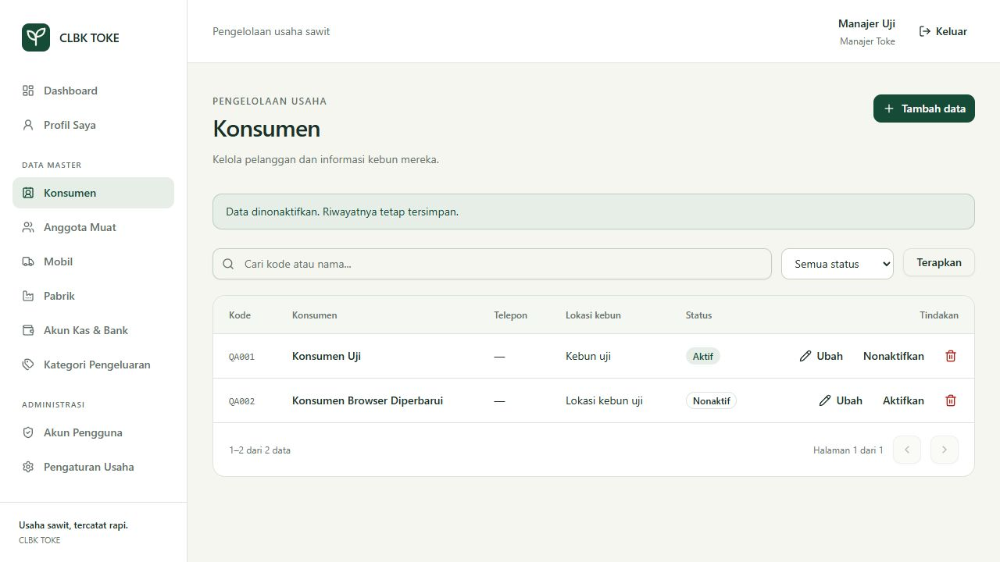

# Hasil implementasi tahap 1

Tanggal pemeriksaan: 9 Oktober 2026. Acuan: tahap 1 pada `prd.md`.

## Modul yang tersedia

- Akun pengguna dengan role Manajer Toke, Supir, dan Kasir.
- CRUD/nonaktif konsumen, anggota muat, mobil, pabrik, akun kas/bank, dan kategori pengeluaran.
- Pencarian, filter status, dan pagination pada server.
- Pengaturan nama usaha dan awalan nomor bukti.
- Sidebar desktop serta menu ponsel yang mengikuti role.
- Form, field, tabel, filter, konfirmasi, dan pesan hasil yang dipakai ulang.
- Dialog untuk perubahan form yang belum disimpan.
- Audit perubahan master, akun melalui administrasi/bootstrap, serta pengaturan usaha.

Manajer memiliki akses pengelolaan. Supir dan kasir ditolak bila membuka route pengelolaan atau mengirim request perubahan langsung. Endpoint referensi hanya mengirim ID, kode, dan nama/plat dari data aktif; kontak, alamat, dan catatan privat tidak ikut dikirim. Referensi akun kas/kategori biaya dibatasi untuk manajer dan kasir.

Akun nonaktif tidak dapat login. Status dan role dibaca ulang pada request yang terautentikasi. Pemeriksaan hash sesi berjalan setelah pembacaan akun terbaru, sehingga sesi dengan kata sandi lama ditolak. Penonaktifan dan pengaturan ulang kata sandi melalui manajer menghapus sesi akun terkait serta mengganti token remember. Role tidak dapat diubah melalui profil sendiri. Manajer terakhir tidak dapat dinonaktifkan atau diturunkan rolenya.

## Integritas data dan seed

Kapasitas mobil menerima kg dengan maksimal tiga desimal, lalu disimpan sebagai integer gram. Kode dan plat dinormalisasi sebelum pemeriksaan unik. Telepon konsumen boleh sama. Supir default harus berasal dari akun supir aktif.

Action master, akun, dan pengaturan memakai koordinator transaksi tulis fondasi. Otorisasi diperiksa lagi setelah memperoleh write lock. Perubahan data dan audit commit/rollback bersama. Audit memakai allowlist field dan tidak menyimpan kata sandi/hash, token remember, atau sesi. Trigger SQLite menolak update/delete audit.

Master yang dirujuk foreign key tidak dapat dihapus; penonaktifan mempertahankan record dan referensinya. Tabel transaksi sawit belum dibuat pada tahap ini. Pengujian penghapusan master terpakai menggunakan fixture FK SQLite untuk membuktikan pemblokiran dan pesan penonaktifan; pengujian dengan transaksi sawit sebenarnya dilanjutkan pada tahap modul sumbernya.

Seed awal:

| Data | Nilai |
| --- | --- |
| Akun kas | KAS-UTAMA / Kas Utama / tunai; tanpa saldo |
| Kategori biaya | BBM, tol, parkir, perawatan mobil, makan operasional, biaya operasional lain |
| Nama usaha | CLBK TOKE |
| Zona waktu | Asia/Jakarta |
| Toleransi berat | 200 basis points / 2% |
| Awalan nomor bukti | CLBK |

Seed dapat diulang tanpa menimpa perubahan maupun status nonaktif. Tidak ada akun, kata sandi, atau konsumen contoh dalam seed operasional. Saldo kas berasal dari ledger yang akan dibuat pada tahap keuangan. Zona waktu dan toleransi berat tetap mengikuti ketetapan PRD dan tidak dapat diubah melalui form.

## Hasil pemeriksaan

| Pemeriksaan | Hasil |
| --- | --- |
| TypeScript dan build Vite | Lolos |
| Format frontend | Lolos |
| Format PHP/Pint | Lolos |
| Validasi Composer | Lolos |
| Seluruh pengujian otomatis web | 74 lolos, 551 assertions |
| Login manajer dan supir di browser | Berhasil |
| Tambah, ubah, nonaktif konsumen | Berhasil; nama/kode/status pada daftar diperiksa |
| Pencarian kode dan filter nonaktif | Berhasil |
| Form mobil | Kapasitas tepat dan pilihan supir aktif tampil |
| Dialog perubahan belum disimpan | Tetap mengedit dan meninggalkan form berhasil |
| Pengaturan usaha | Nama/awalan tampil; WIB, toleransi 2%, gram, dan A4 tampil sebagai ketetapan |
| Navigasi supir | Hanya menu yang tersedia untuk role tersebut; menu master/administrasi tidak ditampilkan |
| Tampilan ponsel 390 × 844 | Menu bekerja; lebar dokumen tetap 390 px, tabel bergulir di dalam wadah |
| Console pada pemeriksaan browser | Tidak ada error/warning yang tercatat |

Pengujian otomatis mencakup seluruh enam jenis master, penolakan akses kedua role nonmanajer, validasi referensi aktif, normalisasi kode/plat, bobot pecahan gram, constraint DB, master terpakai, rollback jika audit gagal, seed idempotent, perlindungan manajer terakhir, pembatalan sesi, profil tanpa eskalasi role, dan audit append-only. Pengujian fondasi autentikasi/CSRF/SQLite tetap lulus.

Pemeriksaan browser menggunakan database uji terpisah. Database dan skrip fixture telah dibersihkan setelah pengujian. Akun dan data pada screenshot merupakan fixture pengujian, bukan data operasional:

[Menu ponsel](screenshots/tahap-1-mobile.jpg).

## Menjalankan dan batas tahap

`composer setup` sekarang menjalankan migrasi serta seed awal. Instalasi yang sudah menjalankan fondasi memakai migrasi, seed, dan build sebagaimana panduan `README.md`. Akun pertama dibuat dengan `php artisan clbk:bootstrap-user` sebagai manajer aktif. Jika akun fondasi sudah ada, akun paling awal dipertahankan sebagai manajer saat migrasi role. Akun tambahan dibuat melalui menu Akun Pengguna.

Database proyek sudah dimigrasikan dan di-seed. Snapshot konsisten sebelum migrasi tersimpan di `.bootstrap/before-stage1-20261008-201656.sqlite`; tanggal pada nama berkas memakai UTC. Backup ini merupakan pengamanan upgrade lokal, belum sistem backup/restore operasional tahap 6.

Tahap 2 belum dimulai. Riwayat transaksi pada master, versi harga, tiket timbang, trip, stok sortir, pembayaran, gaji, ledger, dashboard keuangan, dan laporan mengikuti tahap berikutnya. Berat penjualan pabrik dan penjualan sortir tetap akan memakai input manual sesuai PRD.

Pengujian sesi dan interaksi perangkat nyata dilakukan melalui browser sesuai cakupan web proyek.
