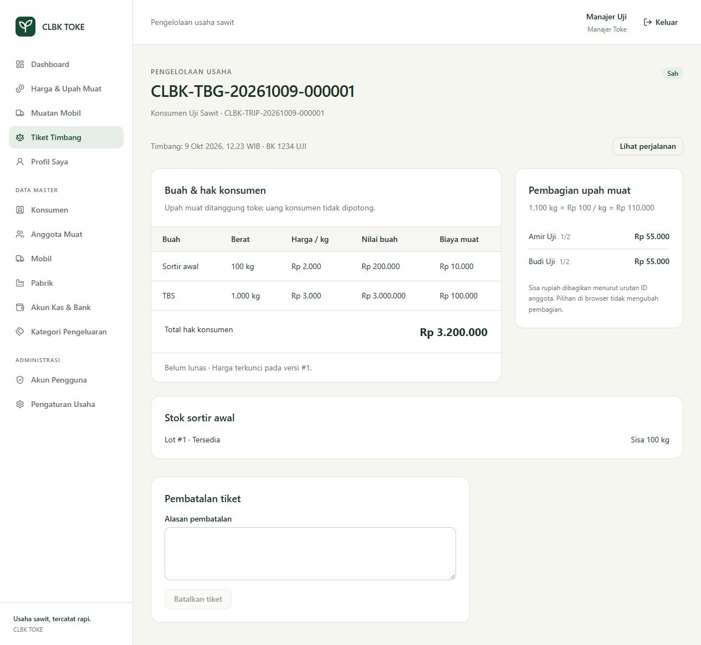
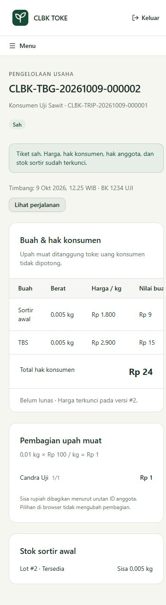

# Tahap 2 — harga dan timbang

Status: selesai untuk cakupan tahap 2 pada 9 Oktober 2026. Acuan bisnis tetap `prd.md`, khususnya bagian 5.2, 5.6, 6.1–6.5, 11.2–11.3, 12.1–12.2, dan 17.

## Hasil

- Menu **Harga & Upah Muat**: publikasi satu versi harga beli TBS/sortir dan upah, riwayat per waktu berlaku, serta publikasi/riwayat harga referensi pabrik terpisah. Versi append-only; publikasi harga beli tidak boleh berlaku pada/sebelum waktu tiket yang sudah disahkan, termasuk tiket yang kemudian dibatalkan.
- Menu **Muatan Mobil**: pembukaan perjalanan loading dengan mobil aktif, supir aktif, dan pabrik tujuan opsional. Supir membuka untuk dirinya sendiri. Satu mobil hanya mempunyai satu trip loading/dispatched. Nomor bisnis memakai sequence transaksional yang tidak dipakai ulang setelah draft dihapus.
- Menu **Tiket Timbang**: pencarian, filter status/tanggal, pagination, draft, edit/hapus oleh pembuat, ringkasan, dan pengesahan. Form memilih konsumen, perjalanan, dua berat kg, dan anggota aktif melalui pencarian server dengan pagination.
- Waktu server dipakai untuk tiket supir saat pengesahan. Manajer dapat memilih tanggal timbang, dengan alasan wajib untuk tanggal sebelum tanggal usaha saat ini. Waktu dan business date disimpan masing-masing sebagai UTC dan tanggal WIB.
- Pengesahan mengunci versi/tarif, nilai TBS/sortir, basis serta total upah, alokasi per kategori, dan bagian setiap anggota. Upah ditanggung toke dan tidak mengurangi hak konsumen. Harga wajib tersedia pada tanggal usaha yang sama; draft boleh menunggu harga. Harga berubah sejak ringkasan menyebabkan pengesahan ditolak, ringkasan diperbarui, lalu pengguna dapat mengonfirmasi ulang.
- Sortir awal membentuk lot berbiaya tersedia dan receipt ledger. Detail tiket menampilkan berat sisa dari ledger. Pengesahan TBS saja tidak membuat lot sortir.
- Manajer dapat membatalkan tiket sah dengan alasan ketika trip masih loading dan lot masih hanya mempunyai receipt awal. Ledger reversal meniadakan berat dan biaya asal, sementara snapshot lama tetap tersimpan. Tiket pengganti harus milik konsumen yang sama dan merujuk tiket batal; maksimal satu pengganti aktif.
- Kasir dapat membaca tiket sah/batal. Supir hanya dapat membaca trip/tiket yang ditugaskan kepadanya; pemeriksaan juga berlaku pada URL langsung, pencarian, endpoint pemilih, dan replay idempotensi.

## Integritas perhitungan dan penyimpanan

Berat tersimpan sebagai integer gram; input kg dikonversi tanpa float dan dibatasi maksimal tiga desimal. Harga/nominal adalah integer rupiah. Nilai buah dan total upah memakai round-half-up. Bagian anggota dibagi rata dengan sisa Rp1 untuk ID terkecil. Biaya kategori dibagi dari total upah yang sudah dibulatkan dengan proporsi berat dan sisa terbesar; saat sisa sama, urutan kategori SORT lalu TBS. Perkalian proporsi dipecah menjadi hasil bagi/sisa agar tetap aman pada batas input 64 bit.

Seluruh penulisan melalui `WriteTransaction` (BEGIN IMMEDIATE), pembacaan ulang aktor/status/master di dalam write lock, dan audit pada transaksi yang sama. Draft memakai pemeriksaan `version`. Pengesahan serta pembatalan memakai `IdempotencyService`: unik aktor/operasi/key, hash input server yang dinormalisasi, dan referensi hasil. Replay isi sama menghasilkan dokumen yang sama; isi berbeda ditolak. Kegagalan audit membatalkan snapshot, lot, ledger, dan idempotensi sekaligus.

Database menerapkan CHECK tipe/rentang/status, FK RESTRICT, unique nomor/sumber lot, partial unique trip aktif, trigger append-only harga/ledger/idempotensi, serta trigger yang membekukan tiket dan detail sah. Trigger pengesahan memeriksa kelengkapan snapshot dan kesamaan total berat, nilai buah, alokasi kategori, serta hak anggota.

## Pemeriksaan

| Pemeriksaan | Hasil |
|---|---|
| Semua pengujian PHP tahap 0–2 | **102 lulus, 910 assertions** |
| Build frontend / TypeScript | Lulus |
| Pint dan Prettier | Lulus |
| Harga Rp3.000 kemarin, Rp2.900 besok | Snapshot lama tetap; tiket baru memakai versi baru |
| Harga tanggal usaha belum tersedia | Draft tersimpan; pengesahan ditolak tanpa fallback kemarin |
| Satu, dua, dan tiga anggota; pilihan terbalik | Jumlah hak sama persis dengan total upah |
| AC37: 5 gram TBS + 5 gram sortir, Rp100/kg | Upah Rp1; kategori dan anggota tetap berjumlah Rp1 |
| Dua proses PHP pada SQLite WAL, key sama | Satu hasil posted, satu lot, satu receipt, satu idempotensi |
| Harga/aktor/master/trip berubah setelah draft | Diperiksa ulang sebelum pengesahan |
| Pembatalan dan replay | Berat serta biaya lot kembali nol tanpa menghapus histori |
| Audit gagal | Seluruh transaksi rollback |
| Batas input dan penulisan SQL tidak sah | Berat pecahan, perubahan snapshot, dan alokasi tidak lengkap ditolak |

Browser memakai database sementara terpisah dengan akun/master uji. Alur manajer: menerbitkan harga, membuka trip, mencatat 1.000 kg TBS + 100 kg sortir dengan dua anggota, mengesahkan, melihat stok 100 kg dan hak Rp3.200.000/upah Rp55.000 per anggota, serta mencari tiket. Alur supir: form tanpa tanggal mundur, draft dua kategori 5 gram, pengesahan ditolak setelah versi harga berubah, ringkasan versi baru ditampilkan, lalu konfirmasi ulang berhasil. Kasir memperoleh daftar baca tanpa aksi timbang. Layar 390 × 844 memiliki menu mobile dan tabel yang dapat digeser tanpa overflow halaman.

Pemeriksaan dialog menemukan masalah ref tombol pada React 18; `Button` diperbaiki memakai `forwardRef`. Setelah dialog dibatalkan, fokus kembali ke tombol pemicu. Pemeriksaan ulang pada tab baru tidak menunjukkan warning/error console. Dialog pembatalan dibuka dan dibatalkan; tidak ada pembayaran atau penghapusan permanen melalui browser.

## Database proyek dan batas tahap berikutnya

Backup konsisten sebelum migrasi tersimpan di `.bootstrap/before-stage2-20261009-053007.sqlite`. Migrasi tahap 2 diterapkan tanpa mengubah master atau membuat akun/harga/tiket contoh di database proyek. Database dan helper pemeriksaan sementara dibersihkan setelah QA; screenshot tetap menjadi bukti hasil.

Tahap 3 harus memperluas `sort_lots` untuk sumber FACTORY_RETURN dan nullable biaya unavailable, menambah FK ke dokumen retur yang baru tersedia, serta memperluas jenis ledger dengan sale/adjustment dan FK alokasi penjualan. Saat memperluas tabel SQLite, pertahankan constraint sumber unik/XOR, trigger append-only, dan rekonsiliasi biaya. Skema tahap 2 sengaja hanya mengaktifkan INITIAL_SORT dan receipt/reversal sehingga tidak ada FK menuju tabel tahap berikutnya yang belum dibuat.

Tahap 3 mengimplementasikan keberangkatan serta pembekuan biaya TBS, tiga berat manual pabrik, nota/retur, dan berat/harga sortir terjual manual. Kolom `manual_load_grams` tetap null pada pembukaan trip/pengesahan timbang; biaya sortir awal berada di lotnya.

Tahap 4 menambahkan pembayaran konsumen/upah dan sumber kas. Sebelum modul pembayaran diaktifkan, perluas pengecekan dependensi `VoidWeighing` agar pembayaran konsumen serta upah yang masih sah menghalangi pembatalan; setelah reversal stok tersedia pada tahap 3, pemeriksaan lot perlu memakai rekonsiliasi saldo berat/biaya terhadap receipt asal. Status/sisa tagihan kemudian dihitung dari alokasi voucher yang sah. Tahap 2 belum mengeluarkan uang atau mencatat pembayaran/laba.
