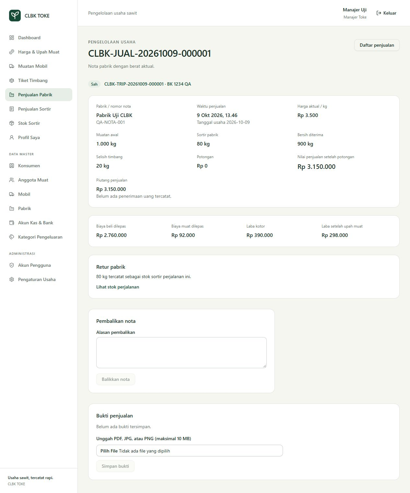
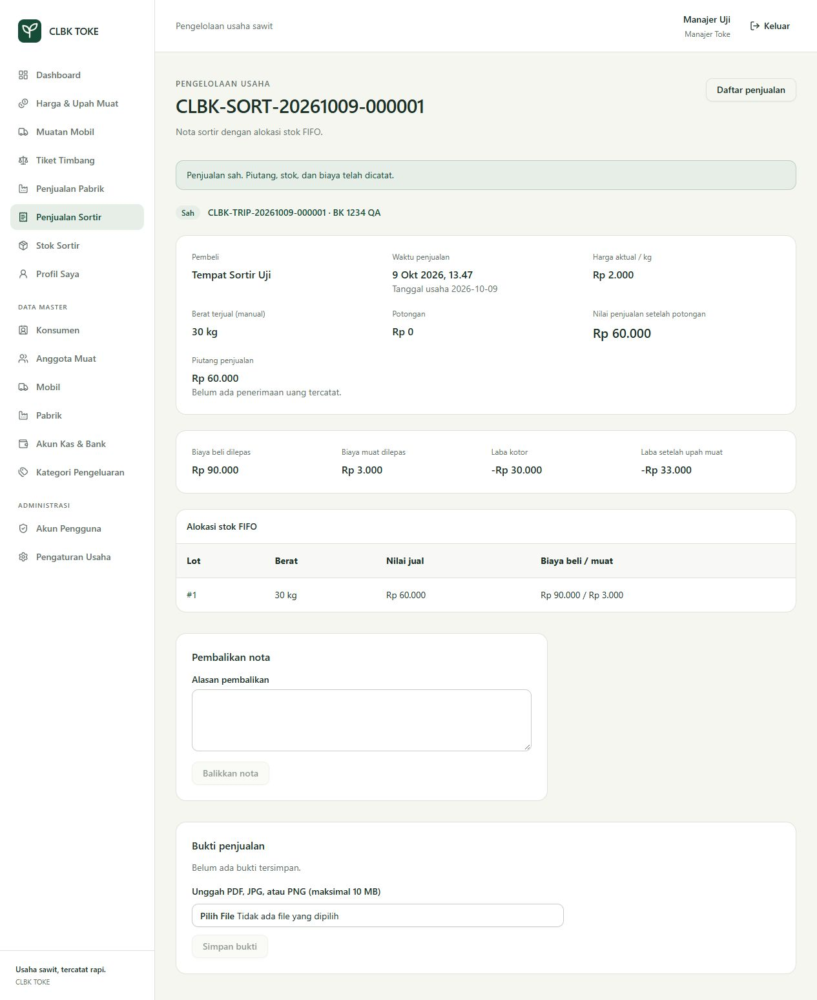
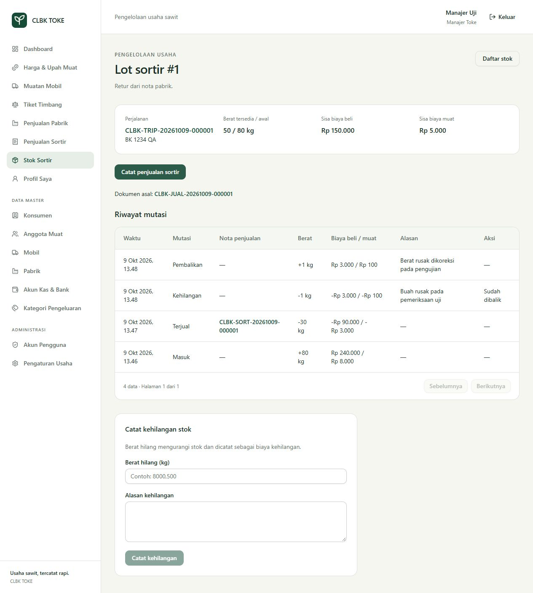

# Tahap 3 — penjualan dan stok

Status: selesai untuk cakupan tahap 3 pada 9 Oktober 2026. Acuan bisnis: `prd.md` bagian 5.3–5.5, 6.3–6.4, 11.4, 12.3–12.6, dan 17.

## Hasil

- **Muatan Mobil**: keberangkatan dengan snapshot biaya item TBS pada tiket sah. Sortir awal tetap membawa biaya di lotnya. Keberangkatan tidak mengisi berat pabrik; draft tiket harus disahkan/dihapus dahulu. Referensi tiket, mobil/supir, waktu berangkat, serta biaya TBS tidak diubah sesudah keberangkatan.
- **Penjualan Pabrik**: pilih mobil/perjalanan dan pabrik aktif; tiga input kg manual, nomor nota, harga aktual, potongan/alasan, dan catatan. Berat bersih akhir dipakai langsung. Draft dapat diedit/dihapus pembuat; pengesahan mengunci nota. Satu nota draft/posted per trip dan satu nomor nota aktif per pabrik.
- Selisih `muatan awal − sortir − bersih` negatif atau di atas 2% memerlukan persetujuan/alasan manajer. Persetujuan terikat versi draft; edit membatalkannya. Manajer yang sudah nonaktif tidak dapat menjadi persetujuan pengesahan baru.
- **Retur pabrik**: stok sesuai berat sortir manual. Biaya beli/muat dibawa dengan proporsi sortir terhadap muatan awal; biaya yang dilepas pabrik adalah snapshot TBS dikurangi biaya retur. Tidak membentuk tiket atau utang konsumen baru.
- **Penjualan Sortir**: berat dan harga manual, nama/kontak pembeli, potongan/alasan, catatan. Stok tersedia ditampilkan sebagai informasi, tanpa mengisi berat terjual. Alokasi FIFO terbatas pada lot trip yang dipilih. Ringkasan menyertakan lot, berat, nilai jual, dan biaya untuk manajer; perubahan stok sejak ringkasan mengharuskan konfirmasi ulang.
- **Stok Sortir**: daftar/detail lot, tautan dokumen asal dan nota penjualan, sisa berat/biaya, dan mutasi berurutan. Manajer mencatat kehilangan dengan berat manual/alasan dan biaya kehilangan, atau membalik catatan tersebut. Kehilangan tidak menjadi pendapatan penjualan.
- **Pembalikan nota**: manajer dengan alasan; nota asli tetap tersimpan. Penjualan sortir mengembalikan alokasi berat/biaya. Retur pabrik harus kembali penuh sebelum nota asal dibalik. Pembalik ledger laba bertanggal hari pembalikan, sehingga posting lama tidak dihapus.
- **Nota pengganti**: nomor baru, tautan `replaces_sale_id`, alasan, dan salinan berat lama untuk diperiksa/dikoreksi. Trip `correction_pending` tidak memesan mobil; snapshot keberangkatan dipakai kembali meskipun mobil sudah mempunyai trip baru. Nota pengganti yang sah mengembalikan `factory_recorded`.
- **Penutupan trip**: stok habis, tidak ada draft penjualan, serta nota pabrik sah bila ada sumber TBS/nota sebelumnya. Trip sortir saja dapat selesai tanpa nota pabrik. Pembayaran konsumen/upah tidak menentukan status operasional trip.
- **Bukti privat**: PDF/JPG/PNG maksimal 10 MiB, pemeriksaan MIME dari isi, nama aman, penyimpanan `storage/app/private/sale-proofs`, dan unduhan dengan policy nota. Penghapusan draft menyimpan referensi bukti pada audit sebelum metadata dihapus; file dibersihkan sesudah commit. Bukti nota sah tidak dihapus.
- Supir memakai waktu server saat pengesahan dan hanya mengakses trip tugasnya. Kasir membaca nota sah/terbalik. Biaya penuh/margin disaring dari payload nonmanajer pada nota, retur, stok/mutasi, serta trip yang bersarang di tiket.

## Perhitungan dan integritas

Semua berat tersimpan sebagai integer gram dan rupiah sebagai integer. Proporsi memakai pembagian hasil bagi/sisa agar tidak melampaui integer 64 bit. Pembulatan round-half-up diterapkan pada nilai baris dan alokasi biaya sebagian stok. Penjualan sisa terakhir mengambil seluruh biaya tersisa. Pendapatan sortir adalah jumlah subtotal baris yang dibulatkan dikurangi potongan. Biaya dari sumber unavailable tetap null, termasuk ketika alokasi memuat campuran lot lengkap/tidak lengkap; margin ditandai **Belum lengkap**.

Contoh PRD: TBS berbiaya Rp3.000.000 dan muat Rp100.000; input pabrik 1.000 kg awal, 80 kg sortir, 900 kg bersih, harga Rp3.500/kg. Penjualan pabrik Rp3.150.000, selisih 20 kg, biaya retur Rp240.000/Rp8.000, biaya dilepas Rp2.760.000/Rp92.000. Sortir 80 kg dijual Rp2.000/kg menghasilkan Rp160.000. Total setelah muat **Rp210.000**, sebelum biaya lain. Bila sortir hanya dijual 30 kg, pendapatan Rp60.000, biaya dilepas Rp90.000/Rp3.000; sisa 50 kg membawa biaya Rp150.000/Rp5.000.

Posting, persetujuan, pembalikan, kehilangan, keberangkatan, dan penutupan memakai transaksi SQLite IMMEDIATE, pembacaan ulang aktor/versi/saldo, idempotensi, dan audit. Kegagalan di akhir proses membatalkan header, retur, alokasi, ledger stok/laba, perubahan trip, serta idempotensi bersama-sama. Pengulangan key/isi sama hanya menghasilkan satu transaksi; isi berbeda ditolak.

Migrasi `2026_10_09_000003_create_sales_and_inventory` menambah `factory_sales`, `factory_returns`, `sort_sales`, `sort_sale_items`, `profit_entries`, dan `attachments`. Tabel stok tahap 2 dibangun ulang secara atomik dengan ID lama tetap, FK RESTRICT, sumber unik/XOR, nullable biaya hanya untuk sumber unavailable, serta jenis mutasi receipt/sale/adjustment/reversal. Trigger mempertahankan ledger append-only, snapshot sumber, biaya keberangkatan, nota/detail sah, rekonsiliasi posting, saldo stok nonnegatif, dan biaya nol ketika lot habis.

## Pemeriksaan

| Pemeriksaan | Hasil |
|---|---|
| Seluruh PHP tahap 0–3 | **134 lulus, 1.489 assertions** |
| Build frontend / TypeScript | Lulus |
| Pint, Prettier, Composer validate | Lulus |
| Contoh tiga berat manual / laba PRD | 900 kg langsung; selisih 20 kg; total setelah muat Rp210.000 |
| Dua trip mobil sama pada hari sama | Berat, stok, dan biaya tetap terpisah |
| Penjualan sebagian / gram terakhir | Biaya proporsional; berat/biaya akhir tepat nol |
| Pembulatan lintas lot | Header sama dengan jumlah subtotal baris |
| Dua proses terpisah pada WAL menjual 60 kg + 60 kg dari stok 80 kg | Satu posted, satu ditolak, sisa 20 kg |
| Preview FIFO berubah / oversell | Ditolak tanpa alokasi setengah tersimpan |
| Persetujuan selisih | Versi lama/edit/nonaktif tidak meloloskan posting |
| Pembalikan nota kemarin pada hari berikutnya | Ledger asli tetap; pembalik lawan tanda pada hari berikutnya |
| Retur sudah dijual atau hilang | Nota asal ditahan sampai turunannya dibalik |
| Koreksi trip lama ketika mobil membuka trip baru | Biaya asal tetap, satu trip operasional aktif |
| Tanpa tiket konsumen | Penjualan/stok manual tetap sah; biaya null/margin belum lengkap |
| Audit gagal pada posting pabrik/sortir atau pembalikan | Semua perubahan terkait rollback |
| Policy / payload / bukti privat | Trip lain ditolak; biaya penuh tidak terkirim; MIME/ukuran/unduhan diperiksa |
| Migrasi dengan stok tahap 2, termasuk reversal | ID, biaya, saldo, dan FK tetap benar |

Browser memakai database sementara terpisah. Manajer mencatat keberangkatan, tiga berat manual contoh PRD, pengesahan pabrik, penjualan sortir 30 kg, dan kehilangan 1 kg beserta pembalikannya. Sisa kembali 50 kg/Rp150.000/Rp5.000. Supir membuka trip berikutnya pada mobil sama tanpa tiket, mengisi tiga berat manual dengan selisih 3%, menunggu persetujuan manajer, lalu mengesahkan. Kasir hanya memperoleh tampilan baca. Tidak ada pembayaran uang atau penghapusan permanen melalui browser.

Layar 390 × 844 mempunyai menu mobile, tabel FIFO dapat digeser, dan tidak menambah overflow halaman. Console pada alur supir tidak menunjukkan warning/error. Bukti tampilan disimpan di `docs/screenshots/tahap-3-*.jpg`.

## Database proyek dan integrasi berikutnya

Backup konsisten sebelum migrasi: `.bootstrap/before-stage3-20261009-065534.sqlite`. Migrasi sudah diterapkan ke database proyek. Seluruh baris/kolom lama pada **19 tabel** dibandingkan dengan backup dan tetap sama. Integrity check dan foreign key check lulus; tabel dokumen/ledger baru kosong, tanpa akun atau transaksi QA pada database proyek. Uji migrasi juga membuktikan sumber stok/receipt/reversal tahap 2 tetap kompatibel. Untuk pemulihan operasional gunakan backup; rollback migrasi menghapus histori modul tahap 3.

Tahap 4 menambahkan pembayaran konsumen, payroll, penerimaan piutang, pengeluaran harian, saldo/ledger kas, dan pembalikan voucher. Sebelum rilis keuangan, perluas `ReverseSale` untuk menahan penerimaan uang yang masih sah, dan `VoidWeighing` untuk menahan pembayaran konsumen/upah yang masih sah. `profit_entries` nanti memperoleh sumber pengeluaran harian; penerimaan kas tidak mencatat pendapatan lagi. Sisa/piutang pada tahap 3 sama dengan nilai nota sah karena belum ada penerimaan uang.

Dashboard harian, laba bersih setelah biaya operasional, laporan/ekspor, dan drill-down lengkap mengikuti tahap 5. Cetak melalui browser, konfigurasi batas upload PHP, backup/restore lengkap beserta berkas bukti, dan deployment mengikuti tahap 6. Batas upload server PHP harus mendukung 10 MiB dan `post_max_size` harus lebih besar agar batas aplikasi dapat digunakan penuh.
