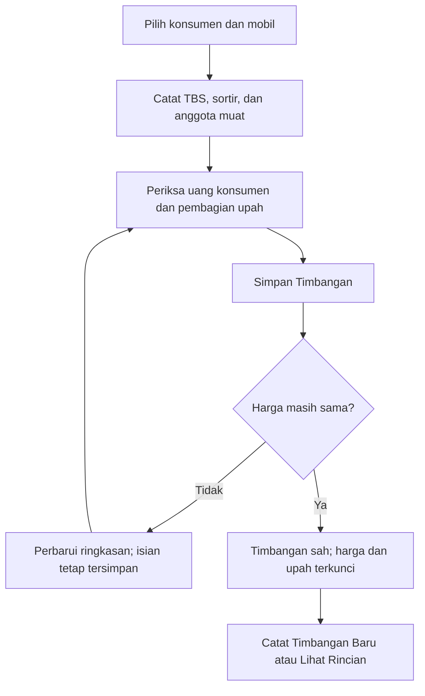

# Workflow sederhana — tahap 2

Status: selesai pada 9 Oktober 2026. Timbang Sawit memakai mobil langsung dan satu kali simpan. Tahap 3 penjualan serta tahap 4 penghapusan menu perjalanan/stok belum dikerjakan.

## Alur yang sudah aktif

Supir atau manajer membuka Timbang Sawit, memilih konsumen serta mobil aktif, mengisi TBS dan sortir dalam kg, memilih minimal satu anggota muat, memeriksa ringkasan, lalu menekan **Simpan Timbangan**. Sortir boleh nol; setidaknya satu jenis buah harus mempunyai berat positif. Waktu dan petugas otomatis mengikuti server. Formulir baru tidak mempunyai perjalanan, waktu manual, tanggal mundur, atau pengesahan terpisah.

Harga TBS, harga sortir, dan upah per kg otomatis dibaca dari harga hari tersebut. Ringkasan uang konsumen dan pembagian upah dihitung server setiap berat/anggota berubah. Upah menggunakan TBS + sortir, ditanggung toke, dan dibagi rata dengan pembulatan yang mempertahankan total. Ringkasan tampil sebelum tombol simpan pada ponsel dan di samping formulir pada desktop.

Jika harga belum tersedia, simpan belum dapat dilakukan dan aplikasi menjelaskan bahwa manajer perlu menerbitkan harga. Jika harga berubah setelah ringkasan ditampilkan, server menolak penyimpanan tanpa membuat draft persisten; formulir mempertahankan isian dan memperbarui ringkasan. Pengguna memeriksa harga serta nominal terbaru lalu menekan simpan kembali. Tidak ada penyimpanan ulang otomatis.

Satu transaksi database mencatat dokumen, rincian berat, snapshot harga, hak konsumen, pembagian upah, nomor, audit, dan kunci simpan ganda. Draft internal langsung disahkan sebelum commit. Kegagalan membatalkan seluruh perubahan, termasuk nomor; tidak meninggalkan tiket setengah tersimpan. Pengiriman ulang dengan kunci/data sama mengembalikan dokumen yang sama, termasuk sesudah harga atau status master berubah.

Timbangan baru bertipe `direct`, mempunyai `vehicle_id`, dan `trip_id = null`. Sortir hanya tersimpan pada rincian konsumen. Tidak dibuat perjalanan, lot sortir, mutasi stok, atau pembayaran otomatis. Pembayaran dilakukan melalui Uang Penimbang dan Gaji Karyawan Muat yang sudah ada.

## Daftar, pembayaran, koreksi, dan histori

Daftar timbang menampilkan nomor, konsumen, waktu, mobil, berat TBS/sortir, uang konsumen, anggota, status pembayaran, dan status dokumen. Sesudah simpan tampil **Catat Timbangan Baru** serta **Lihat Rincian**. Rincian transaksi langsung menampilkan mobil, hak konsumen, upah, dan pembayaran tanpa bagian perjalanan/stok atau tombol pengesahan.

Supir melihat transaksi langsung yang dicatatnya. Memakai mobil yang sama tidak memberi akses ke transaksi supir lain. Kasir dapat membaca timbangan sah dan membayar haknya, tetapi tidak membuat atau menghitung pratinjau timbang. Manajer dapat mencatat serta membatalkan sesuai aturan koreksi.

Pembayaran sebagian/penuh tetap menggunakan snapshot timbang, tanpa menghitung kembali menurut harga terbaru. Pembatalan oleh manajer mempertahankan nominal historis dan menonaktifkan hak aktif; pembayaran konsumen/payroll yang masih sah harus dibalik dahulu. Pembatalan dapat diulang dengan kunci yang sama tanpa menggandakan perubahan. Timbangan pengganti merujuk dokumen batal milik konsumen sama dan tidak boleh menggandakan pengganti aktif.

Histori legacy tetap dapat dibaca. Draft lama memakai halaman **Edit Draft Timbang Lama**, masih mengikuti aturan perjalanan dan pengesahan lama agar dokumen yang sudah ada dapat diselesaikan. Formulir tambah dan endpoint simpan baru hanya menerima alur langsung. Tautan timbang pada halaman perjalanan lama meneruskan pilihan mobil, bukan menambah tiket terkait perjalanan.

Seluruh halaman, field, dan proses Data Master dipertahankan. Tidak ada migrasi baru, reset database, atau pengulangan seeder pada tahap ini.

## Verifikasi

- **186 pengujian, 2.390 assertion, berhasil.** Tiga belas pengujian baru mencakup pratinjau tanpa transaksi, harga harian, perubahan harga, satu/dua/tiga anggota, pembulatan desimal, sortir nol, sortir saja, upah nol, master nonaktif, role, simpan ganda, rollback audit, pembayaran sebagian/lunas, pembatalan, pengganti, dan histori campuran.
- Fixture pengujian lama membuat dokumen legacy melalui action historis. Pengesahan, penjualan/stok, keuangan, integritas, dan akses legacy tetap diuji; endpoint tambah baru tidak dipakai untuk membuat histori buatan.
- Pengujian penyimpanan memakai SQLite `:memory:` dengan transaksi nyata di batas terluar. Database tiap pengujian disiapkan ulang; tidak mencoba membalik migrasi kendaraan yang sengaja menolak penghapusan format `direct`.
- Pemeriksaan format PHP dan frontend berhasil; TypeScript serta build frontend berhasil.
- Pemeriksaan browser memakai akun supir dan database salinan pada port 8001. Desktop 1366 × 900 dan ponsel 390 × 844 tidak mempunyai overflow horizontal halaman formulir.
- Ringkasan awal 1.000 kg TBS + 100 kg sortir menghasilkan Rp3.200.000 untuk konsumen dan upah Rp110.000: Rp36.667, Rp36.667, Rp36.666. Perubahan harga saat form terbuka mempertahankan pilihan/isian, menampilkan pesan pemeriksaan ulang, dan mengganti ringkasan menjadi Rp3.080.000 serta upah Rp132.000.
- Setelah simpan ulang dengan harga terbaru, satu timbangan `direct` berstatus `posted` muncul dengan mobil yang dipilih, tanpa perjalanan/stok/pembayaran tambahan. Daftar, status belum lunas, pilihan lanjut, serta rincian berhasil dibuka.
- Perbandingan database usaha terhadap backup menunjukkan isi **37 tabel persisten**, termasuk tabel migrasi, tetap sama. Tabel sesi/cache tidak dibandingkan. Integritas SQLite `ok` dan tidak ada pelanggaran foreign key.
- Server utama pada port 8000 tetap dapat dibuka. Server percobaan tidak menggunakan database usaha.

Backup data aktual berada di `.bootstrap/before-workflow-stage2-20261009.sqlite`; salinan browser ada di `.bootstrap/workflow-stage2-ui.sqlite`. Laporan data berada di `.bootstrap/workflow-stage2-report.json`, hasil pengujian di `.bootstrap/stage2-full-tests.txt`, dan bukti formulir desktop/ponsel di `.bootstrap/workflow-stage2-form-desktop.jpg` serta `.bootstrap/workflow-stage2-form-mobile.jpg`.

Tahap berikutnya: penjualan pabrik dengan mobil, berat bersih, dan harga otomatis; penjualan sortir dengan mobil, berat, dan harga manual.
