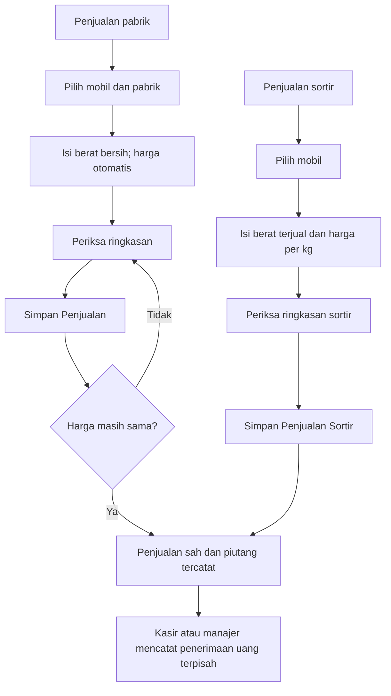

# Workflow sederhana — tahap 3 dan 4

Status: selesai pada 10 Oktober 2026. Mengikuti [rencana yang disetujui](rencana-workflow-sederhana.md). Tahap 5 pemeriksaan akhir menyeluruh belum dijalankan sebagai tahap tersendiri.

Perubahan lanjutan: alur penjualan saat ini memakai [Penerimaan Penjualan untuk pabrik dan sortir](penerimaan-semua-penjualan.md). Catatan dan hasil verifikasi di bawah menggambarkan versi sebelumnya.

## Tahap 3: penjualan langsung

Penjualan pabrik meminta mobil, pabrik, dan **berat bersih diterima**. Harga per kg mengikuti riwayat harga pabrik pada waktu server dan hanya ditampilkan, tanpa input harga manual. Nomor nota, potongan, dan catatan berada dalam bagian informasi tambahan opsional. Berat awal, berat sortir pabrik, perjalanan, waktu manual, persetujuan selisih, alasan potongan, serta unggah bukti tidak tersedia dalam transaksi baru.

Penjualan sortir meminta mobil, **berat terjual**, dan **harga jual per kg** secara manual. Nama pembeli/tempat, kontak, serta catatan opsional. Penjualan sortir dapat dilakukan tanpa timbangan konsumen, nota pabrik, perjalanan, atau saldo stok sebelumnya. Berat sortir pada tiket konsumen tetap menjadi rincian pembelian konsumen, terpisah dari berat sortir yang dijual.

Kedua formulir mempunyai ringkasan berat, harga, nilai buah, dan total yang dihitung server. Berat disimpan dalam gram dan nominal dalam Rupiah bulat. Nilai pabrik = berat bersih × harga terkunci − potongan; nilai sortir = berat terjual × harga manual. Potongan pabrik tidak boleh melebihi nilai buah. Nol pada nilai akhir pabrik diperbolehkan jika potongannya sama dengan nilai buah; berat harus tetap positif. Penjualan sortir memakai harga positif dan tidak mempunyai potongan baru.

Satu tombol menyimpan penjualan sah. Proses internal mencatat dokumen, nomor, snapshot harga, pendapatan, audit, dan kunci simpan ganda dalam satu transaksi database. Tidak ada draft persisten antara pengisian dan pengesahan. Kegagalan membatalkan seluruh perubahan, termasuk nomor. Pengiriman ulang dengan kunci dan data sama mengembalikan dokumen yang sama; data berbeda dengan kunci lama ditolak.

Jika harga pabrik belum tersedia, formulir menjelaskan bahwa harga perlu diatur lebih dahulu. Jika harga berubah saat formulir terbuka, simpan ditolak tanpa membuat nota, isian dipertahankan, dan ringkasan diperbarui. Pengguna memeriksa ringkasan baru lalu menekan simpan kembali. Harga pada penjualan lama tetap terkunci.

Sesudah berhasil, daftar menyediakan **Catat Penjualan Baru** dan **Lihat Rincian**. Daftar menampilkan mobil, tujuan/pembeli, tanggal, berat, nilai jual, status penerimaan, dan status dokumen. Rincian transaksi baru tidak mempunyai perjalanan, stok, FIFO, retur, pengesahan terpisah, atau laba per nota.

## Penerimaan, akses, koreksi, dan histori

Menyimpan penjualan tidak menerima uang atau menambah saldo kas otomatis. Kasir/manajer mencatat penerimaan sebagian atau penuh melalui Penerimaan Penjualan. Sisa piutang serta status belum lunas/sebagian/lunas mengikuti penerimaan yang masih sah.

Supir dapat membuat dan melihat transaksi langsung yang dicatatnya. Penggunaan mobil yang sama tidak memberi akses ke transaksi supir lain. Kasir membaca penjualan sah dan mencatat penerimaan, tanpa membuat penjualan. Manajer mempunyai akses keseluruhan dan koreksi.

Penjualan sah tidak diedit langsung. Manajer dapat membatalkan dengan alasan; penerimaan uang yang masih sah harus dibalik dahulu. Riwayat dan nominal penjualan tetap tersimpan. Nota pengganti harus merujuk nota batal untuk mobil yang sama, pabrik yang sama bila jenisnya pabrik, dan mempunyai alasan koreksi. Pengganti aktif ganda ditolak. Pembatalan transaksi langsung tidak membuat perubahan perjalanan, stok, atau FIFO.

Dokumen legacy, snapshot biaya historis, pembayaran, lampiran lama, dan audit tetap dipertahankan. Draft lama mempunyai formulir edit tersendiri dengan referensi perjalanan yang sudah tersimpan; tidak memilih atau membuka perjalanan baru. Aturan historis tetap berlaku untuk dokumen tersebut. Endpoint tambah operasional hanya menerima workflow langsung. Tautan perjalanan/stok yang sudah dihapus tidak ditampilkan pada rincian atau pengeluaran lama; referensinya dapat tampil sebagai teks arsip.

## Tahap 4: navigasi, pengeluaran, dashboard, dan laporan

- Menu **Muatan Mobil** dan **Stok Sortir**, berkas halaman keduanya, serta seluruh URL operasional perjalanan/stok dihapus. URL lama mengembalikan 404 untuk setiap role. Referensi perjalanan pada pilihan operasional dan keuangan tidak tersedia.
- **Timbang Sawit** tetap memakai alur tahap 2: konsumen, mobil, TBS/sortir, anggota muat, ringkasan otomatis, satu kali simpan.
- Pengeluaran harian tidak mempunyai input perjalanan. Server menolak `trip_id` pada pencatatan baru; referensi pengeluaran historis tetap disimpan.
- Dashboard dan **Laporan** memakai filter tanggal mulai, tanggal akhir, serta mobil. Periode awal adalah hari usaha saat ini.
- Ringkasan meliputi transaksi timbang neto, TBS/sortir dibeli, TBS/sortir terjual, pembelian, pendapatan, hak upah, dan pengeluaran operasional. Laporan menyediakan rincian per hari dan per mobil.
- Manajer melihat **Selisih transaksi periode** = pendapatan − pembelian − hak upah − pengeluaran. Pembayaran konsumen dan gaji tidak dikurangi lagi. Tidak memakai margin FIFO, biaya per nota yang diperkirakan, atau label laba penjualan untuk transaksi baru.
- Pengeluaran harian tidak dibagi otomatis ke kendaraan. Selisih transaksi tersedia pada pilihan semua mobil; filter mobil menampilkan transaksi kendaraan tanpa mengalokasikan biaya umum secara sembarang.
- Pembatalan mengurangi berat/nilai pada tanggal pembatalan, tanpa menulis ulang angka periode asal. Karena itu periode koreksi dapat mempunyai angka neto negatif. Tanggal pembatalan timbang mengikuti zona waktu usaha, termasuk tepat pada tengah malam.
- Utang konsumen, piutang penjualan, serta kas/bank ditampilkan sebagai **Saldo saat ini**, terpisah dari transaksi periode. Utang/piutang mengikuti filter mobil; kas/bank selalu saldo seluruh usaha dari seluruh tanggal.
- Supir melihat transaksi yang dapat diaksesnya tanpa saldo keuangan atau selisih usaha. Kasir melihat saldo dan ringkasan pembayaran, tanpa selisih usaha manajer.

Seluruh halaman, field, dan CRUD **Data Master dipertahankan**. Tidak ada migrasi baru, reset database, pengulangan seeder, atau penghapusan tabel arsip pada tahap ini.

## Penyimpanan dan komponen

| Dokumen baru | Referensi dan nilai |
|---|---|
| Timbangan | `workflow = direct`, `vehicle_id`, `trip_id = null`; rincian buah konsumen dan hak upah sesuai tahap 2. |
| Penjualan pabrik | `workflow = direct`, `vehicle_id`, `factory_id`, snapshot harga pabrik, `accepted_grams`, nominal; berat awal/sortir/selisih dan persetujuan kosong; nomor nota opsional. |
| Penjualan sortir | `workflow = direct`, `vehicle_id`, `manual_sold_grams`, harga manual dan nominal; pembeli opsional; tidak mempunyai alokasi FIFO. |
| Biaya penjualan baru | `cost_status = unavailable`; biaya pembelian/muat per nota kosong, tanpa menebak sumber buah. |
| Pengeluaran baru | Kategori, nominal, kas/bank, waktu, deskripsi; `trip_id = null`. |

Formulir memakai ReferencePicker, FormField, UnsavedChangesGuard, dan komponen UI yang sudah ada. `SaleSummary` dipakai bersama oleh penjualan pabrik/sortir; `useSalePreview` menjaga ringkasan sesuai isian terakhir. `PeriodOverview` dipakai oleh Dashboard dan Laporan. Format desktop dan ponsel memakai komponen yang sama; ringkasan muncul sebelum tombol simpan pada ponsel.

## Verifikasi

- **201 pengujian, 2.809 assertion, berhasil.** Lima belas pengujian baru mencakup kedua penjualan langsung, pratinjau tanpa transaksi, harga terkunci/berubah, simpan ganda, rollback audit/nomor, input tidak valid, master nonaktif, role, nota opsional/unik, penerimaan sebagian/lunas, pembatalan/pengganti, URL yang dihapus, perhitungan periode, pembatalan lintas hari, serta tengah malam.
- Pengujian histori memakai router khusus pengujian pada `/__test_archive`; router ini tidak didaftarkan aplikasi. Aturan historis tetap diuji tanpa menghidupkan kembali URL perjalanan/stok produksi. Pengujian baru membuktikan URL produksi yang dihapus tetap 404.
- Pemeriksaan format PHP/frontend, TypeScript, dan build berhasil.
- Browser memakai salinan data pada port 8001 dengan akun supir, manajer, dan kasir. Penjualan pabrik 900 kg tersimpan Rp2.970.000 setelah perubahan harga diperiksa ulang; sortir 100 kg × Rp2.200 tersimpan Rp220.000. Tidak ada perjalanan, lot, FIFO, retur, penerimaan, atau mutasi kas baru dari penyimpanan tersebut.
- Formulir pabrik, sortir, dan laporan pada ponsel 390 × 844 tidak mempunyai overflow horizontal halaman. Tabel laporan dapat digeser di dalam bagiannya.
- Dashboard/laporan menampilkan 900 kg TBS terjual, 100 kg sortir terjual, dan pendapatan Rp3.190.000 pada data uji. Kasir dapat membuka piutang dan tombol penerimaan. Form pengeluaran versi akhir tidak mempunyai input atau petunjuk perjalanan.
- Isi **37 tabel persisten** database usaha tetap sama dibanding backup; sesi/cache dikecualikan. Integritas SQLite `ok`, tanpa pelanggaran foreign key. Server utama port 8000 dipertahankan.

Backup: `.bootstrap/before-workflow-stage34-20261009.sqlite`. Laporan data: `.bootstrap/workflow-stage34-report.json`. Hasil pengujian/build: `.bootstrap/stage34-full-tests.txt` dan `.bootstrap/stage34-build.txt`. Bukti browser: `.bootstrap/workflow-stage34-factory-form.jpg`, `workflow-stage34-factory-mobile.jpg`, `workflow-stage34-sort-form.jpg`, `workflow-stage34-sort-mobile.jpg`, `workflow-stage34-dashboard.jpg`, dan `workflow-stage34-report-mobile.jpg`.
