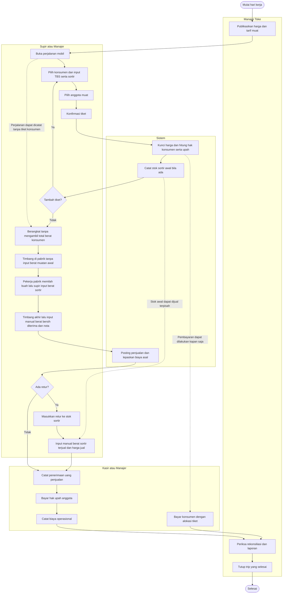
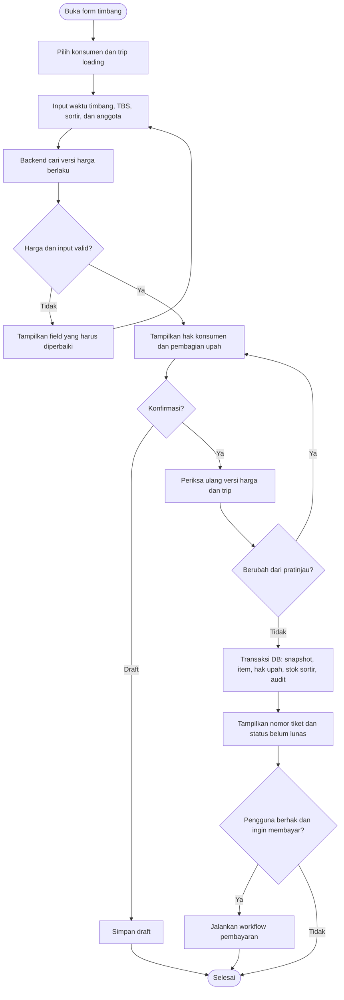
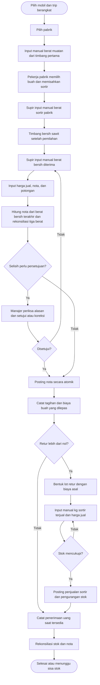
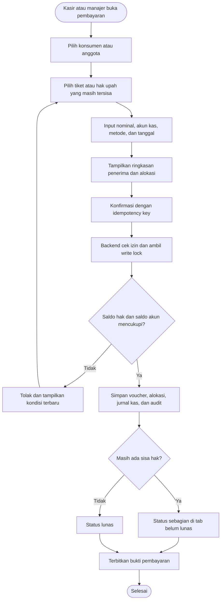
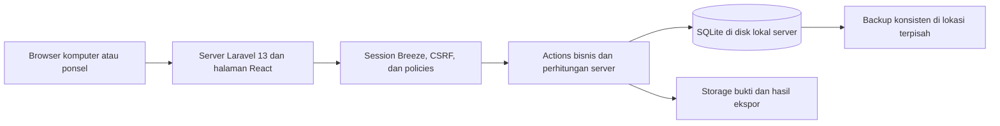
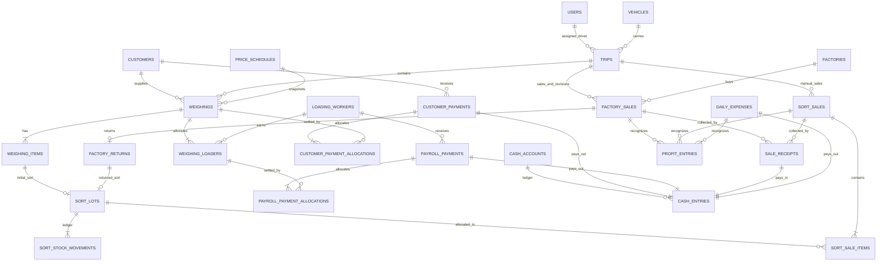

# PRD — CLBK TOKE

> Rencana produk dan implementasi aplikasi pengelolaan usaha toke sawit.
> Status: aplikasi web dan tahap 1–6 PRD telah diimplementasikan. Tahap 6 mencakup backup/restore terverifikasi, monitoring, dan konfigurasi deployment Coolify dengan Nginx + PHP-FPM. Pengujian browser perangkat nyata, cetak, dan verifikasi server produksi tetap perlu dilakukan. Penyederhanaan workflow tahap 1–4 selesai; pemeriksaan akhir workflow merupakan acuan terpisah.
> Bahasa antarmuka: Indonesia. Mata uang: Rupiah. Satuan tampilan berat: kilogram.

**Acuan workflow terbaru:** [rencana workflow sederhana](docs/rencana-workflow-sederhana.md). Transaksi baru langsung memilih mobil, timbangan cukup konsumen/TBS/sortir/anggota, penjualan pabrik hanya memakai berat bersih dengan harga otomatis, dan penjualan sortir memakai berat serta harga manual. Muatan Mobil dan Stok Sortir sudah dihapus dari menu, halaman, dan URL operasional. Ketentuan perjalanan, retur, FIFO, dan laba per nota dalam bagian lama di bawah ini menjadi acuan histori, bukan workflow transaksi baru. Seluruh Data Master tetap seperti sekarang. [Tahap 1 transisi data](docs/workflow-sederhana-tahap-1.md), [tahap 2 Timbang Sawit](docs/workflow-sederhana-tahap-2.md), serta [tahap 3–4 penjualan dan pembersihan workflow](docs/workflow-sederhana-tahap-3-4.md) selesai. Timbangan dan penjualan baru disimpan sah dalam satu langkah, dengan harga terkunci dan pembayaran/penerimaan terpisah. Penjualan pabrik dan sortir sama-sama dibayar melalui [Penerimaan Penjualan](docs/penerimaan-semua-penjualan.md). Dashboard/Laporan menggunakan selisih transaksi periode tanpa menghitung pembayaran konsumen atau gaji sebagai biaya lagi; pengeluaran tidak memakai perjalanan. [Tahap 5 PRD: Dashboard dan laporan](docs/tahap-5.md) telah diimplementasikan sesuai workflow ini. Tahap 5 dalam rencana penyederhanaan tetap merupakan pemeriksaan akhir workflow yang terpisah.

**Keuntungan bersih Dashboard (pilihan pengguna terbaru):** untuk periode yang dipilih, pendapatan penjualan pabrik + sortir − pembelian buah − hak upah muat − pengeluaran operasional. Label ini menggantikan Selisih transaksi periode pada Dashboard, laporan, CSV, dan cetak. Pembayaran konsumen/gaji tidak dihitung sebagai biaya kedua kali. Angka tersedia bagi manajer ketika semua mobil dipilih; pembelian dan penjualan dapat terjadi pada tanggal yang berbeda. Rincian tampilan tersedia pada [pembaruan Dashboard](docs/redesain-dashboard.md).

**Penugasan mobil supir (pembaruan terbaru):** manajer menetapkan satu mobil aktif per akun supir melalui Kelola Pengguna. Mobil otomatis terkunci pada Timbang Sawit, Penjualan Pabrik, dan Penjualan Sortir. Supir tanpa mobil aktif tidak dapat mencatat transaksi baru. Pergantian mobil memerlukan muat ulang form lama dan tidak mengubah mobil/hak akses pada transaksi terdahulu. [Implementasi dan pemakaian penugasan mobil](docs/penugasan-mobil-supir.md).

**Tampilan Penjualan Pabrik:** daftar nota memakai filter berlabel, rincian berat/nilai/penerimaan, serta susunan khusus layar kecil. Form pencatatan membagi tujuan, hasil timbang, dan informasi nota, dengan ringkasan nilai bersih yang menonjol. [Pembaruan tampilan dan verifikasi](docs/redesain-penjualan-pabrik.md).

**Gaji Karyawan Muat:** daftar karyawan dan Periksa & Bayar memakai tampilan baru. Seluruh sisa upah dalam periode otomatis menjadi dasar pembayaran, dengan satu bagian rincian semua riwayat timbang dan tanpa pemilihan tiket. Nominal awal terisi sisa periode serta dapat dikurangi untuk pembayaran sebagian dari timbangan tertua. Cakupan tanggal pada daftar dibawa ke halaman pembayaran. [Pembaruan UI dan pembayaran seluruh periode](docs/redesain-gaji-karyawan-muat.md).

**Navigasi admin, kasir, dan supir (pembaruan terbaru):** kasir memiliki menu Dashboard, Harga & Upah Muat, Laporan, Profil Saya, Uang Penimbang, Gaji Karyawan Muat, Riwayat Penggajian Karyawan, Penerimaan Penjualan, Uang Keluar Harian, serta Kas Usaha. Admin/manajer memakai tampilan sidebar dan navigasi ponsel yang sama dengan kasir, dengan seluruh 20 tautan operasional, keuangan, data master, administrasi, dan profil tetap tersedia. Supir memiliki Dashboard, Timbang Sawit, Tambah Konsumen, Penjualan Pabrik, Penjualan Sortir, dan Profil Saya; halaman Harga serta Laporan, CSV, dan cetak laporan tidak tersedia untuk supir. Seluruh role memakai navigasi bawah di ponsel/tablet dan sidebar mulai lebar 1.024 px. Header menampilkan nama usaha/halaman, role, serta tombol keluar tanpa tombol profil. Profil Saya tersedia melalui navigasi. Uang Penimbang dan Periksa Pembayaran admin/kasir hanya menampilkan kartu tiket yang belum lunas; voucher serta riwayat pembayaran tetap tersimpan. [Rincian navigasi dan verifikasi](docs/navigasi-mobile-kasir-supir.md).

**Tampilan Laporan dan cetak:** halaman kasir/manajer memakai filter berkelompok, ringkasan angka, cakupan filter aktif, serta rincian yang menyesuaikan layar kecil. Seluruh laporan dan voucher cetak/PDF memakai identitas usaha, total yang jelas, tabel berulang lintas halaman, serta nomor halaman; voucher memiliki ruang tanda tangan dan penjelasan status pembalikan. [Pembaruan desain dan pemeriksaan cetak](docs/redesain-laporan-dan-cetak.md).

## 1. Tujuan produk

CLBK TOKE membantu toke menerima dan menimbang buah konsumen, mengelola muatan mobil, menjual TBS ke pabrik, menjual buah sortir, membayar hasil sawit konsumen, membayar anggota muat, dan melihat laporan usaha dari satu sumber data.

Sistem harus menjawab pertanyaan berikut dengan jelas:

- Berapa buah yang diterima, sedang dimuat, sudah dijual, dan masih menjadi stok sortir?
- Berapa hak setiap konsumen berdasarkan harga saat buahnya ditimbang?
- Berapa hak upah setiap anggota berdasarkan pekerjaan yang benar-benar dilakukan?
- Berapa utang konsumen, utang upah, piutang penjualan, serta saldo kas saat ini?
- Berapa pendapatan, laba kotor, dan laba bersih operasional untuk periode tertentu?
- Siapa yang membuat, membayar, membatalkan, atau mengoreksi transaksi?

### 1.1 Hasil yang ditargetkan

1. Semua tiket timbang dapat ditelusuri ke konsumen, harga, perjalanan mobil, dan anggota muat.
2. Perubahan harga harian tidak mengubah hak konsumen pada tiket lama.
3. Hak upah dihitung otomatis dan dibagi tepat sesuai anggota pada setiap tiket.
4. Pelunasan mempunyai transaksi pembayaran, alokasi, dan bukti; tidak sekadar mengganti label.
5. Total muatan, hasil pabrik, retur, sortir, dan selisih timbang dapat direkonsiliasi.
6. Laba tidak menghitung pembayaran konsumen atau pembayaran gaji sebagai biaya dua kali.

## 2. Keputusan dasar dan lingkup

### 2.1 Keputusan yang sudah disetujui pengguna

| Keputusan | Rancangan yang digunakan |
|---|---|
| Penanggung upah muat | Toke. Hak konsumen tidak dipotong upah muat. |
| Penggunaan aplikasi | Semua pengguna terhubung ke satu server melalui jaringan kantor atau internet. |
| Frontend | ReactJS + TypeScript. |
| Backend | Laravel 13. |
| Autentikasi | Laravel Breeze, dengan verifikasi kompatibilitas pada tahap fondasi. |
| Database | SQLite pada disk lokal server. |
| Styling dan komponen | TailwindCSS + shadcn/ui. |

### 2.2 Lingkup MVP

- Dashboard operasional dan keuangan sesuai role.
- Timbang Sawit, termasuk harga terkunci dan pembagian upah.
- Pengelolaan perjalanan/muatan mobil dan Jual Sawit ke pabrik.
- Penjualan Buah Sortir dari stok awal maupun retur pabrik.
- Informasi Harga Sawit dan Upah Muat beserta riwayat perubahan.
- Pembayaran Konsumen, menggunakan istilah bisnis **Uang Penimbang** sebagai alias menu.
- Kelola Anggota Muat, Data Mobil, Data Pabrik, dan Data Konsumen/Pelanggan.
- Gaji Karyawan Muat, termasuk riwayat dan pelunasan.
- Uang Keluar Harian untuk biaya operasional.
- Laporan transaksi, stok, utang, upah, kas, dan laba.
- Pengelolaan akun, role, audit transaksi, dan backup database.
- Web responsif untuk browser komputer dan ponsel.

Pembayaran sebagian dimasukkan agar sisa utang tetap akurat. Uang Penimbang hanya menyediakan kartu timbangan **Belum Lunas**, termasuk yang dibayar sebagian; pembayaran yang lunas tetap tersimpan pada riwayat voucher. Daftar Gaji Karyawan Muat tetap menyediakan status **Belum Lunas / Lunas**.

### 2.3 Di luar MVP

- Sinkronisasi banyak komputer yang masing-masing melakukan transaksi offline.
- Pembacaan otomatis perangkat timbangan, GPS, dan integrasi API pabrik.
- Integrasi transfer bank atau pembayaran digital otomatis.
- Pinjaman/bon konsumen, uang muka upah, bunga, dan potongan lain yang belum diminta.
- Multi-cabang, konsolidasi banyak perusahaan, dan pembukuan pajak lengkap.
- Paket aplikasi ponsel native; supir memakai web responsif di browser ponsel.

## 3. Istilah dan ketentuan operasional

| Istilah | Arti |
|---|---|
| Toke | Pengelola usaha yang membeli/mengambil buah konsumen lalu menjualnya. |
| Konsumen/pelanggan | Pemasok buah kepada toke; dalam sistem ini mempunyai hak menerima pembayaran. |
| TBS | Tandan buah segar yang dicatat sebagai kategori buah utama. |
| Sortir awal | Buah yang sudah dikategorikan sortir saat timbang konsumen dan dibeli dengan harga sortir. |
| Retur/sortir pabrik | Buah milik toke yang ditolak dan dikembalikan pabrik dari suatu perjalanan. |
| Tiket timbang | Dokumen penerimaan buah konsumen dan sumber hak konsumen serta hak upah. |
| Trip/perjalanan/muatan | Satu perjalanan mobil ke pabrik dengan berat muatan dan hasil penjualan yang diinput manual oleh supir. Tiket terkait menjadi referensi biaya dan hak pembayaran. |
| Harga beli toke | Harga yang dibayarkan kepada konsumen; berbeda dari harga jual pabrik. |
| Harga jual pabrik | Harga pada nota penjualan pabrik yang dikunci saat penjualan diposting. |
| Hak upah | Kewajiban toke kepada anggota setelah tiket timbang dikonfirmasi. |
| Posting/konfirmasi | Mengubah draft menjadi transaksi sah, dengan angka dan snapshot terkunci. |
| Pembalikan/reversal | Transaksi yang membalik transaksi lama dengan alasan dan audit. |

Ketentuan rancangan ditetapkan sebagai berikut:

1. Satu tiket timbang dicatat pada satu perjalanan sebagai sumber biaya pembelian dan upah. Berat muatan perjalanan diinput manual; sistem tidak mengambilnya dari jumlah berat tiket maupun seluruh konsumen pada tanggal yang sama. Perjalanan dan penjualan dapat dicatat tanpa harus mengumpulkan tiket hari itu.
2. TBS dan sortir awal adalah dua kelompok berat yang terpisah. Angka TBS tidak sudah mencakup angka sortir.
3. Sortir awal masuk stok dari pencatatan timbang konsumen. Sortir pabrik berasal dari hasil pemilahan di pabrik yang diinput manual oleh supir. Berat sortir yang dijual dan harga jualnya juga diinput manual.
4. Dasar upah pada tiket adalah **TBS + sortir awal**. Tiket menyimpan dasar berat dan tarif yang terkunci; biaya upah ditanggung toke tanpa memotong hak konsumen.
5. Upah dibagi rata kepada seluruh anggota yang dipilih pada tiket; persentase khusus belum masuk MVP.
6. Retur pabrik tidak mengubah hak konsumen yang sudah disepakati, dan tidak menghasilkan pembelian baru.
7. Penjualan bisa dibayar langsung atau belakangan; hak tagih dan penerimaan kas dicatat terpisah.
8. Zona waktu usaha ditetapkan `Asia/Jakarta`. Semua perhitungan “hari ini” mengikuti zona waktu usaha, bukan komputer masing-masing.

## 4. Pengguna dan hak akses

Role aplikasi dibatasi menjadi `manager`, `driver`, dan `cashier`. Anggota muat adalah data karyawan; tidak otomatis mempunyai akun login.

| Fitur/aksi | Manajer Toke | Supir | Kasir |
|---|---|---|---|
| Dashboard operasional | Semua | Muatan dan transaksi yang ditugaskan | Ringkasan pembayaran dan kas |
| Laba dan laporan keuangan penuh | Ya | Tidak | Laporan kas/pembayaran sesuai tugas |
| Halaman Harga & Upah Muat | Lihat dan terbitkan | Tidak; tarif transaksi tetap otomatis | Lihat dan terbitkan harga beli, upah muat, serta harga pabrik |
| Halaman Laporan, ekspor CSV, dan cetak laporan | Semua jenis | Tidak | Semua kecuali audit; tanpa laba bersih |
| Input dan konfirmasi timbang | Ya | Ya, pada trip yang ditugaskan | Lihat untuk pembayaran |
| Input dan posting penjualan pabrik | Ya | Ya, pada trip yang ditugaskan | Lihat dan catat penerimaan uang |
| Input dan posting penjualan sortir | Ya | Ya, untuk sumber trip yang ditugaskan | Lihat dan catat penerimaan uang |
| Mengubah harga beli dan tarif muat | Ya | Lihat yang diperlukan | Ya, sebagai versi baru dengan audit |
| Mengubah harga referensi pabrik | Ya | Lihat dan input harga aktual nota | Ya, sebagai versi baru dengan audit |
| Membayar konsumen | Ya | Tidak | Ya |
| Menambahkan konsumen aktif | Ya | Ya, melalui Tambah Konsumen | Tidak |
| Membayar gaji anggota muat | Ya | Tidak | Ya |
| Riwayat Penggajian Karyawan | Ya | Tidak | Ya |
| Mencatat biaya operasional harian | Ya | Tidak | Ya |
| CRUD konsumen, anggota, mobil, pabrik | Ya | Pilih referensi aktif | Pilih referensi aktif |
| Mengubah akun, role, pengaturan | Ya | Tidak | Tidak |
| Membatalkan/membalik transaksi sah | Ya, dengan alasan | Tidak | Ajukan koreksi |
| Backup dan restore | Ya | Tidak | Tidak |

Pembatasan dilakukan pada route, policy, query data, dan response backend. Menyembunyikan menu saja tidak cukup. Data margin dan laba tidak dikirim ke supir jika tidak berhak.

Supir dapat melihat status pembayaran tiket sebagai informasi operasional, tetapi tombol **Bayar/Lunaskan** hanya tersedia untuk manajer/kasir. Opsi “Lunas” ketika manajer menimbang harus menjalankan proses pembayaran nyata; supir tidak dapat mengesahkan pembayaran.

## 5. Spesifikasi fitur

### 5.1 Dashboard

Komponen utama:

- Card TBS ditimbang hari ini, sortir awal diterima, dan total berat penerimaan.
- Card buah terjual hari ini: TBS diterima pabrik dan sortir yang sudah dijual, dengan rincian terpisah.
- Card pendapatan penjualan, laba kotor, dan laba bersih operasional hari ini.
- Pendapatan mengikuti input penjualan manual. Bila suatu penjualan belum mempunyai biaya asal dari tiket terkait, laba ditampilkan **Belum lengkap**; biaya yang tidak tersedia tidak dianggap nol.
- Card total utang konsumen, utang upah, piutang penjualan, dan saldo akun kas.
- Daftar muatan mobil: nomor trip, plat, supir, total berat internal, berat sortir pabrik, berat bersih diterima, status, dan tujuan pabrik. Sebelum supir mencatat timbang pabrik, berat diberi label **Belum dicatat**.
- Daftar pekerjaan tertunda: muatan belum dijual, retur belum selesai, stok sortir, dan tagihan belum lunas.
- Filter tanggal/periode dan tautan dari angka ringkasan ke transaksi sumber.

“Muatan mobil hari ini” mencakup trip yang dibuka hari ini serta trip lama yang masih aktif, dengan label tanggal asal. Mobil yang mempunyai dua trip ditampilkan sebagai dua muatan.

Laba hari ini mengikuti tanggal posting penjualan/biaya. Arus kas mengikuti tanggal penerimaan/pembayaran. Kedua metrik tidak dicampur. Detail rumus ada pada bagian 12.

### 5.2 Timbang Sawit

Input utama:

1. Pilih konsumen aktif.
2. Pilih mobil dan trip yang masih `loading`.
3. Isi tanggal/waktu timbang; waktu input dicatat terpisah.
4. Masukkan berat TBS dan sortir awal dalam kg.
5. Tampilkan harga beli TBS, harga beli sortir, tarif upah, dan waktu berlakunya.
6. Pilih satu atau lebih anggota muat; dasar berat upah dihitung dari TBS + sortir awal pada tiket.
7. Tampilkan nilai hak konsumen dan pembagian hak upah per anggota.
8. Simpan draft atau konfirmasi tiket.
9. Manajer/kasir dapat melanjutkan ke pembayaran dengan ringkasan yang sama.

Output: nomor tiket, rincian berat, harga snapshot, nilai konsumen, trip, anggota, total upah, pembagian per anggota, dan status pembayaran.

Validasi:

- Total berat lebih besar dari nol; masing-masing kategori tidak negatif.
- Tidak boleh memilih konsumen, mobil, atau anggota yang dinonaktifkan untuk transaksi baru.
- Harga yang berlaku harus tersedia; sistem tidak diam-diam menggunakan harga nol.
- Anggota muat minimal satu jika dasar upah positif dan pekerjaan dilakukan.
- Trip harus masih menerima tiket; tiket tidak boleh masuk dua trip.
- Harga pratinjau yang berubah sebelum konfirmasi harus ditampilkan kembali untuk disetujui.
- Tiket yang diposting mempunyai snapshot sendiri; nilai dari browser dihitung ulang backend.

Timbang konsumen dicatat manual. Angkanya digunakan untuk hak konsumen dan upah; tidak mengisi otomatis berat muatan atau hasil timbang pabrik.

### 5.3 Muatan Mobil / Perjalanan

Modul **Muatan Mobil** mencatat perjalanan dan hasil timbang manual dari supir.

Alur ditetapkan:

1. Supir memilih mobil, membuat perjalanan, dan mengantar buah ke pabrik.
2. Di pabrik, mobil/muatan ditimbang. Formulir penjualan tidak meminta berat muatan awal.
3. Pekerja muat pabrik memilih buah yang diterima dan memisahkan buah sortir. Supir memasukkan **berat buah sortir pabrik** secara manual.
4. Setelah pemilahan, dilakukan timbang bersih sawit yang diterima pabrik. Supir memasukkan **berat bersih diterima pabrik** secara manual.
5. Berat bersih terakhir menjadi dasar penjualan TBS ke pabrik.
6. Buah sortir dibawa ke tempat penjualan sortir. Supir memasukkan **berat sortir terjual** dan **harga jual sortir** secara manual pada fitur Penjualan Buah Sortir.

Aturan perjalanan:

- Formulir hanya meminta berat sortir dan berat bersih diterima pabrik. Total berat untuk perhitungan biaya internal adalah jumlah keduanya; tidak mengambil jumlah timbang konsumen hari itu.
- Kolom berat muatan awal pada penyimpanan nota tetap dipertahankan untuk kompatibilitas data lama. Pada formulir baru nilainya dihitung sistem, bukan diinput pengguna.
- Aksi **Berangkat** mencatat keberangkatan dan membekukan referensi tiket serta biaya kategori TBS yang sudah terkait. Biaya sortir awal tetap berada pada lot sortir awalnya. Berat hasil pabrik tidak wajib tersedia saat berangkat karena baru diinput setelah timbang di pabrik.
- Tiket yang terkait digunakan untuk biaya pembelian dan upah, tanpa mengganti atau memvalidasi berat manual supir terhadap total tiket.
- Satu mobil mempunyai satu perjalanan aktif (`loading` atau `dispatched`) pada satu waktu. Sesudah hasil pabrik dicatat, mobil dapat membuka perjalanan baru meskipun sortir perjalanan sebelumnya belum habis dijual.
- Berat sortir dan berat bersih diterima dikunci saat nota diposting. Penutupan perjalanan dilakukan setelah nota dan stok terkait direkonsiliasi; pembayaran konsumen/upah tetap terpisah.
- Perjalanan yang hanya menangani sortir dapat selesai tanpa nota pabrik setelah penjualan dan stok sortir selesai dicatat.

### 5.4 Jual Sawit ke Pabrik

Alur:

1. Pilih mobil lalu pilih trip berstatus `dispatched`.
2. Pilih pabrik aktif.
3. Formulir tidak menampilkan input berat muatan awal.
4. Setelah pekerja pabrik memilah buah, supir memasukkan berat sortir pabrik secara manual.
5. Setelah timbang bersih berikutnya, supir memasukkan berat bersih sawit yang diterima pabrik secara manual.
6. Input nomor nota dan waktu penjualan. Sistem memakai input berat bersih terakhir langsung sebagai berat penjualan TBS.
7. Harga jual terisi otomatis dari riwayat harga pabrik yang berlaku pada waktu penjualan dan tidak dapat diedit. Input potongan nota dalam rupiah tanpa input alasan potongan.
8. Tampilkan berat sortir, berat bersih diterima, harga otomatis, dan nilai nota. Halaman detail tidak menampilkan input alasan persetujuan selisih berat maupun unggah bukti.
9. Posting penjualan mengunci nota dan membentuk stok retur serta piutang penjualan.
10. Kasir/manajer mencatat penerimaan uang; jika langsung dibayar, kedua proses dapat dijalankan dalam satu transaksi backend.

MVP memakai satu nota pabrik per trip. Pemecahan satu trip ke beberapa pabrik memerlukan perluasan alokasi, sehingga tidak diaktifkan pada MVP.

```text
berat_diterima_pabrik = input_manual_berat_bersih_setelah_sortir
total_berat_internal = input_manual_berat_sortir + berat_diterima_pabrik
selisih_nota_baru = total_berat_internal - input_manual_berat_sortir - berat_diterima_pabrik = 0
nilai_nota = round(berat_diterima_kg × harga_jual_snapshot) - potongan_nota
```

Berat sortir tidak negatif, berat bersih diterima lebih dari nol, dan jumlah keduanya tidak melebihi batas penyimpanan berat. Berat bersih setelah sortir **tidak dikurangi sortir lagi**. Nilai nota tidak boleh negatif. Sistem tidak membandingkan berat dengan total timbang konsumen. Data lama yang mempunyai selisih negatif atau selisih di atas toleransi tetap membutuhkan persetujuan manajer atas versi draft terbaru, melalui tombol tanpa input alasan. Catatan persetujuan standar dibuat sistem untuk riwayat audit. Potongan pabrik tanpa alasan memakai catatan standar sistem agar tetap kompatibel dengan aturan database. Bukti lama tetap dapat dilihat; formulir unggah bukti pabrik dihilangkan.

### 5.5 Penjualan Buah Sortir / Pengantaran Sortir

Sumber stok:

- Sortir awal dari tiket konsumen.
- Buah retur pabrik dari nota trip.

Input: pilih perjalanan/sumber sortir, nama pembeli/tempat sortir, tanggal, **input manual berat sortir yang benar-benar terjual**, **input manual harga jual per kg**, potongan bila ada, dan catatan/bukti. Sistem tidak otomatis mengisi berat terjual dari seluruh stok maupun data timbang konsumen.

Output: pendapatan penjualan sortir, biaya asal yang dilepas, margin kotor, biaya muat terkait, margin setelah muat, dan sisa stok.

- Stok dapat dijual bertahap; jumlah terjual tidak boleh melampaui stok tersedia.
- Sistem mengalokasikan jumlah manual yang dijual ke lot sumber dengan FIFO. Alokasi internal ini tidak mengubah berat atau harga yang diinput supir.
- Retur pabrik membawa biaya asal TBS, tidak memakai harga beli sortir baru.
- Stok rusak/hilang dicatat sebagai penyesuaian oleh manajer dengan alasan; tidak disamarkan sebagai penjualan.
- Penjualan sah membentuk tagihan; penerimaan uang dicatat kasir/manajer.
- “Keuntungan sortir” dihitung dari pendapatan dikurangi biaya asal dan biaya terkait, bukan menganggap seluruh penerimaan sebagai laba.

### 5.6 Informasi Harga Sawit dan Upah Muat

Manajer mengisi:

- Harga beli TBS per kg.
- Harga beli sortir awal per kg.
- Upah muat per kg.
- Tanggal dan waktu mulai berlaku.
- Catatan perubahan.

Setiap publikasi menjadi versi baru. Harga lama tidak ditimpa. Satu versi memuat tiga tarif sekaligus agar tiket memakai kombinasi yang jelas.

Contoh wajib:

- Tiket A ditimbang saat TBS Rp3.000/kg: harga tiket A tetap Rp3.000/kg.
- Besok manajer memublikasikan Rp2.900/kg.
- Konsumen A mengambil uang besok: haknya dihitung dari Rp3.000/kg.
- Tiket B yang ditimbang sesudah perubahan memakai Rp2.900/kg.

Harga pabrik disimpan terpisah pada riwayat harga pabrik. Saat menjual, sistem mengambil versi harga yang berlaku untuk pabrik dan waktu penjualan, lalu menyimpan ID versi serta harga sebagai snapshot. Harga tidak dapat diedit pada formulir; backend mengabaikan harga yang dikirim browser. Bila harga belum tersedia, draft tidak dapat disimpan. Nota yang telah disahkan tetap memakai snapshot saat harga pabrik berubah.

### 5.7 Uang Penimbang / Pembayaran Konsumen

Daftar utama hanya menampilkan konsumen dengan tiket yang masih mempunyai sisa hak; pembayaran sebagian diberi badge **Sebagian**. Tiket lunas tidak ditampilkan pada kartu konsumen maupun kartu pilihan Periksa Pembayaran. Penyaringan dilakukan sebelum pratinjau dan pagination, sehingga tiket yang belum lunas tetap tersedia di halaman pertama meskipun memiliki banyak riwayat lunas.

Card per konsumen menampilkan nama, daftar tiket belum lunas, tanggal timbang, berat, harga snapshot tiap kategori, total hak, total dibayar, sisa, dan pembayaran terakhir. Jumlah tiket dan nominal kartu mengikuti tiket yang masih memiliki sisa. Ringkasan periode pada Periksa Pembayaran tetap mencakup semua hak/pembayaran dalam periode, sedangkan pilihan pembayaran hanya memuat tiket belum lunas. Setelah seluruhnya lunas, kartu/form pembayaran diganti keadaan kosong; voucher, rincian timbang, dan riwayat pembayaran tetap tersimpan. Pembalikan pembayaran mengembalikan tiket ke daftar belum lunas. Ketentuan ini berlaku untuk admin/manajer serta kasir.

Aksi **Bayar** atau **Lunaskan**:

1. Pilih tiket yang dibayar; dapat beberapa tiket milik konsumen yang sama.
2. Tampilkan sisa setiap tiket dan total pembayaran.
3. Pilih akun kas/bank, metode, tanggal, serta referensi transfer jika diperlukan.
4. Konfirmasi penerima dan nominal.
5. Backend membuat voucher, alokasi tiket, dan jurnal kas secara atomik.
6. Cetak/unduh bukti dan perbarui saldo.

Pelunasan mengalokasikan ke tiket tertua yang dipilih. Satu voucher tidak boleh berisi tiket dari konsumen berbeda. Pembayaran berlebih ditolak; saldo titipan tidak termasuk MVP.

Pembaruan kas tunggal: admin/manajer dan kasir memakai satu Kas Usaha untuk seluruh penerimaan serta pembayaran. Manajer memiliki tombol **Buat Kas Usaha** di halaman kas, hanya aktif ketika belum ada akun kas. Pembuatan kas pertama dimulai dengan saldo Rp0, kode internal otomatis, dan audit. Setelah satu akun tercatat, tombol dinonaktifkan dan server menolak penambahan akun, termasuk ketika akun lama nonaktif. Metode tunai/transfer tetap dicatat, tetapi pengguna tidak memilih akun kas lain. Saldo dan mutasi lama tetap tersimpan. Penambahan konsumen aktif tersedia untuk supir melalui formulir khusus dan langsung mengisi pilihan konsumen pada formulir timbang; daftar, pengubahan, dan penghapusan master tetap dikelola manajer.

### 5.8 Kelola Anggota Muat

- Tambah, lihat, ubah, nonaktifkan, dan hapus anggota yang belum memiliki referensi transaksi.
- Data: kode, nama, nomor telepon, alamat, tanggal bergabung, dan status aktif.
- Detail anggota menampilkan riwayat tiket, hak upah, pembayaran, serta sisa.
- Anggota yang sudah mempunyai transaksi dinonaktifkan, bukan dihapus permanen.

### 5.9 Gaji Karyawan Muat

Card anggota hanya menampilkan pekerjaan/tiket yang masih memiliki sisa upah pada periode. Rincian anggota memuat pekerjaan yang belum lunas dan pembayaran sisa periode; pekerjaan lunas serta voucher dipindahkan ke halaman **Riwayat Penggajian Karyawan** untuk kasir dan admin/manajer. Riwayat memuat tab Pekerjaan lunas dan Voucher pembayaran dengan pencarian karyawan/nomor dokumen, rentang tanggal, serta akses bukti gaji. Karyawan nonaktif tetap tercantum dalam riwayat. Pembalikan pembayaran mengembalikan pekerjaan yang memiliki sisa ke rincian anggota, dan voucher pembalikan tetap tersimpan.

- Hak berasal dari alokasi anggota pada tiket, bukan dihitung ulang memakai tarif saat penggajian.
- Kasir/manajer dapat membayar sebagian atau melunaskan periode yang dipilih.
- Periode hanya memfilter pekerjaan; tidak menciptakan hak upah baru.
- Pembayaran mengalokasikan nominal ke hak upah yang belum terbayar dan mencatat uang keluar.
- Bukti gaji memuat nomor pembayaran, periode, rincian tiket, nominal, penerima, dan petugas.

### 5.10 Uang Keluar Harian

Input: tanggal, kategori, nominal, akun kas/bank, deskripsi, trip terkait bila ada, dan bukti.

Kategori awal: BBM, tol, parkir, perawatan mobil, makan operasional, dan biaya operasional lain.

Pembayaran konsumen dan pembayaran gaji dibuat dari modul masing-masing. Keduanya tampil pada laporan seluruh uang keluar, tetapi tidak diinput ulang sebagai biaya operasional harian.

Biaya operasional dicatat sebagai dibayar saat diposting.

### 5.11 Data Konsumen/Pelanggan

- CRUD nama, telepon, alamat/kebun, catatan, dan status aktif; seluruh formulir master tidak meminta kode.
- Detail: riwayat timbang, total hak, pembayaran, dan sisa utang.
- Nomor telepon boleh sama bila memang dipakai bersama. Kode internal unik dibuat otomatis saat penyimpanan dan dipertahankan saat data diedit.
- Penghapusan permanen hanya untuk data yang belum dipakai; selebihnya nonaktifkan.

### 5.12 Data Mobil

- CRUD plat nomor unik, jenis, kapasitas kg opsional, supir default, dan status aktif. Kode internal mobil dibuat otomatis.
- Tampilkan trip aktif dan riwayat perjalanan.
- Pelampauan kapasitas menjadi peringatan pada berat muatan manual yang dicatat.
- Mengubah supir default tidak mengubah supir pada perjalanan lama.

### 5.13 Data Pabrik

- CRUD nama, alamat, kontak, dan status aktif. Kode internal pabrik dibuat otomatis.
- Riwayat harga TBS pabrik dengan waktu mulai berlaku.
- Riwayat nota, volume diterima, retur, selisih, dan saldo tagihan.
- Harga referensi pabrik tidak memperbarui penjualan lama.

### 5.14 Laporan

| Laporan | Rincian utama |
|---|---|
| Ringkasan periode | Metrik pembelian/penjualan/upah/biaya, selisih transaksi periode, rincian per hari dan mobil |
| Timbang konsumen | Tiket, TBS/sortir, berat, harga snapshot, nilai, mobil, anggota dan tarif upah |
| Penjualan pabrik | Pabrik, nota, berat diterima, harga terkunci, potongan, pendapatan, penerimaan/piutang saat ini |
| Penjualan sortir | Pembeli, mobil, berat manual, harga jual, potongan, pendapatan, penerimaan/piutang saat ini |
| Piutang penjualan | Nota pabrik/sortir, nilai, diterima, sisa piutang dan status pembayaran saat ini |
| Utang konsumen | Hak tiket, dibayar, sisa, umur utang dari tanggal timbang |
| Upah muat | Hak anggota per tiket, tarif, pembagi, dibayar, sisa |
| Kas & bank | Saldo awal, masuk, keluar, saldo akhir per akun, saldo berjalan dan voucher sumber |
| Penerimaan penjualan | Voucher, nota pabrik/sortir, tanggal penerimaan, akun, nominal, metode, referensi dan bukti |
| Biaya operasional | Kategori, tanggal, nominal, akun, metode, referensi, keterangan dan bukti |
| Audit | Pengguna, aksi, waktu, perubahan, alasan pembatalan/pembalikan |

Filter tanggal dengan makna jelas: tanggal timbang, tanggal penjualan, atau tanggal pembayaran sesuai laporan. Sediakan filter konsumen, mobil, pabrik, anggota, akun, kategori, dan status bila relevan, termasuk referensi nonaktif dengan histori. Ekspor CSV dan tampilan cetak/PDF memuat seluruh hasil filter; totalnya harus sama dengan layar dan dokumen sumber, tanpa dibatasi halaman tabel.

Tabel ini mengikuti workflow sederhana terbaru. Laporan perjalanan, stok/FIFO, dan laba per nota dari rancangan awal menjadi acuan histori. Selisih transaksi periode memakai pendapatan − pembelian − hak upah − pengeluaran, bukan biaya stok dilepas atau saldo kas. Laporan utang/upah/piutang menyaring tanggal sumber hak dan memakai pembayaran sah seluruh tanggal saat ini. Pembalikan mengurangi periode tanggal pembalikan; transaksi asli tetap tercatat pada tanggal asal. Audit hanya untuk manajer dan hanya menampilkan perubahan atribut usaha yang diizinkan, tanpa payload kredensial atau lokasi berkas privat.

## 6. Aturan bisnis inti

### 6.1 Harga dan transaksi terkunci

1. Untuk waktu timbang yang dipilih, backend mengambil versi harga terakhir dengan `effective_from <= weighed_at`.
2. Kebijakan harga harian mengharuskan versi untuk tanggal usaha tersebut; bila belum ada, konfirmasi diblokir sampai manajer atau kasir memublikasikan harga hari itu.
3. Draft boleh memperbarui pratinjau. Konfirmasi menyimpan ID versi dan nominal snapshot pada tiket/item.
4. Harga sumber boleh ditambah versi baru; kolom snapshot transaksi lama tidak berubah.
5. Input tanggal timbang mundur hanya oleh manajer dengan alasan. Supir memakai waktu usaha saat ini.
6. Publikasi harga tidak boleh diberi waktu berlaku mundur melewati tiket yang sudah sah. Koreksi masa lalu dilakukan lewat alur koreksi tiket, bukan mengganti riwayat diam-diam.
7. Tanggal pembayaran tidak pernah digunakan untuk memilih ulang harga pembelian.

### 6.2 Pembagian upah per tiket

```text
total_upah_tiket = round(dasar_berat_kg × tarif_muat_snapshot)
hak_anggota = total_upah_tiket dibagi jumlah_anggota_pada_tiket
hak_periode_anggota = jumlah seluruh hak tiket sah milik anggota
sisa_upah = hak_periode_anggota - alokasi pembayaran sah
```

Contoh: 1.000 kg × Rp100 = Rp100.000.

- Satu anggota: Rp100.000 untuk anggota tersebut.
- Dua anggota: Rp50.000 per anggota.
- Tiga anggota: Rp33.334, Rp33.333, Rp33.333.

Sisa pembulatan dibagikan Rp1 secara deterministik berdasarkan urutan ID anggota. Urutan pilihan di browser tidak memengaruhi hasil.

Jika A bekerja sendirian pada tiket pertama dan bersama B pada tiket kedua, hak A adalah seluruh upah tiket pertama ditambah separuh tiket kedua. Sistem tidak membagi seluruh upah mobil berdasarkan jumlah anggota terakhir.

Upah dibagi juga ke kategori TBS/sortir pada tiket sesuai dasar berat pekerjaan masing-masing. Alokasi memakai total upah tiket yang sudah dibulatkan, lalu membagi proporsional dan mendistribusikan sisa rupiah secara deterministik; jangan membulatkan biaya tiap kategori secara independen. Jumlah alokasi kategori harus tepat sama dengan total upah dan jumlah hak anggota. Alokasi kategori dan alokasi anggota adalah dua rincian dari total upah yang sama, bukan dua biaya berbeda.

### 6.3 Status dan pembayaran

Status transaksi dan status pembayaran dipisahkan:

| Entitas | Status transaksi/operasional | Status pembayaran turunan |
|---|---|---|
| Tiket timbang | `draft`, `posted`, `voided` | `unpaid`, `partial`, `paid` |
| Trip | `loading`, `dispatched`, `factory_recorded`, `closed`, `cancelled`, `correction_pending` | Tidak mempunyai status lunas konsumen tunggal |
| Penjualan pabrik/sortir | `draft`, `posted`, `reversed` | `unpaid`, `partial`, `paid` untuk penerimaan |
| Voucher pembayaran | `posted`, `reversed` | Nominal/alokasi tetap tersimpan |

- `unpaid`: belum ada pembayaran dan sisa lebih besar dari nol.
- `partial`: sudah ada pembayaran, tetapi sisa masih lebih besar dari nol.
- `paid`: jumlah alokasi pembayaran sah sama dengan hak/tagihan.
- Transaksi `voided`/`reversed` tidak ditampilkan sebagai tagihan aktif.
- Tidak ada endpoint yang sekadar mengubah status menjadi `paid` tanpa voucher.

### 6.4 Koreksi dan pembatalan

- Draft dapat diubah/dihapus oleh pembuat yang berhak.
- Master yang sudah dipakai hanya dapat dinonaktifkan.
- Transaksi sah tidak dihapus permanen atau diubah nominalnya langsung.
- Manajer memasukkan alasan pembatalan; sistem mencatat hubungan transaksi lama dengan transaksi pengganti.
- Tiket tidak boleh dibatalkan bila masih memiliki pembayaran, hak upah yang dibayar, perjalanan berangkat, atau stok sortir yang sudah bergerak. Dependensi harus dibalik dari bagian paling akhir terlebih dahulu.
- Koreksi berat, harga, dan anggota tiket setelah trip diberangkatkan berada di luar MVP. Koreksi nota pabrik tetap diperbolehkan dengan snapshot biaya asal terkunci; sistem tidak membuka ulang tiket perjalanan historis.
- Nota penjualan yang sudah diterima uangnya atau retur-nya sudah dijual/disesuaikan tidak bisa dibalik sebelum transaksi turunannya dibalik. Berat dan biaya lot retur harus kembali tepat ke receipt asal sebelum pembalikan receipt, agar tidak terbentuk stok negatif.
- Pembalikan nota pabrik membuat trip `correction_pending`, bukan otomatis `dispatched`; status ini tidak memesan mobil aktif. Nota pengganti memakai snapshot biaya TBS saat keberangkatan, serta input berat manual nota sebelumnya yang dikoreksi dengan alasan dan audit. Snapshot keberangkatan tidak dianggap mempunyai hasil timbang pabrik. Proses ini tidak mengganggu trip baru mobil tersebut. Posting pengganti mengembalikan status `factory_recorded` lalu trip dapat ditutup kembali.
- Membalik voucher membentuk jurnal kas lawan arah dan membebaskan alokasi lama secara logis; histori voucher/alokasinya tetap ada.
- Jika uang telah benar-benar diserahkan, pembalikan administratif memerlukan pencatatan kejadian pengembalian uang/transfer yang sesuai. Jangan menganggap perubahan status otomatis mengembalikan uang fisik.

### 6.5 Pengiriman ganda dan transaksi bersamaan

- Setiap konfirmasi, pembayaran, dan posting penjualan memakai `idempotency_key`.
- Mengulang request yang sama mengembalikan hasil yang sama, tidak membuat transaksi baru.
- Key yang sama dengan isi berbeda ditolak.
- Hak tersisa, stok tersisa, status trip, dan harga diperiksa ulang di dalam transaksi tulis.
- Dua kasir yang membayar tagihan sama tidak boleh membuat saldo negatif.
- SQLite tidak diperlakukan seperti database dengan row lock. Rancangan utama memakai koordinator transaksi tulis yang memperoleh write lock sebelum membaca saldo, misalnya semantik `BEGIN IMMEDIATE`, lalu membaca ulang saldo dan menjalankan perubahan pada koneksi yang sama. Integrasi dengan pengelolaan transaksi Laravel, rollback, dan retry harus dibuktikan pada tahap fondasi. [SQLite Transactions](https://www.sqlite.org/lang_transaction.html)
- Kesalahan konflik/busy menghasilkan pesan yang jelas dan retry terbatas; pengguna tidak diminta mengirim pembayaran baru tanpa pengecekan hasil sebelumnya.

## 7. Workflow sistem

### 7.1 Workflow harian

1. Manajer mengecek akun kas, harga hari ini, tarif muat, dan data master aktif.
2. Supir/manajer membuka trip untuk mobil dan memilih supir penanggung jawab.
3. Supir menerima buah, memilih konsumen, kategori berat, dan anggota muat.
4. Tiket dikonfirmasi: hak konsumen dan upah tercatat; sortir awal masuk stok.
5. Kasir dapat membayar konsumen sebelum atau setelah penjualan sesuai dana tersedia; harga tetap terkunci. Tiket konsumen tidak menjadi prasyarat pengisian berat penjualan.
6. Trip diberangkatkan; referensi biaya tiket yang sudah terkait dibekukan tanpa mengisi berat muatan dari tiket.
7. Di pabrik supir menginput berat sortir sesudah pemilahan dan berat bersih dari timbang terakhir, kemudian nomor nota. Harga mengikuti riwayat harga pabrik secara otomatis.
8. Penjualan diposting; pendapatan/tagihan, biaya terkait, dan stok retur terbentuk.
9. Supir menjual buah sortir dengan input manual berat terjual dan harga jual; kasir/manajer mencatat penerimaan uang penjualan.
10. Kasir membayar konsumen dan anggota muat dengan alokasi dan bukti.
11. Kasir mencatat biaya harian; manajer merekonsiliasi stok, kas, utang, dan laba.
12. Manajer menutup trip yang selesai dan memeriksa backup.

### 7.2 Diagram aktivitas keseluruhan

Diagram menggunakan Mermaid, dengan kelompok aktivitas sebagai swimlane sederhana. Keputusan pembayaran konsumen berjalan independen dari waktu penjualan.



### 7.3 Diagram aktivitas timbang dan harga terkunci



### 7.4 Diagram aktivitas penjualan pabrik dan sortir



### 7.5 Diagram aktivitas pembayaran konsumen dan gaji



## 8. Arsitektur teknologi

### 8.1 Arsitektur utama

Gunakan **monolit modular Laravel + React melalui Inertia**, dengan frontend dan autentikasi pada origin yang sama. Inertia adalah tambahan penghubung yang sesuai pola React Breeze; bukan penggantian stack React/Laravel yang diminta.



- React dirender melalui halaman Inertia; route utama dikelola Laravel.
- Backend menjadi pemilik aturan harga, pembagian upah, saldo, stok, dan laba.
- SQLite hanya berada di server. Browser komputer dan ponsel mengakses aplikasi pada origin HTTPS yang sama melalui Laravel.
- Seluruh role membaca data yang sama. Jika server ada di kantor, aplikasi tetap dapat dipakai lewat LAN saat internet luar terputus, selama server dan LAN hidup.
- Ketika koneksi server terputus, tampilkan status koneksi dan blokir posting. Tidak ada janji transaksi offline tersinkronisasi pada MVP.

### 8.2 Laravel 13 dan Breeze

Laravel 13 membutuhkan PHP minimal 8.3. Kebutuhan runtime mengikuti dokumentasi rilis resminya. [Laravel 13 Release Notes](https://laravel.com/framework/docs/13.x/releases)

Hasil implementasi fondasi CLBK TOKE menetapkan runtime proyek **PHP 8.4+**. Pada versi Laravel yang terpasang, pengaturan transaksi SQLite `IMMEDIATE` dijalankan secara native ketika PHP 8.4+ digunakan. Batas ini dicantumkan dalam `composer.json` agar write lock diperoleh sebelum pembacaan saldo.

Autentikasi menggunakan **Breeze** dengan baseline rilis `v2.4.2`:

- Rilis Breeze `v2.4.2` mencantumkan dukungan komponen Illuminate `^13.0` dan perbaikan khusus Laravel 13. Rilis ini menjadi baseline spike; kompatibilitas seluruh scaffolding CLBK TOKE tetap diuji pada proyek nyata. [Breeze v2.4.2 composer.json](https://github.com/laravel/breeze/blob/v2.4.2/composer.json), [Breeze v2.4.2 release](https://github.com/laravel/breeze/releases/tag/v2.4.2)
Tahap fondasi menguji Breeze bersama Laravel 13, React/Inertia, login/logout, session, proteksi request, serta build Tailwind + shadcn. Versi yang lolos dipin pada lockfile dan masalah kompatibilitas diselesaikan dalam stack yang ditetapkan.

Jangan menjalankan Breeze dan starter kit Fortify bersamaan sebagai dua sistem login. MVP memiliki satu implementasi autentikasi.

### 8.3 Tailwind dan shadcn/ui

Komponen shadcn disimpan sebagai kode sumber proyek pada `resources/js/components/ui`; wrapper bisnis disimpan terpisah. Alias pada `components.json` disesuaikan ke `resources/js`, bukan menyalin path Vite standalone `src` tanpa penyesuaian. [Dokumentasi shadcn/ui](https://ui.shadcn.com/docs), [components.json](https://ui.shadcn.com/docs/components-json)

Pilih satu versi mayor Tailwind yang didukung hasil scaffolding dan versi shadcn terpilih. Bila menggunakan Tailwind 4, sesuaikan integrasi CSS/Vite berdasarkan dokumentasi; jangan mencampur panduan Tailwind 3 dan 4. [Panduan instalasi Vite](https://ui.shadcn.com/docs/installation/vite)

### 8.4 Akses melalui browser

- Komputer dan ponsel membuka domain HTTPS aplikasi melalui browser yang diperbarui.
- Session, CSRF, dan otorisasi dikelola Laravel pada origin aplikasi yang sama.
- Cetak/PDF, ekspor CSV, serta unggah/unduh bukti menggunakan fasilitas browser.
- Seluruh transaksi memerlukan koneksi ke satu server bersama; tidak ada pencatatan offline tersinkronisasi.

### 8.5 SQLite dan akses bersama

SQLite cocok sebagai database server kecil dengan pola tulis yang terkendali. File database disimpan pada disk lokal server; client berkomunikasi lewat Laravel, bukan network share. SQLite mempunyai batas satu writer pada satu waktu, sehingga transaksi harus singkat dan beban tulis diuji. [Appropriate Uses for SQLite](https://www.sqlite.org/whentouse.html)

Konfigurasi server memakai foreign key aktif pada setiap koneksi, `busy_timeout` terukur, WAL, serta retry yang tidak menggandakan transaksi. Lock wait, busy error, dan latensi diukur saat tiga role bekerja bersamaan.

## 9. Struktur folder

Folder berikut adalah rancangan yang akan dibuat ketika implementasi dimulai; saat penyusunan PRD tidak perlu membuat semua file kosong.

```text
CLBK/
├── prd.md
├── README.md
├── .env.example
├── .gitignore
├── composer.json
├── composer.lock
├── package.json
├── package-lock.json
├── components.json
├── vite.config.ts
├── tsconfig.json
├── app/
│   ├── Actions/
│   │   ├── Weighings/
│   │   │   ├── CreateDraftWeighing.php
│   │   │   ├── PostWeighing.php
│   │   │   └── VoidWeighing.php
│   │   ├── Trips/
│   │   │   ├── DispatchTrip.php
│   │   │   └── CloseTrip.php
│   │   ├── Sales/
│   │   │   ├── PostFactorySale.php
│   │   │   ├── PostSortSale.php
│   │   │   └── ReverseSale.php
│   │   ├── Payments/
│   │   │   ├── PayCustomer.php
│   │   │   ├── PayLoadingWorker.php
│   │   │   ├── ReceiveSalePayment.php
│   │   │   └── ReversePayment.php
│   │   ├── Expenses/
│   │   └── Prices/
│   ├── Domain/
│   │   ├── Pricing/PriceSnapshotResolver.php
│   │   ├── Weighings/WeighingCalculator.php
│   │   ├── Payroll/LoadingWageAllocator.php
│   │   ├── Inventory/InventoryCostAllocator.php
│   │   ├── Accounting/ProfitCalculator.php
│   │   └── Shared/
│   │       ├── Money.php
│   │       └── Weight.php
│   ├── DTOs/
│   ├── Enums/
│   ├── Http/
│   │   ├── Controllers/
│   │   │   ├── Auth/
│   │   │   ├── DashboardController.php
│   │   │   ├── WeighingController.php
│   │   │   ├── TripController.php
│   │   │   ├── FactorySaleController.php
│   │   │   ├── SortSaleController.php
│   │   │   ├── CustomerPaymentController.php
│   │   │   ├── PayrollPaymentController.php
│   │   │   ├── ExpenseController.php
│   │   │   ├── MasterData/
│   │   │   └── Reports/
│   │   ├── Requests/
│   │   │   ├── Weighings/
│   │   │   ├── Sales/
│   │   │   ├── Payments/
│   │   │   └── MasterData/
│   │   ├── Middleware/
│   │   └── Resources/
│   ├── Models/
│   ├── Policies/
│   ├── Queries/
│   │   ├── DashboardQuery.php
│   │   ├── CustomerDebtQuery.php
│   │   ├── WorkerPayrollQuery.php
│   │   └── Reports/
│   ├── Services/
│   │   ├── CashLedgerService.php
│   │   ├── ProfitLedgerService.php
│   │   ├── AuditService.php
│   │   └── IdempotencyService.php
│   └── Support/
├── bootstrap/
├── config/
│   └── clbk.php
├── database/
│   ├── migrations/
│   ├── factories/
│   └── seeders/
├── resources/
│   ├── css/app.css
│   ├── views/app.blade.php
│   └── js/
│       ├── app.tsx
│       ├── bootstrap.ts
│       ├── layouts/
│       │   ├── AppLayout.tsx
│       │   └── AuthLayout.tsx
│       ├── pages/
│       │   ├── Auth/
│       │   ├── Dashboard/Index.tsx
│       │   ├── Weighings/
│       │   ├── Trips/
│       │   ├── FactorySales/
│       │   ├── SortSales/
│       │   ├── Prices/
│       │   ├── CustomerPayments/
│       │   ├── Payroll/
│       │   ├── Expenses/
│       │   ├── MasterData/
│       │   ├── Reports/
│       │   └── Settings/
│       ├── features/
│       │   ├── weighings/
│       │   │   ├── components/
│       │   │   │   ├── WeighingForm.tsx
│       │   │   │   └── LoadingWagePreview.tsx
│       │   │   ├── hooks/
│       │   │   ├── schemas/
│       │   │   └── types.ts
│       │   ├── trips/
│       │   ├── factory-sales/
│       │   │   └── components/FactoryManualWeightForm.tsx
│       │   ├── sort-sales/
│       │   │   └── components/SortManualSaleForm.tsx
│       │   ├── customer-payments/
│       │   ├── payroll/
│       │   └── reports/
│       ├── components/
│       │   ├── ui/
│       │   ├── common/
│       │   └── business/
│       ├── hooks/
│       ├── lib/
│       │   ├── currency.ts
│       │   ├── weight.ts
│       │   ├── dates.ts
│       │   ├── permissions.ts
│       │   └── utils.ts
│       └── types/
├── routes/
│   ├── web.php
│   ├── auth.php
│   └── console.php
├── storage/
│   ├── app/private/receipts/
│   ├── app/private/exports/
│   └── logs/
├── tests/
│   ├── Unit/
│   │   ├── Pricing/
│   │   ├── Payroll/
│   │   └── Inventory/
│   └── Feature/
│       ├── Weighings/
│       ├── Sales/
│       ├── Payments/
│       ├── Reports/
│       └── Authorization/
└── docs/
    ├── architecture.md
    ├── business-rules.md
    ├── deployment.md
    └── backup-restore.md
```

Aturan folder:

- `pages` adalah entry halaman Inertia yang tipis; form dan bagian fitur ada di `features`.
- `Actions` menjalankan satu use case termasuk transaksi database; controller hanya menerima input, memanggil action, dan membentuk response.
- `Domain` memuat perhitungan yang dapat diuji tanpa antarmuka.
- `Queries` memuat query baca dan laporan; tidak mengubah saldo.
- `Policies` memutuskan izin role dan lingkup trip.
- `Requests` memvalidasi bentuk input; action tetap memeriksa aturan lintas transaksi.
- Jangan membuat repository generik untuk setiap model bila Eloquent sudah cukup; tambah abstraksi hanya jika benar-benar diperlukan.
- File SQLite produksi berada di direktori data server yang tidak diakses publik dan tidak masuk Git. Bukti serta backup juga tidak masuk Git.

## 10. Komponen UI reusable

### 10.1 Lapisan komponen

| Lapisan | Lokasi | Isi |
|---|---|---|
| Dasar | `components/ui` | Button, Input, Card, Dialog, Sheet, Tabs, Table, Badge, Select, Checkbox, Alert, Tooltip, Skeleton dari shadcn |
| Pola umum | `components/common` | Layout tabel, field form, filter, keadaan kosong/error, input rupiah/berat |
| Bisnis bersama | `components/business` | Pemilih konsumen, pemilih trip, ringkasan harga, card pembayaran, bukti |
| Khusus fitur | `features/<fitur>/components` | Form timbang, rekonsiliasi pabrik, rincian alokasi gaji |

### 10.2 Daftar komponen

| Komponen | Tanggung jawab dan kontrak utama | Dipakai di |
|---|---|---|
| `AppLayout` | Sidebar sesuai izin, header, breadcrumb, nama usaha | Seluruh halaman login |
| `PageHeader` | Judul, deskripsi singkat, aksi yang sudah diizinkan | Seluruh modul |
| `StatCard` | Label, nilai, satuan, keterangan periode, tautan detail | Dashboard/laporan |
| `DataTable` | Kolom, pagination server, sorting, loading, empty state | Master/transaksi/laporan |
| `SearchToolbar` | Pencarian, filter, reset, jumlah hasil | List halaman |
| `DateRangeFilter` | Awal/akhir, preset, label jenis tanggal | Laporan/pembayaran |
| `StatusBadge` | Status dan label terpusat dengan teks, bukan warna saja | Tiket/trip/voucher |
| `MoneyInput` | Input rupiah, nilai integer, pemisah ribuan | Harga/pembayaran/biaya |
| `WeightInput` | Input kg maksimal 3 desimal, serialisasi gram integer | Timbang/penjualan |
| `FormField` | Label, bantuan, error, required, aksesibilitas | Form |
| `ConfirmationDialog` | Ringkasan penerima/nilai dan aksi konfirmasi | Posting/pembayaran/koreksi |
| `CustomerPicker` | Pencarian konsumen, ID terpilih, parameter `activeOnly`; pembayaran/laporan tetap memuat konsumen nonaktif dengan histori | Timbang/pembayaran/laporan |
| `TripPicker` | Mobil, nomor trip, supir, status, berat; filter trip sah | Timbang/penjualan |
| `FactoryManualWeightForm` | Dua input kg: sortir pabrik dan bersih diterima; total internal dihitung sistem, harga mengikuti riwayat pabrik | Penjualan pabrik |
| `SortManualSaleForm` | Input manual berat sortir terjual dan harga jual; ringkasan nilai dan saldo sumber | Penjualan sortir |
| `FactoryPicker` | Pabrik aktif dan harga referensi | Jual Sawit |
| `LoadingCrewPicker` | Pilihan multianggota aktif, tanpa duplikasi | Timbang |
| `PriceSnapshotSummary` | Harga kategori, versi, waktu berlaku, label terkunci | Timbang/detail/pembayaran |
| `PaymentSummary` | Hak/tagihan, dibayar, sisa, nominal yang akan dibayar | Konsumen/gaji/penerimaan |
| `CustomerPaymentCard` | Konsumen, tiket, harga lama, saldo, aksi bayar | Uang Penimbang |
| `WorkerPayrollCard` | Anggota, periode pekerjaan, hak, saldo, aksi bayar | Gaji Karyawan Muat |
| `ReceiptPreview` | Nomor bukti, rincian, penerima, petugas, cetak/unduh | Pembayaran/penjualan |
| `EmptyState`, `ErrorState`, `ConnectionBanner` | Penjelasan keadaan dan aksi pemulihan | Seluruh modul |

Komponen tidak menentukan hak akses akhir, harga sah, atau saldo sah. Frontend menampilkan preview; server menghitung dan mengesahkan angka. Hindari satu form generik besar untuk seluruh master dan transaksi.

Filter aktif hanya membatasi referensi untuk pekerjaan baru. Konsumen dan anggota nonaktif tetap dapat menerima pelunasan hak lama dan muncul dalam laporan dengan badge **Nonaktif**.

## 11. Skema database

### 11.1 Konvensi

- `id`: integer primary key; FK mengacu ke ID ini. Nomor tiket/nota bisnis disimpan terpisah dan unik.
- Berat: `INTEGER` gram, misalnya 1.250,500 kg disimpan `1250500` gram.
- Nominal: `INTEGER` rupiah; harga/tarif awal per kg juga integer rupiah.
- Perkalian berat dengan harga memakai aritmetika integer: `round_half_up(grams × rate_idr / 1000)`.
- Hindari `FLOAT` untuk uang dan biaya persediaan. SQLite menyatakan floating point bersifat aproksimasi; integer dipilih agar hasil tepat. [SQLite Floating Point](https://www.sqlite.org/floatingpoint.html)
- Waktu kejadian disimpan UTC sebagai timestamp konsisten; `business_date` disimpan `YYYY-MM-DD` sesuai zona usaha untuk filter harian.
- `created_at` dan `updated_at` ada pada tabel master/dokumen. `created_by`/`posted_by` FK ke `users` pada dokumen sesuai aksi.
- Tabel snapshot, alokasi, dan ledger menyimpan waktu penciptaan dan tidak diedit nominalnya setelah posting.
- Setiap header yang dapat dibalik menyimpan `reversed_at`, `reversal_business_date`, `reversed_by`, dan `reversal_reason`; pembalikan tidak mengubah tanggal kejadian asli.
- Status memakai string terbatas dengan `CHECK`; boolean berupa integer `0/1`.
- Semua nominal dan berat positif/nonnegatif diberi `CHECK` sesuai konteks. FK diaktifkan pada setiap koneksi. [SQLite Foreign Keys](https://www.sqlite.org/pragma.html#pragma_foreign_keys)
- Kolom JSON berbentuk TEXT JSON valid hanya untuk metadata/audit; saldo, berat, dan alokasi tidak disembunyikan dalam JSON.

Notasi pada tabel: `PK` primary key; `FK` foreign key; `UQ` unik; `?` nullable. Kolom audit umum mengikuti konvensi di atas.

### 11.2 Master, akun, dan harga

| Tabel | Kolom utama | Aturan |
|---|---|---|
| `users` | `id PK`, `name`, `email UQ`, `password`, `role`, `is_active`, `remember_token?` | Role manager/driver/cashier; akun dibuat manajer |
| `customers` | `id PK`, `code UQ`, `name`, `phone?`, `address?`, `farm_location?`, `notes?`, `is_active` | Saldo dihitung dari transaksi, bukan field bebas |
| `loading_workers` | `id PK`, `code UQ`, `name`, `phone?`, `address?`, `joined_on?`, `is_active` | Tidak wajib punya user login |
| `vehicles` | `id PK`, `code UQ`, `plate_number UQ`, `vehicle_type?`, `capacity_grams?`, `default_driver_id FK users?`, `is_active` | Supir trip disimpan sendiri |
| `factories` | `id PK`, `code UQ`, `name`, `address?`, `contact_name?`, `phone?`, `is_active` | Harga berada di tabel riwayat |
| `price_schedules` | `id PK`, `business_date`, `effective_from UQ`, `tbs_buy_price_idr`, `sort_buy_price_idr`, `loading_rate_idr`, `notes?`, `published_by FK users` | Versi hanya ditambah; snapshot tiket tidak ikut berubah |
| `factory_price_schedules` | `id PK`, `factory_id FK`, `effective_from`, `tbs_sell_price_idr`, `published_by FK users` | UQ(factory_id, effective_from) |
| `cash_accounts` | `id PK`, `code UQ`, `name`, `type`, `is_active` | Type cash/bank; saldo dari ledger |
| `expense_categories` | `id PK`, `code UQ`, `name`, `is_active` | Hanya kategori biaya operasional |
| `app_settings` | `key PK`, `value_json`, `updated_by FK users` | Nama usaha, timezone, toleransi berat, nomor bukti |

Tambahkan tabel session/password reset sesuai scaffold autentikasi yang lolos tahap fondasi; tabel infrastruktur ini tidak menggantikan role/policy aplikasi.

### 11.3 Perjalanan, tiket, dan hak upah

| Tabel | Kolom utama | Aturan |
|---|---|---|
| `trips` | `id PK`, `number UQ`, `vehicle_id FK`, `driver_id FK users`, `planned_factory_id FK?`, `business_date`, `status`, `departed_at?`, `closed_at?`, `manual_load_grams?`, `tbs_purchase_cost_snapshot_idr?`, `tbs_loading_cost_snapshot_idr?`, `cost_status`, `version` | Berat muatan diinput manual di pabrik dan dikunci saat nota diposting; snapshot biaya hanya item TBS pada tiket terkait; biaya sortir awal tetap di lotnya; cost_status available/unavailable |
| `weighings` | `id PK`, `number UQ`, `customer_id FK`, `trip_id FK`, `weighed_at`, `business_date`, `price_schedule_id FK?`, `loading_rate_snapshot_idr?`, `loading_basis_grams?`, `total_purchase_idr?`, `total_loading_wage_idr?`, `status`, `posted_at?`, `voided_at?`, `void_reason?`, `replaces_weighing_id FK?`, `version` | Snapshot wajib saat posted; status pembayaran dihitung |
| `weighing_items` | `id PK`, `weighing_id FK`, `fruit_type`, `weight_grams`, `buy_price_snapshot_idr`, `purchase_amount_idr`, `loading_basis_grams`, `loading_cost_allocated_idr` | UQ(weighing_id, fruit_type); fruit_type TBS/SORT; maksimal dua baris positif |
| `weighing_loaders` | `id PK`, `weighing_id FK`, `worker_id FK loading_workers`, `member_count_snapshot`, `share_amount_idr`, `allocation_order` | UQ(weighing_id, worker_id); sumber hak upah anggota |

Harga pada draft dapat nullable sampai tersedia, tetapi seluruh snapshot dan total wajib lengkap ketika `status = posted`. Nominal tersimpan dihitung server, bukan menerima total akhir dari browser.

### 11.4 Penjualan pabrik dan retur

| Tabel | Kolom utama | Aturan |
|---|---|---|
| `factory_sales` | `id PK`, `number UQ`, `trip_id FK`, `factory_id FK`, `factory_price_schedule_id FK?`, `invoice_number`, `sold_at`, `business_date`, `initial_load_grams`, `sorted_out_grams`, `accepted_grams`, `weight_difference_grams`, `sell_price_snapshot_idr`, `deduction_idr`, `deduction_reason?`, `revenue_idr`, `purchase_cost_released_idr?`, `loading_cost_released_idr?`, `cost_status`, `status`, `variance_approved_by FK users?`, `variance_reason?`, `posted_at?`, `replaces_factory_sale_id FK?` | sorted_out dan accepted adalah input manual; initial_load dihitung dari keduanya pada formulir baru, tetap mempertahankan nilai nota lama; accepted sudah bersih setelah sortir; partial UQ(trip_id) untuk status draft/posted dan partial UQ(factory_id, invoice_number) pada nota aktif |
| `factory_returns` | `id PK`, `factory_sale_id FK UQ`, `weight_grams`, `purchase_cost_carried_idr?`, `loading_cost_carried_idr?`, `cost_status`, `received_at`, `notes?` | weight_grams berasal dari input manual sorted_out_grams; dibuat bila sortir pabrik > 0; tidak membuat utang konsumen |

MVP memelihara satu nota aktif per trip. Koreksi membalik nota asli, lalu membuat record pengganti dengan nomor internal baru dan `replaces_factory_sale_id`. Nota asli tetap tersimpan; constraint unik hanya untuk status draft/posted sehingga tidak menghalangi pengganti. Trip masuk `correction_pending` selama proses ini sesuai aturan pada bagian 6.4. Nomor nota pabrik yang sama boleh digunakan kembali hanya bila nota lama sudah dibalik.

### 11.5 Persediaan dan penjualan sortir

| Tabel | Kolom utama | Aturan |
|---|---|---|
| `sort_lots` | `id PK`, `source_type`, `source_weighing_item_id FK UQ?`, `source_factory_return_id FK UQ?`, `trip_id FK`, `received_at`, `initial_grams`, `initial_purchase_cost_idr?`, `initial_loading_cost_idr?`, `cost_status`, `status` | Tepat satu sumber: INITIAL_SORT atau FACTORY_RETURN; biaya unavailable tidak dianggap nol |
| `sort_stock_movements` | `id PK`, `lot_id FK`, `kind`, `quantity_delta_grams`, `purchase_cost_delta_idr?`, `loading_cost_delta_idr?`, `sort_sale_item_id FK?`, `reversal_of_id FK UQ?`, `reason?`, `occurred_at`, `created_by FK users` | Ledger append-only; jenis receipt/sale/adjustment/reversal; biaya nullable hanya untuk sumber unavailable |
| `sort_sales` | `id PK`, `number UQ`, `trip_id FK`, `buyer_name`, `buyer_contact?`, `sold_at`, `business_date`, `manual_sold_grams`, `sell_price_snapshot_idr`, `deduction_idr`, `deduction_reason?`, `revenue_idr`, `purchase_cost_released_idr?`, `loading_cost_released_idr?`, `cost_status`, `status`, `posted_at?`, `replaces_sort_sale_id FK?` | Berat terjual dan harga diinput manual; satu sumber perjalanan per nota; metadata pembalikan mengikuti konvensi |
| `sort_sale_items` | `id PK`, `sort_sale_id FK`, `lot_id FK`, `weight_grams`, `sell_price_snapshot_idr`, `gross_revenue_idr`, `purchase_cost_released_idr?`, `loading_cost_released_idr?` | UQ(sort_sale_id, lot_id); alokasi FIFO internal berjumlah tepat manual_sold_grams, dengan harga snapshot yang sama seperti header |

Sisa berat dan biaya lot dihitung dari ledger. Penyesuaian minus melepaskan nilai biaya sebagai kerugian stok pada tanggal kejadian. Bila biaya asal unavailable, stok berat tetap dicatat sedangkan nilai biaya dan laba diberi label **Belum lengkap**; sistem tidak menggantinya dengan nol.

### 11.6 Pembayaran konsumen dan gaji

| Tabel | Kolom utama | Aturan |
|---|---|---|
| `customer_payments` | `id PK`, `number UQ`, `customer_id FK`, `cash_account_id FK`, `paid_at`, `business_date`, `amount_idr`, `method`, `reference?`, `notes?`, `status`, `reversed_at?`, `reversal_reason?`, `created_by FK users` | Nominal > 0; voucher tidak dihapus |
| `customer_payment_allocations` | `id PK`, `customer_payment_id FK`, `weighing_id FK`, `amount_idr` | UQ(payment_id, weighing_id); seluruh tiket milik penerima |
| `payroll_payments` | `id PK`, `number UQ`, `worker_id FK`, `cash_account_id FK`, `period_start`, `period_end`, `paid_at`, `business_date`, `amount_idr`, `method`, `reference?`, `status`, `reversed_at?`, `reversal_reason?`, `created_by FK users` | Periode adalah filter, bukan sumber hak baru |
| `payroll_payment_allocations` | `id PK`, `payroll_payment_id FK`, `weighing_loader_id FK`, `amount_idr` | UQ(payment_id, weighing_loader_id); semua hak milik anggota yang dibayar |

Jumlah alokasi setiap voucher sama dengan nominal voucher. Pembayaran berstatus `reversed` tidak dihitung untuk mengurangi sisa hak, tetapi record alokasi asli tetap disimpan untuk audit.

### 11.7 Penerimaan penjualan, pengeluaran, dan kas

| Tabel | Kolom utama | Aturan |
|---|---|---|
| `sale_receipts` | `id PK`, `number UQ`, `cash_account_id FK`, `factory_sale_id FK?`, `sort_sale_id FK?`, `received_at`, `business_date`, `amount_idr`, `method`, `reference?`, `status`, `reversed_at?`, `reversal_reason?`, `created_by FK users` | Tepat satu jenis penjualan; beberapa penerimaan per nota dibolehkan |
| `daily_expenses` | `id PK`, `number UQ`, `expense_category_id FK`, `trip_id FK?`, `cash_account_id FK`, `spent_at`, `business_date`, `amount_idr`, `description`, `status`, `reversal_reason?`, `created_by FK users` | Biaya sekaligus pembayaran pada MVP |
| `cash_entries` | `id PK`, `cash_account_id FK`, `direction`, `amount_idr`, `occurred_at`, `business_date`, `kind`, `customer_payment_id FK UQ?`, `payroll_payment_id FK UQ?`, `sale_receipt_id FK UQ?`, `daily_expense_id FK UQ?`, `reversal_of_id FK UQ?`, `reference?`, `reason?`, `created_by FK users` | Sumber dokumen tepat satu; opening/capital/withdrawal dapat manual oleh manajer |
| `profit_entries` | `id PK`, `category`, `amount_delta_idr`, `occurred_at`, `business_date`, `trip_id FK?`, `factory_sale_id FK?`, `sort_sale_id FK?`, `daily_expense_id FK?`, `sort_stock_movement_id FK?`, `reversal_of_id FK UQ?`, `created_by FK users` | Ledger append-only untuk revenue/purchase_cost/loading_cost/operating_expense/stock_loss; tepat satu sumber dokumen pada entry asli |

Jurnal pembalikan menunjuk `reversal_of_id` dan tidak mengisi kembali FK dokumen asli yang UQ. Arah `in/out`, nominal positif. Saldo akun = total masuk − total keluar, termasuk saldo awal/modal yang dicatat sebagai entry.

Setoran modal dan penarikan pemilik diberi jenis khusus, memengaruhi kas tetapi tidak memengaruhi laba. Ini diperlukan agar pembayaran dapat dilakukan sebelum hasil penjualan masuk, tanpa membuat penerimaan penjualan palsu.

`profit_entries` menyimpan dampak penjualan/biaya pada tanggal kejadian: pendapatan dan biaya bernilai delta positif di kategori masing-masing; pembalikan bernilai negatif dan menunjuk entry asli. Beberapa kategori boleh berasal dari satu nota, dengan partial unique `(sumber, category)` untuk entry asli. Pembalikan terjadi pada tanggal pembalikan, sehingga membalik nota hari ini tidak menghapus laba yang pernah tercatat pada laporan kemarin. Ini ledger laporan operasional, bukan buku besar akuntansi lengkap.

### 11.8 Kontrol dan audit

| Tabel | Kolom utama | Aturan |
|---|---|---|
| `idempotency_requests` | `id PK`, `actor_id FK users`, `operation`, `key`, `request_hash`, `response_reference?`, `status`, `created_at` | UQ(actor_id, operation, key); tersimpan bersama transaksi bisnis |
| `audit_logs` | `id PK`, `actor_id FK users?`, `action`, `entity_type`, `entity_id`, `before_json?`, `after_json?`, `reason?`, `occurred_at` | Append-only; jangan simpan password/session/token |
| `attachments` | `id PK`, `entity_type`, `entity_id`, `storage_path`, `original_name`, `mime_type`, `size_bytes`, `uploaded_by FK users`, `created_at` | Dokumen privat dengan pemeriksaan akses |

Relasi polymorphic pada audit/lampiran tidak mempunyai FK lintas tabel; aplikasi memvalidasi jenis entitas yang diizinkan. Relasi inti keuangan menggunakan FK konkret agar integritas lebih kuat.

### 11.9 ER diagram hubungan inti



ER memperlihatkan relasi bisnis setelah posting. Constraint “tepat satu sumber” pada lot/penerimaan tetap wajib walaupun dua garis alternatif ditampilkan.

### 11.10 Constraint, indeks, dan transaksi wajib

Constraint utama:

- Foreign key dokumen ke master menggunakan `RESTRICT`, bukan cascade yang menghapus histori.
- Nomor bisnis unik; kode master dibuat otomatis dalam transaksi tulis, melewati kode lama yang sudah terpakai. Plat dinormalisasi sebelum diperiksa.
- Partial unique index membatasi satu trip aktif per mobil untuk status loading/dispatched.
- Partial unique index membatasi satu nota pabrik draft/posted per trip; revisi yang sudah reversed tetap tersimpan.
- Sumber lot unik dan XOR antara item sortir awal dan retur pabrik.
- Penerimaan XOR antara penjualan pabrik dan sortir.
- Jurnal mempunyai satu sumber sah atau jenis manual yang diizinkan.
- Total alokasi voucher, total pembagian upah, batas stok, dan batas saldo memerlukan validasi transaksi lintas baris; `CHECK` per baris saja tidak cukup.
- Berat sortir dan berat diterima adalah input manual yang terpisah dari jumlah berat tiket; total internal dihitung dari keduanya. Total alokasi item penjualan sortir harus sama dengan berat manual pada header.
- Field payment status disajikan dari query; jika dicache, diperbarui hanya melalui action pembayaran dan diverifikasi berkala.

Indeks baca yang direncanakan:

- `weighings(customer_id, status, weighed_at)`, `weighings(trip_id, status)`.
- `trips(vehicle_id, status, business_date)`, `trips(driver_id, status)`.
- `factory_sales(factory_id, business_date, status)`.
- `sort_sales(business_date, status)` dan `sort_stock_movements(lot_id, occurred_at)`.
- `weighing_loaders(worker_id, weighing_id)`.
- FK tiket pada alokasi konsumen dan FK hak pada alokasi upah.
- `cash_entries(cash_account_id, occurred_at)`.
- `profit_entries(business_date, category)` dan `profit_entries(trip_id, occurred_at)`.
- `daily_expenses(expense_category_id, business_date, status)`.
- `audit_logs(entity_type, entity_id, occurred_at)`.

Posting tiket, keberangkatan trip, posting penjualan, penjualan stok, pembayaran, penerimaan kas, dan pembalikan masing-masing harus atomik. Tidak boleh voucher tersimpan tetapi kas gagal dicatat, atau nota tersimpan tetapi stok retur gagal terbentuk.

## 12. Perhitungan uang, stok, dan laba

### 12.1 Hak konsumen

```text
nilai_TBS = round_half_up(gram_TBS × harga_beli_TBS / 1000)
nilai_sortir = round_half_up(gram_sortir × harga_beli_sortir / 1000)
hak_konsumen = nilai_TBS + nilai_sortir
sisa_hak = hak_konsumen - jumlah_alokasi_pembayaran_sah
```

Upah muat ditanggung toke, sehingga **tidak dikurangi dari hak konsumen**.

Contoh: 1.000 kg TBS × Rp3.000 + 100 kg sortir × Rp2.000 = Rp3.200.000. Dibayar besok ketika harga TBS berubah Rp2.900, hak tiket tetap Rp3.200.000.

### 12.2 Pengakuan biaya dan hak upah

Untuk menjaga laba antarhari konsisten, pisahkan **kewajiban pembayaran** dari **biaya yang dilepas saat buah dijual**:

- Saat tiket diposting, hak konsumen dan hak upah sudah terbentuk.
- Biaya beli buah dan alokasi biaya muat tercatat sebagai biaya asal persediaan.
- Saat TBS dijual, biaya TBS dilepas ke perhitungan hasil penjualan; bagian biaya buah retur tetap dibawa stok retur.
- Saat sortir dijual, biaya asal dan biaya muat pada lot yang terjual dilepas pada tanggal penjualan sortir.
- Pembayaran konsumen/upah menyelesaikan kewajiban dan mengurangi kas; tidak menambah biaya laba sekali lagi.

Ini adalah kebijakan perhitungan laporan operasional aplikasi. Biaya muat pada stok belum terjual ditampilkan sebagai biaya persediaan yang belum dilepas, sedangkan utang upah tetap dapat dibayar kapan saja.

Berat pada penjualan tetap manual. Biaya asal memakai tiket yang memang terkait ke perjalanan, bukan seluruh pembelian pada hari penjualan. Trip tanpa tiket tetap dapat mencatat penjualan, piutang, penerimaan kas, dan stok berat. Biaya asal yang tidak tersedia disimpan nullable dengan `cost_status = unavailable`; pendapatan tetap ditampilkan, tetapi laba tidak dianggap lengkap. Tidak ada input biaya baru pada form supir.

### 12.3 Alokasi biaya TBS yang dikembalikan pabrik

```text
biaya_beli_retur = round_half_up(total_biaya_beli_TBS_trip × gram_sortir_manual / gram_total_internal)
biaya_muat_retur = round_half_up(total_biaya_muat_TBS_trip × gram_sortir_manual / gram_total_internal)
biaya_beli_dilepas_pabrik = total_biaya_beli_TBS_trip - biaya_beli_retur
biaya_muat_dilepas_pabrik = total_biaya_muat_TBS_trip - biaya_muat_retur
```

Rumus memakai kolom total berat internal dan berat sortir manual. Untuk nota baru dari formulir, total berat internal adalah berat sortir ditambah berat bersih diterima; nota lama tetap memakai berat awal tersimpan. Tiket terkait hanya menjadi sumber nominal biaya; beratnya tidak dipakai sebagai pengganti berat nota. Selisih/susut pada rekonsiliasi nota lama sudah termasuk biaya yang dilepas pabrik; jangan mengurangkan biaya susut yang sama lagi.

Berat sortir tidak boleh melebihi total berat internal. Rumus hanya dijalankan bila total berat lebih dari nol dan biaya sumber tersedia. Bila biaya sumber unavailable, stok retur tetap memakai berat sortir manual, sedangkan biaya dan laba tetap berstatus belum lengkap. Trip sortir saja menggunakan lot sumbernya tanpa memanggil rumus nota pabrik.

### 12.4 Alokasi biaya penjualan sortir bertahap

Setiap penjualan mengambil biaya secara proporsional dari **sisa berat dan sisa biaya lot**. Penjualan terakhir mengambil seluruh sisa biaya sehingga pembulatan tidak meninggalkan nilai tanpa berat.

```text
biaya_porsi = round_half_up(sisa_biaya_lot × gram_dijual / sisa_gram_lot)
pendapatan_sortir = jumlah subtotal item - potongan nota
margin_sortir_kotor = pendapatan_sortir - biaya_beli_porsi
margin_sortir_setelah_muat = margin_sortir_kotor - biaya_muat_porsi
```

Alokasi potongan nota ke detail bila dibutuhkan menggunakan proporsi pendapatan bruto dengan distribusi sisa pembulatan deterministik. Total detail harus sama dengan total dokumen.

Berat dijual dan harga jual berasal dari input manual supir. Alokasi biaya dijalankan hanya bila biaya lot tersedia; nilai unavailable tetap nullable dan tidak ditampilkan sebagai keuntungan penuh.

### 12.5 Laba harian dan arus kas

```text
pendapatan_periode = penjualan_pabrik_bersih + penjualan_sortir_bersih
biaya_buah_periode = biaya_beli_dilepas_pabrik + biaya_beli_sortir_terjual
laba_kotor = pendapatan_periode - biaya_buah_periode
laba_bersih_operasional = laba_kotor
                         - biaya_muat_yang_dilepas_pada_penjualan
                         - biaya_operasional_periode
                         - biaya_stok_sortir_rusak_atau_hilang

kas_masuk = penerimaan_penjualan + modal/setoran + arus_masuk_lain_sah
kas_keluar = pembayaran_konsumen + pembayaran_upah + biaya_dibayar + penarikan_pemilik
saldo_akhir = saldo_awal + kas_masuk - kas_keluar
```

Definisi “bersih” pada MVP adalah bersih setelah biaya muat dan biaya operasional yang dicatat, sebelum pajak/depresiasi yang belum menjadi modul. Label UI dan laporan harus menyebut **Laba Bersih Operasional**.

Laporan laba periode membaca `profit_entries`, termasuk angka pembalikan pada tanggal pembalikan; jangan mengambil hanya header yang statusnya masih `posted`. Saldo utang/piutang **per tanggal** menghitung hak dan pembayaran yang efektif sampai batas tanggal itu, serta pembalikan yang sudah terjadi sampai batas tersebut. Saldo kas/stok historis menggunakan tanggal pada ledger masing-masing. Status saat ini hanya dipakai untuk daftar kerja saat ini.

Jika periode memuat penjualan atau penyesuaian stok dengan `cost_status = unavailable`, pendapatan dan arus kas tetap disajikan, tetapi total laba periode ditandai **Belum lengkap**. Sistem tidak menerbitkan total laba final dengan menganggap biaya kosong sebagai nol.

Trip dengan stok sortir yang belum dijual diberi label **Hasil trip belum final**. Laporan menunjukkan pendapatan dan laba yang sudah terealisasi, serta sisa nilai persediaannya; tidak menganggap stok belum terjual sebagai pendapatan.

Biaya operasional bertaut trip dapat dihitung pada laporan keseluruhan trip. Pada laporan tanggal, biaya mengikuti tanggal kejadian. Jangan mengalokasikan biaya harian ke trip lalu mengurangkan biaya yang sama sekali lagi dari total periode.

### 12.6 Contoh rekonsiliasi nota lama

Contoh berikut mendokumentasikan perhitungan nota lama dengan tiga berat tersimpan. Formulir baru hanya meminta sortir dan bersih diterima sesuai revisi 5.4; total internalnya dihitung dari kedua berat tersebut.

Supir memasukkan hasil timbang pertama di pabrik sebagai muatan awal **1.000 kg**. Pekerja pabrik memisahkan sortir **80 kg**, lalu timbang terakhir menghasilkan sawit diterima **900 kg**. Ketiga angka diinput manual oleh supir. Harga jual Rp3.500/kg tanpa potongan. Biaya beli dari tiket terkait Rp3.000.000 dan biaya muat Rp100.000; nominal biaya ini tidak menentukan input berat muatan.

| Komponen | Nilai |
|---|---:|
| Muatan awal manual | 1.000 kg |
| Sortir pabrik manual | 80 kg |
| Bersih diterima manual, dasar nota | 900 kg |
| Selisih timbang | 20 kg |
| Pendapatan pabrik | Rp3.150.000 |
| Biaya beli yang tetap pada retur 80 kg | Rp240.000 |
| Biaya muat yang tetap pada retur | Rp8.000 |
| Biaya beli dilepas saat penjualan pabrik | Rp2.760.000 |
| Biaya muat dilepas saat penjualan pabrik | Rp92.000 |
| Laba kotor penjualan pabrik | Rp390.000 |
| Hasil pabrik setelah muat, sebelum biaya harian | Rp298.000 |

Kemudian supir memasukkan manual penjualan sortir **80 kg** dengan harga jual **Rp2.000/kg**:

| Komponen | Nilai |
|---|---:|
| Pendapatan sortir | Rp160.000 |
| Biaya beli sortir yang dilepas | Rp240.000 |
| Biaya muat sortir yang dilepas | Rp8.000 |
| Margin kotor sortir | -Rp80.000 |
| Margin sortir setelah muat | -Rp88.000 |
| Total laba trip setelah muat | Rp210.000 |

Pemeriksaan berat: 1.000 − 80 − 900 = 20 kg. Nota pabrik memakai 900 kg langsung, tanpa dikurangi 80 kg lagi. Pemeriksaan hasil: Rp3.150.000 + Rp160.000 − Rp3.000.000 − Rp100.000 = Rp210.000. Biaya selisih 20 kg sudah termasuk biaya yang dilepas pabrik. Membayar konsumen dan anggota tidak mengurangi laba ini lagi.

## 13. Kontrak route dan proses backend

Arsitektur Inertia memakai route web dengan session dan proteksi request. Tabel berikut adalah kontrak awal, bukan daftar REST API terpisah yang wajib dibuat.

| Kelompok | Route/aksi utama | Pemeriksaan wajib |
|---|---|---|
| Dashboard | `GET /dashboard` | Response dibatasi role |
| Timbang | `GET /weighings`, `POST /weighings`, `POST /weighings/{id}/post` | Harga, trip, berat, anggota, key |
| Koreksi timbang | `POST /weighings/{id}/void` | Manajer, alasan, dependensi |
| Trip | `GET /trips`, `POST /trips`, `POST /trips/{id}/dispatch`, `POST /trips/{id}/close` | Mobil aktif, status, sumber biaya; berat pabrik tidak diwajibkan saat berangkat |
| Penjualan pabrik | `GET /factory-sales`, `POST /factory-sales`, `POST /factory-sales/{id}/post` | Trip, tiga berat manual, nota, rekonsiliasi, snapshot; tidak mengambil total berat konsumen |
| Koreksi nota pabrik | `POST /factory-sales/{id}/replace` | Manajer, nota lama reversed, trip correction_pending, snapshot biaya TBS, revisi input berat manual dengan audit |
| Penjualan sortir | `GET /sort-sales`, `POST /sort-sales`, `POST /sort-sales/{id}/post` | Berat terjual manual, harga jual manual, sisa stok, alokasi lot |
| Harga | `GET /prices`, `POST /prices`, `POST /prices/factory` | Manajer/kasir untuk harga beli, upah muat, dan referensi pabrik; waktu berlaku dan versi |
| Konsumen | `GET /customer-payments`, `POST /customer-payments` | Penerima, saldo tiket, akun kas |
| Gaji | `GET /payroll`, `POST /payroll-payments` | Hak anggota dan periode |
| Penerimaan | `POST /sale-receipts` | Kasir/manajer, saldo tagihan |
| Biaya | `GET /expenses`, `POST /expenses` | Kategori biaya dan akun kas |
| Penyesuaian stok | `POST /sort-lots/{id}/adjustments` | Manajer, alasan, sisa stok/biaya, ledger kerugian |
| Pembalikan | `POST /payments/{type}/{id}/reverse`, `POST /sales/{type}/{id}/reverse` | Jenis whitelist, manajer, alasan |
| Master | CRUD `/customers`, `/loading-workers`, `/vehicles`, `/factories` | Manajer untuk perubahan |
| Laporan | `GET /reports/{type}`, `GET /reports/{type}/export` | Whitelist jenis, filter dan izin |

Semua halaman list memakai pagination server dan filter yang divalidasi. Response konfirmasi minimal memuat nomor dokumen, total sah, status, dan tautan detail/bukti. Error validasi dikembalikan per field; konflik saldo/status menampilkan kondisi terbaru.

## 14. Rancangan antarmuka

### 14.1 Navigasi

```text
Dashboard
Operasional
  Timbang Sawit
  Muatan Mobil
  Jual Sawit
  Penjualan Buah Sortir
Keuangan
  Uang Penimbang / Pembayaran Konsumen
  Gaji Karyawan Muat
  Uang Keluar Harian
  Penerimaan Penjualan
Master dan Pengaturan
  Informasi Harga dan Upah Muat
  Anggota Muat
  Konsumen / Pelanggan
  Data Mobil
  Data Pabrik
  Akun Kas
Laporan
Pengaturan Pengguna dan Usaha
```

Navigasi terbaru mengikuti workflow sederhana. Pada ponsel/tablet, supir memakai navigasi bawah **Dashboard**, **Timbang**, **Menu**, **Pabrik**, dan **Sortir**. Panel **Menu supir** menyediakan seluruh enam tautan, termasuk Tambah Konsumen dan Profil Saya; tombol Menu menjadi aktif pada kedua halaman tersebut. Admin/manajer serta kasir memakai navigasi bawah **Dashboard**, **Penimbang**, **Menu**, **Gaji Muat**, dan **Kas Usaha**. Tombol Menu di tengah membuka modal beranimasi: sepuluh tautan untuk kasir, dan seluruh 20 tautan admin dalam kelompok Ringkasan usaha, Operasional, Keuangan, Data master, Administrasi, serta Akun. Penerimaan Penjualan tersedia pada sidebar desktop dan modal Menu untuk penjualan pabrik maupun sortir. Seluruh role memakai sidebar sesuai hak akses mulai lebar 1.024 px; navigasi bawah disembunyikan dan modal Menu ditutup saat beralih ke desktop. Header menampilkan usaha/halaman aktif, label role, dan tombol keluar tanpa tombol profil; Profil Saya tersedia melalui navigasi. Menu Timbang, Penjualan Pabrik, serta Penjualan Sortir tidak tampil pada navigasi utama kasir; rincian dokumen sumber tetap dapat dibuka dari laporan dan transaksi keuangan sesuai izin yang ada. Kelima halaman data master admin memiliki tautan dan indikator halaman aktif masing-masing.

### 14.2 Prinsip tampilan

- Sidebar ringkas di desktop, navigasi sederhana pada browser ponsel.
- Form timbang satu alur: konsumen → muatan → berat → anggota → ringkasan → konfirmasi.
- Harga snapshot selalu terlihat dengan tanggal; contoh “Harga tiket Rp3.000/kg · berlaku saat timbang”.
- Tombol pembayaran menampilkan jumlah, misalnya **Lunaskan Rp3.200.000**.
- Card Uang Penimbang hanya memuat tiket belum lunas, dengan teks status, nilai dibayar, sisa, dan detail tiket. Riwayat yang lunas tersedia melalui voucher; status Belum Lunas/Lunas pada Gaji Karyawan Muat tetap tersedia.
- Gunakan warna status sebagai bantuan; jangan mengandalkan warna saja.
- Rupiah ditampilkan `Rp3.000.000`; kilogram mengikuti format Indonesia dan satuan eksplisit.
- Form penjualan pabrik menampilkan dua input manual: **Sortir Pabrik → Bersih Diterima**, harga otomatis yang tidak dapat diedit, potongan tanpa alasan, dan nilai nota. Detail nota tidak menyediakan input alasan persetujuan selisih atau unggah bukti.
- Form penjualan sortir menampilkan input manual **Berat Terjual** dan **Harga Jual per Kg**, beserta nilai penjualan dan sisa stok.
- Pesan kegagalan menyebut data yang perlu diperbaiki, bukan hanya “Error”.
- Saat submit, tombol dinonaktifkan sampai hasil diketahui; retry tetap memakai key yang sama.
- Form yang belum disimpan memberi peringatan saat navigasi. Draft server dipakai untuk pekerjaan yang perlu disimpan sementara.
- Teks dan input dapat digunakan dengan keyboard, fokus terlihat, label terhubung ke field, dan konfirmasi dapat dibaca pembaca layar.

## 15. Kebutuhan nonfungsional dan operasional

### 15.1 Keamanan

- Login hanya untuk akun aktif; registrasi publik dinonaktifkan.
- Manajer membuat akun dan role; role tidak dapat diubah dari profil sendiri.
- Password memakai mekanisme hash Laravel; login diberi pembatasan percobaan.
- Session, logout, CSRF, cookie, dan izin diuji melalui browser komputer maupun ponsel.
- Bukti transaksi disimpan privat; unduh membutuhkan otorisasi dokumen.
- Rahasia konfigurasi tidak masuk Git dan tidak dikirim ke frontend.
- Upload dibatasi tipe/ukuran dan nama file dinormalisasi; jangan menjalankan isi upload.
- Ekspor CSV menangani nilai teks yang dapat dianggap formula oleh aplikasi spreadsheet.
- Audit menyimpan aktor, waktu, aksi, nilai sebelum/sesudah yang relevan, dan alasan.

### 15.2 Integritas dan performa

- Target awal pada server yang disepakati: halaman list dan dashboard ≤ 2 detik p95 untuk data uji 10.000 tiket; posting biasa ≤ 2 detik p95 di luar waktu upload.
- Uji manajer, supir, dan kasir melakukan pekerjaan bersamaan, termasuk dua permintaan pembayaran pada tiket sama.
- Angka, daftar, dan laporan dihitung server; query dashboard dibatasi agar tidak memuat seluruh histori ke browser.
- Total pembulatan, alokasi, dan ledger harus dapat direkonsiliasi tanpa toleransi rupiah.
- Batasi nominal/berat agar operasi integer tidak overflow dan nilai JSON tidak melampaui batas aman numerik frontend; nilai besar dikirim sebagai string jika diperlukan.

### 15.3 Backup, restore, dan deployment

- Backup harian database dan storage bukti, serta backup sebelum upgrade.
- Gunakan snapshot database yang konsisten/SQLite Backup API; jangan menyalin file utama database aktif tanpa menangani WAL dan konsistensinya. [SQLite Backup API](https://www.sqlite.org/backup.html)
- Simpan backup di lokasi berbeda dari disk data utama; retention awal 7 harian dan 4 mingguan, dapat diatur manajer.
- Target awal: kehilangan data maksimal 24 jam dengan backup harian; pemulihan ≤ 2 jam setelah mesin pengganti tersedia, harus dibuktikan dengan simulasi restore.
- Restore dilakukan dalam maintenance mode setelah backup kondisi sekarang, dengan pemeriksaan jumlah dokumen, saldo kas, utang, stok, dan akses bukti.
- Deployment memakai web server produksi yang mendukung PHP 8.4+ sesuai runtime fondasi; development server bukan rancangan server produksi.
- Dokumentasikan lokasi DB/storage, pemilik proses, izin file, URL, HTTPS, jadwal backup, dan prosedur upgrade.
- Migrasi dijalankan sekali pada server; browser memuat aset dari rilis aplikasi yang sama dan tidak membuka database secara langsung.
- Pantau kegagalan posting, konflik SQLite, backup gagal, dan ruang disk.

## 16. Acceptance criteria dan rencana pengujian

Fondasi web dan tahap 1 memiliki pengujian otomatis serta pemeriksaan browser, dicatat pada bagian 17. Skenario transaksi sawit, pembayaran, dan laporan di bawah tetap menjadi syarat penerimaan tahap terkait.

| ID | Skenario | Hasil yang harus terbukti |
|---|---|---|
| AC-01 | Tiket 1.000 kg diposting saat Rp3.000, dibayar ketika harga Rp2.900 | Hak tetap Rp3.000.000 |
| AC-02 | Tiket baru setelah perubahan harga | Memakai versi baru; tiket lama tetap sama |
| AC-03 | Harga berubah setelah preview sebelum konfirmasi | Pengguna mendapat ringkasan baru sebelum posting |
| AC-04 | 1.000 kg × Rp100, satu anggota | Hak anggota Rp100.000 |
| AC-05 | Tiket yang sama, dua anggota | Masing-masing Rp50.000 |
| AC-06 | Tiket yang sama, tiga anggota | Rp33.334 + Rp33.333 + Rp33.333; total tepat |
| AC-07 | A bekerja sendiri lalu bekerja bersama B | Hak dijumlah per tiket, bukan membagi seluruh trip |
| AC-08 | Tiket TBS 1.000 kg dan sortir awal 100 kg | Hak memakai dua harga; upah tidak dipotong dari konsumen |
| AC-09 | Satu mobil melakukan dua trip hari yang sama | Setiap penjualan memakai input berat manual trip masing-masing, tanpa menjumlahkan semua konsumen hari itu |
| AC-10 | Trip berangkat sebelum hasil timbang pabrik tersedia | Dapat berangkat tanpa berat pabrik; supir menginputnya setelah timbang dan nilainya terkunci ketika nota diposting |
| AC-11 | Input sortir 80 kg dan bersih akhir 900 kg tanpa muatan awal, harga manual, atau alasan potongan | Total internal 980 kg; nota memakai 900 kg langsung dengan harga pabrik otomatis; stok sortir pabrik 80 kg; potongan dapat disimpan tanpa input alasan |
| AC-12 | Retur pabrik diposting | Tidak membuat tiket konsumen atau utang baru |
| AC-13 | Supir input manual penjualan sortir 30 kg dari stok 80 kg dan harga Rp2.000/kg | Pendapatan Rp60.000; stok sisa 50 kg; biaya yang tersedia dilepas proporsional |
| AC-14 | Jual semua sisa lot | Berat dan sisa biaya tepat nol |
| AC-15 | Jual melebihi stok; dua penjualan bersamaan | Salah satu ditolak; stok tidak negatif |
| AC-16 | Bayar sebagian Rp1.000.000 dari hak Rp3.000.000 | Sisa Rp2.000.000, badge Sebagian di Belum Lunas |
| AC-17 | Pelunasan sisa tiket | Voucher, alokasi, kas, dan status sesuai; bukti tersedia |
| AC-18 | Dua kasir melunasi tiket sama secara bersamaan | Tidak ada pembayaran berlebih atau kas keluar ganda |
| AC-19 | Request pembayaran diulang dengan key sama | Mengembalikan voucher sama |
| AC-20 | Request key sama dengan isi berbeda | Ditolak dengan pesan konflik |
| AC-21 | Membayar gaji setelah tarif berubah | Menggunakan hak snapshot pekerjaan lama |
| AC-22 | Konsumen/gaji dibayar setelah penjualan | Kas berkurang; laba penjualan tidak berkurang lagi |
| AC-23 | Penjualan belum diterima uangnya | Pendapatan tercatat; piutang naik; kas belum naik |
| AC-24 | Biaya operasional Rp100.000 dibayar | Biaya dan kas keluar masing-masing tercatat satu kali |
| AC-25 | Modal awal disetor | Kas bertambah; pendapatan/laba tidak bertambah |
| AC-26 | Supir mengirim request pembayaran langsung | Backend menolak walaupun bypass menu |
| AC-27 | Supir meminta data trip lain atau margin penuh | Data dibatasi sesuai policy |
| AC-28 | Pembalikan pembayaran oleh manajer | Kas lawan arah, hak kembali, histori dan alasan tersimpan |
| AC-29 | Pembatalan tiket dengan dependensi aktif | Diblokir dengan daftar dependensi yang harus diselesaikan |
| AC-30 | Anggota/master sudah dipakai transaksi | Tidak dapat dihapus permanen; dapat dinonaktifkan |
| AC-31 | Contoh laba pada bagian 12.6 | Hasil trip Rp210.000 sebelum biaya lain |
| AC-32 | Posting gagal di tengah proses | Seluruh perubahan rollback; tidak ada dokumen separuh jadi |
| AC-33 | Ekspor laporan dengan filter yang sama | Total sama dengan layar dan transaksi sumber |
| AC-34 | Server terputus saat dipakai melalui browser | Status koneksi jelas; tidak melakukan posting lokal tersembunyi |
| AC-35 | Login/logout/cetak pada browser komputer dan ponsel | Session, proteksi request, bukti, dan logout berfungsi |
| AC-36 | Backup dipulihkan ke server uji | Dokumen, saldo, stok, harga snapshot, dan bukti cocok |
| AC-37 | Dasar upah TBS 5 gram + sortir 5 gram pada Rp100/kg | Total Rp1; alokasi kategori dan anggota masing-masing berjumlah Rp1 |
| AC-38 | Nota kemarin dibalik hari ini | Laporan kemarin tetap memuat posting asli; hari ini memuat pembalikan lawan tanda |
| AC-39 | Trip dicatat tanpa tiket konsumen | Penjualan pabrik dan sortir tetap dapat diinput manual; pendapatan tersedia dan laba diberi label Belum lengkap bila biaya asal unavailable |
| AC-40 | Nota trip lama dikoreksi saat mobil sudah memiliki trip baru | Biaya TBS tetap memakai snapshot keberangkatan; revisi berat manual diaudit; tidak menciptakan dua trip operasional aktif |
| AC-41 | Retur sudah berkurang karena penyesuaian kerusakan | Nota asal tidak dapat dibalik sebelum penyesuaian dan dependensi lain dibalik |
| AC-42 | Konsumen/anggota nonaktif masih memiliki sisa hak | Tetap dapat dibayar; transaksi timbang baru memakai referensi aktif |

Jenis pengujian:

- Unit: resolusi harga, pembulatan berat/harga, pembagian upah, alokasi biaya stok, rumus laba.
- Feature: posting, pembayaran, pembalikan, policy role, transaksi rollback, idempotensi.
- Integrasi SQLite nyata: write contention, saldo/stok bersamaan, FK, partial unique index, backup/restore.
- Uji alur pengguna: satu hari kerja lengkap dan pembayaran hari berikutnya di browser komputer dan ponsel.

## 17. Tahapan implementasi

| Tahap | Hasil konkret | Syarat selesai |
|---|---|---|
| 0. Validasi fondasi | Laravel 13 + Breeze React/Inertia, Tailwind/shadcn, SQLite, status koneksi browser | Login, build, session browser, strategi write lock dan kompatibilitas terbukti |
| 1. Identitas dan master | Akun/role, konsumen, anggota, mobil, pabrik, akun kas, pengaturan usaha | Policy dan CRUD/nonaktif berjalan; seed awal siap |
| 2. Harga dan timbang | Versi harga, trip loading, tiket, snapshot, hak anggota, stok sortir awal | AC harga dan pembagian upah lulus |
| 3. Penjualan dan stok | Keberangkatan, input sortir dan bersih pabrik manual, harga pabrik otomatis, input penjualan sortir manual, rekonsiliasi dan stok | Berat tidak mengambil total konsumen; nota memakai bersih akhir langsung; biaya dan hasil dapat ditelusuri |
| 4. Keuangan | Pembayaran konsumen, gaji, penerimaan penjualan, biaya, ledger kas, pembalikan | Konflik, idempotensi, saldo, dan audit lulus |
| 5. Dashboard dan laporan | Metrik, drill-down, filter, CSV, cetak, bukti, audit | Rumus selisih periode/utang/piutang/kas sama dengan dokumen sumber dan seluruh hasil ekspor |
| 6. Deployment dan operasional | Coolify, HTTPS, cetak/unduh web, backup/restore, monitoring | Hari kerja lengkap dan pemulihan data terbukti |

Tahap 2 dan 3 mendahului laporan laba agar laporan mempunyai transaksi dan biaya asal yang benar. UI pembayaran dapat dipersiapkan lebih awal, tetapi posting keuangan tidak dirilis sebelum integritas dan kontrol konflik siap.

Pengembangan mengikuti urutan tahap di atas. Setiap tahap menghasilkan modul yang dapat ditinjau dengan aturan dalam PRD ini.

### 17.1 Status implementasi fondasi — 9 Oktober 2026

Fondasi web telah diimplementasikan dan lolos 40 pengujian otomatis, build frontend, serta pemeriksaan login/logout di browser pada saat tahap 0. Tahap 1 dilanjutkan sesuai instruksi pengguna dan statusnya dicatat di bagian 17.2. Rincian fondasi terdapat di README.md dan docs/tahap-0.md.

### 17.2 Status tahap 1 — 9 Oktober 2026

Akun/role, CRUD/nonaktif konsumen, anggota muat, mobil, pabrik, akun kas/bank, kategori biaya awal, serta pengaturan usaha sudah diimplementasikan. Akses pengelolaan dibatasi untuk manajer melalui policy di server. Supir/kasir memperoleh referensi aktif yang dibutuhkan melalui endpoint pemilih; data kontak/catatan privat tidak ikut dikirim. Akun nonaktif ditolak saat login dan sesi lama mengikuti perubahan status/role. Minimal satu manajer aktif dipertahankan.

Semua perubahan master, akun melalui menu administrasi/bootstrap, dan pengaturan diaudit secara append-only bersama transaksi tulis SQLite. Seed awal dapat diulang tanpa menimpa perubahan dan tidak membuat kredensial atau konsumen contoh. Zona waktu WIB dan toleransi berat 2% tetap mengikuti bagian 18. Kapasitas mobil dikonversi dari input kg menjadi integer gram dengan maksimal tiga desimal.

Pengujian otomatis, build frontend, pemeriksaan format, dan alur browser dicatat di `docs/tahap-1.md`. Riwayat transaksi pada detail master, saldo kas, dan bukti transaksi mengikuti tahap modul sumbernya. Harga referensi pabrik sudah tersedia pada tahap 2; alur penjualan manual pada bagian 5.3 tetap menjadi acuan tahap 3.

### 17.3 Status tahap 2 — 9 Oktober 2026

Versi harga beli TBS/sortir dan upah muat, riwayat harga pabrik, pembukaan perjalanan loading, draft/edit/hapus tiket, pratinjau, pengesahan dengan snapshot, hak konsumen dan anggota, alokasi biaya muat kategori, serta lot dan ledger stok sortir awal sudah diimplementasikan. Publikasi harga lama tidak ditimpa; harga wajib tersedia pada tanggal usaha tiket. Harga pratinjau yang berubah memerlukan persetujuan ulang. Supir memakai waktu server dan hanya mengakses perjalanan yang ditugaskan kepadanya.

Upah ditanggung toke, dasar upah memakai TBS + sortir awal, dan pembagian anggota serta kategori memakai aritmetika integer yang dapat direkonsiliasi. Tiket sah tidak dapat diubah nominalnya atau dihapus. Pembatalan oleh manajer memerlukan alasan, trip masih loading, dan stok belum bergerak; reversal stok serta relasi tiket pengganti menjaga histori. Pengesahan/pembatalan memakai idempotensi, audit, pemeriksaan versi, dan transaksi SQLite yang sama.

Seluruh 102 pengujian otomatis (910 assertions), build frontend, dan pemeriksaan browser tahap 2 tercatat di `docs/tahap-2.md`. Pengujian bersamaan memakai dua proses terpisah pada database WAL. Berat muatan pabrik tidak pernah diisi dari total tiket. Keberangkatan, penjualan pabrik dengan tiga berat manual, retur pabrik, dan penjualan sortir manual tetap menjadi tahap 3; pembayaran dan gaji menjadi tahap 4.

### 17.4 Status tahap 3 — 9 Oktober 2026

Keberangkatan dan pembekuan biaya TBS, draft/edit/hapus nota pabrik/sortir, pengesahan, tiga berat pabrik manual, harga aktual/potongan, persetujuan selisih versi terbaru, stok retur, FIFO penjualan sortir manual, sisa berat/biaya, kehilangan stok dan pembalikannya, bukti privat, serta penutupan perjalanan sudah diimplementasikan. Input berat tidak mengambil total konsumen atau seluruh stok. Berat bersih pabrik digunakan langsung.

Retur membawa biaya TBS dari snapshot keberangkatan dan tidak menambah hak konsumen. Biaya unavailable tetap null dan margin ditampilkan **Belum lengkap**. Penjualan membentuk piutang dan ledger pendapatan/biaya; belum mencatat kas. Pembalikan nota mempertahankan histori, memakai tanggal pembalikan untuk ledger laba, dan mensyaratkan stok retur kembali tepat ke berat/biaya asal. Nota pengganti memakai nomor baru, tautan `replaces_sale_id` pada masing-masing tabel penjualan, alasan koreksi, serta snapshot biaya asal yang tetap terkunci. Trip koreksi tidak memesan ulang mobil aktif.

Seluruh 134 pengujian PHP (1.489 assertions), build frontend/TypeScript, pemeriksaan format, dan alur browser manajer/supir/kasir serta layar 390 × 844 lulus. Contoh bagian 12.6 menghasilkan Rp210.000 setelah muat dan sebelum biaya lain; dua proses SQLite yang berebut stok hanya mengesahkan satu penjualan bila stok tidak cukup. Migrasi mempertahankan seluruh baris pada 19 tabel lama dibanding backup konsisten, dengan integrity/FK check lulus. Rincian tercatat di `docs/tahap-3.md`.

Cakupan pembayaran dan kas telah diselesaikan pada tahap 4 sebagaimana bagian 17.5. Pembalikan nota/tiket kini menahan alokasi uang yang masih sah. Dashboard/laporan lengkap tetap mengikuti tahap 5.

### 17.5 Status tahap 4 — 9 Oktober 2026

Pembayaran konsumen dan gaji sebagian/lunas, card Belum Lunas/Lunas dengan snapshot tiket, pilihan hak dan alokasi pekerjaan tertua, periode gaji, penerimaan penjualan pabrik/sortir, pengeluaran harian, ledger kas/bank, saldo awal/modal/penarikan, bukti privat, serta voucher dengan format cetak A4 sudah diimplementasikan. Hak konsumen tidak dipotong upah; harga dan hak anggota tetap menggunakan snapshot. Penerima nonaktif yang masih mempunyai hak tetap dapat dibayar.

Penerimaan piutang tidak menambah pendapatan kedua kali. Pembayaran konsumen/gaji tidak membebankan biaya ulang. Pengeluaran mencatat biaya dan kas tepat satu kali. Kas tidak boleh negatif; pemeriksaan saldo, versi/sisa hak, sumber, idempotensi, dan audit dilakukan di bawah write lock SQLite. Kasir/manajer mencatat transaksi keuangan, sedangkan pembalikan dan modal dibatasi ke manajer. Pembalikan memerlukan alasan serta kejadian/referensi pengembalian uang dan membentuk jurnal lawan arah hari ini, tanpa menghapus voucher, alokasi, atau laba hari lama.

Pembatalan tiket menahan pembayaran konsumen dan gaji aktif; pembalikan nota menahan penerimaan penjualan aktif. Proteksi sumber, rekonsiliasi nominal, ledger append-only, serta larangan perubahan/penghapusan voucher tersedia pada aplikasi dan database. Seluruh 161 pengujian PHP (1.934 assertions), build/TypeScript, dan pemeriksaan format lulus. Migrasi mempertahankan data pada 26 tabel lama dibanding backup dan pemeriksaan integrity/FK lulus. Rincian konkurensi dua kasir, pemeriksaan browser manajer/kasir/supir dan layar ponsel, serta backup dicatat di `docs/tahap-4.md`. Dashboard/laporan dan pemulihan operasional tetap mengikuti tahap 5–6.

### 17.6 Revisi formulir penjualan pabrik — 9 Oktober 2026

Form tambah/edit nota pabrik tidak lagi meminta berat muatan awal atau alasan potongan. Harga jual otomatis memakai versi harga pabrik pada waktu penjualan dan disimpan sebagai snapshot; nilai dari browser tidak digunakan. Total internal dihitung dari sortir dan bersih diterima bila berat awal tidak dikirim. Data lama tetap terbaca. Persetujuan selisih pada detail nota memakai tombol tanpa input alasan, dengan catatan standar pada audit. Form unggah bukti pabrik dihilangkan; berkas yang sudah tersimpan tetap dapat dilihat. Form penjualan sortir tetap memakai harga manual, alasan potongan, dan unggah bukti.

Verifikasi: 58 pengujian penjualan/keuangan berhasil (992 assertions), TypeScript dan build frontend berhasil, serta pengecekan browser pada formulir dan detail nota nomor 2 menunjukkan kolom yang diminta sudah dihilangkan dan harga otomatis Rp3.100/kg tidak dapat diedit.

### 17.7 Status tahap 5 PRD — 10 Oktober 2026

Dashboard dan laporan telah diimplementasikan: tautan metrik ke rincian sumber, filter sesuai jenis laporan, utang konsumen/upah dan piutang saat ini, arus kas per akun, ringkasan harian/per mobil, rincian timbang/penjualan/penerimaan/pengeluaran, serta audit khusus manajer. Penjualan pabrik dan sortir sama-sama memakai penerimaan terpisah. CSV dan cetak memakai query serta filter yang sama dengan layar, memuat seluruh halaman dan total yang sama, termasuk kilogram tiga desimal dan pembalikan lintas tanggal WIB. Bukti tetap mengikuti otorisasi dokumen sumber.

Seluruh **227 pengujian PHP (4.849 assertions)**, build frontend/TypeScript, Pint, dan Prettier lulus. Pengujian mencakup rekonsiliasi sumber, 55 baris lintas halaman, status sebagian/lunas, histori master nonaktif, hak akses seluruh endpoint, formula CSV/escaping cetak, pembalikan lewat tengah malam WIB, saldo berjalan dari histori sebelum periode, bukti privat, perubahan audit tanpa atribut sensitif, dan snapshot pembacaan SQLite ketika koneksi lain menulis. Pembacaan database lokal memakai mode read-only; semua laporan cocok dengan ringkasan sumber, integrity check `ok`, dan tidak ada pelanggaran foreign key. Tahap ini tidak memerlukan migrasi baru atau perubahan transaksi lokal.

Status verifikasi: implementasi dan pemeriksaan otomatis selesai; pemeriksaan visual browser, layar ponsel, serta tata letak hasil cetak manual belum dilakukan karena koneksi browser/komputer tidak tersedia pada sesi ini. Rincian penggunaan, hasil, dan batas cakupan tersedia pada [hasil tahap 5](docs/tahap-5.md). Tahap 5 pemeriksaan akhir dalam rencana workflow sederhana merupakan acuan terpisah; deployment/backup-restore tetap tahap 6 PRD.

### 17.8 Status tahap 6 PRD — 16 Oktober 2026

Deployment memakai Coolify dengan Nginx + PHP-FPM 8.4 pada satu VPS. Browser komputer dan ponsel mengakses origin HTTPS yang sama. Source, secret runtime, storage data persisten, dan disk backup terpisah dijelaskan di DEPLOY.md.

Backup menggabungkan snapshot SQLite konsisten yang menangani WAL dan bukti privat, manifest HMAC/SHA256, retensi default tujuh harian/empat mingguan yang dapat diubah manajer, jadwal harian, serta penolakan lokasi publik/volume produksi yang sama dengan database. Restore memerlukan maintenance, backup kondisi sekarang, kode migrasi yang cocok, dan rekonsiliasi seluruh tabel usaha, kas/utang/piutang/stok/harga snapshot/bukti. Sesi/reset token/remember token/cache dicabut dan audit restore ditambahkan. Mesin pengganti memakai opsi khusus yang menolak database nonkosong. Pemeriksaan clbk:doctor memantau integritas, kapasitas data, backup dan scheduler.

Simulasi terisolasi sebelumnya memulihkan 33 tabel usaha dan bukti dengan checksum cocok dalam 0,066 detik pada dataset sintetis kecil. Tes tambahan mempertahankan piutang belum diterima dan histori stok bersaldo. Alur satu hari kerja sampai pelunasan hari berikutnya lulus melalui controller HTTP, dengan kas akhir Rp4.990.000 dan keuntungan periode −Rp10.000 tanpa biaya ganda.

Verifikasi server produksi belum ditutup: Docker build/run di Coolify, DNS/HTTPS, SMTP, permission/storage, scheduler, backup/offsite, alarm, restore dan p95 10.000 tiket perlu dibuktikan pada mesin target. AC-34/35 diperiksa melalui browser komputer dan ponsel; AC-36 memerlukan latihan pemulihan pada data representatif. Rincian pengujian terbaru dicatat pada [hasil tahap 6](docs/tahap-6.md), [panduan Coolify](DEPLOY.md), dan [backup/restore](docs/backup-restore.md).

## 18. Ketetapan implementasi

Ketentuan berikut ditetapkan untuk implementasi dan tidak memerlukan masukan tambahan.

| Ketentuan | Nilai/aturan tetap | Modul |
|---|---|---|
| Zona waktu usaha | Asia/Jakarta | Fondasi dan dashboard harian |
| Berat muatan ke pabrik | Total internal dihitung dari sortir dan bersih diterima, bukan total konsumen hari itu; tidak ada input berat awal | Muatan dan penjualan pabrik |
| Sortir pabrik | Input manual hasil pemilahan pekerja pabrik | Penjualan pabrik dan stok sortir |
| Berat diterima pabrik | Input manual timbang bersih sesudah sortir; dipakai langsung untuk penjualan | Penjualan pabrik |
| Penjualan sortir | Input manual berat terjual dan harga jual per kg | Penjualan Buah Sortir |
| Dasar upah | TBS + sortir awal pada tiket; ditanggung toke dan dibagi rata antaranggota tiket | Timbang dan payroll |
| Ketelitian timbangan | Maksimal 3 desimal kg / 1 gram | Input timbang dan nota |
| Toleransi selisih berat | 2% sebagai ambang persetujuan manajer pada nota lama; persetujuan melalui tombol tanpa input alasan | Posting pabrik |
| Saldo kas boleh negatif | Tidak; setor modal/saldo awal sah sebelum pembayaran | Pembayaran |
| Periode bayar gaji | Berdasarkan rentang pekerjaan yang dipilih pada pembayaran | Payroll |
| Penggunaan aplikasi | Satu server bersama yang diakses melalui jaringan kantor atau internet | Browser komputer dan ponsel |
| Format bukti | A4 | Pembayaran dan laporan web |
| Harga nol | Diblokir untuk pembelian/penjualan sah | Harga dan posting |

## 19. Referensi dokumentasi

Dokumentasi Laravel dan shadcn diperiksa melalui Context7 dengan library ID `/laravel/docs/__branch__13.x` dan `/shadcn-ui/ui`. Pemeriksaan tambahan menggunakan sumber resmi untuk deklarasi Breeze dan karakteristik SQLite.

- [Laravel 13 Release Notes](https://laravel.com/framework/docs/13.x/releases)
- [Laravel 13 Starter Kits](https://laravel.com/framework/docs/13.x/starter-kits)
- [Laravel Breeze repository](https://github.com/laravel/breeze)
- [Laravel Breeze v2.4.2 dependency constraints](https://github.com/laravel/breeze/blob/v2.4.2/composer.json)
- [Laravel Breeze v2.4.2 release](https://github.com/laravel/breeze/releases/tag/v2.4.2)
- [shadcn/ui documentation](https://ui.shadcn.com/docs)
- [shadcn components.json](https://ui.shadcn.com/docs/components-json)
- [shadcn Vite installation](https://ui.shadcn.com/docs/installation/vite)
- [SQLite appropriate uses](https://www.sqlite.org/whentouse.html)
- [SQLite transaction semantics](https://www.sqlite.org/lang_transaction.html)
- [SQLite numeric precision](https://www.sqlite.org/floatingpoint.html)
- [SQLite foreign key pragma](https://www.sqlite.org/pragma.html#pragma_foreign_keys)
- [SQLite backup API](https://www.sqlite.org/backup.html)

Struktur folder, skema domain, kebijakan biaya, matriks role, dan workflow CLBK TOKE merupakan keputusan rancangan dalam PRD ini. Dokumentasi library menjadi dasar integrasi teknis, bukan sumber aturan bisnis usaha.
