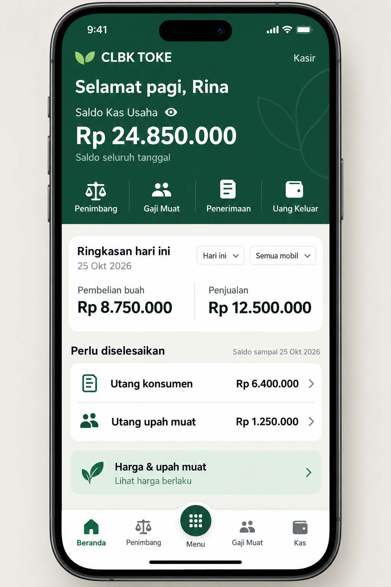
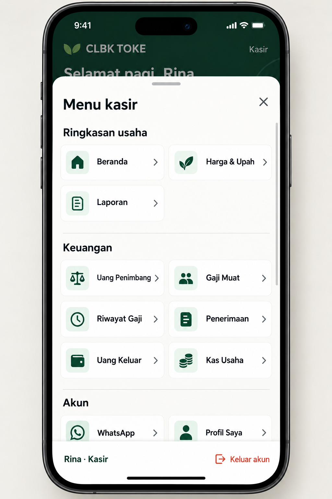
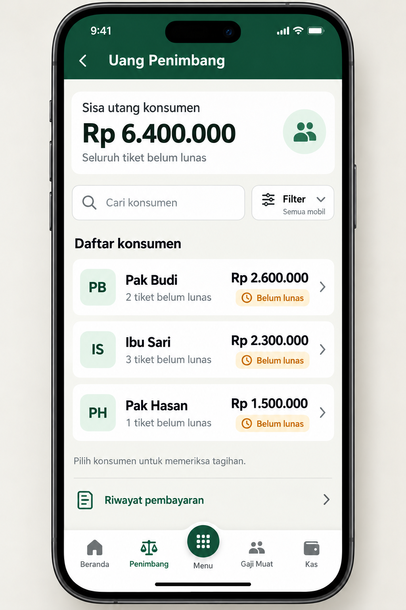
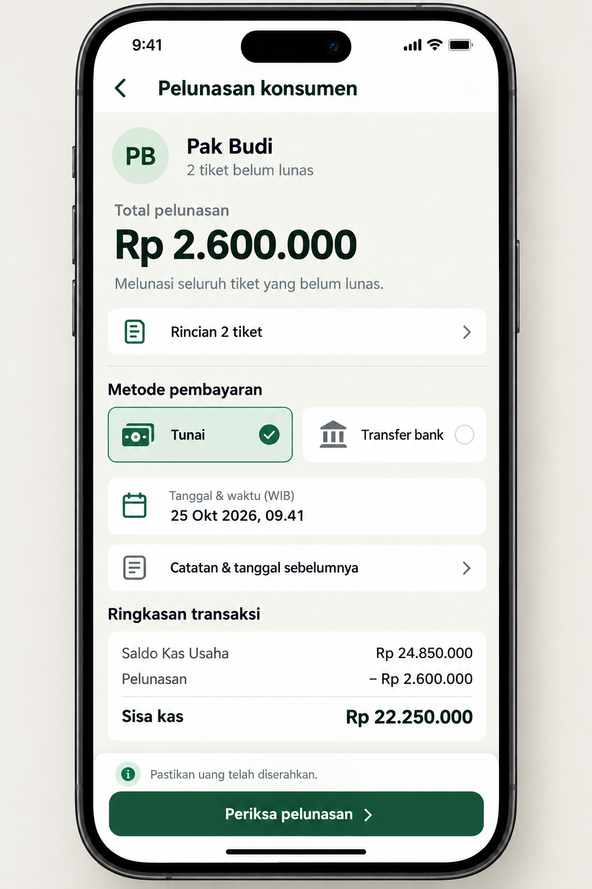
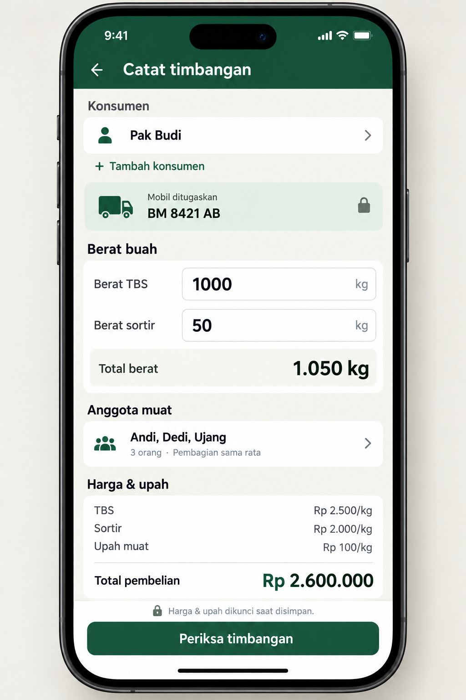
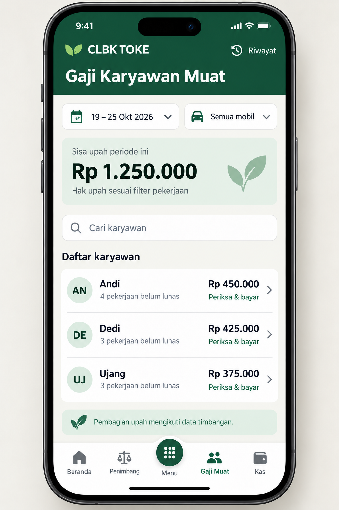
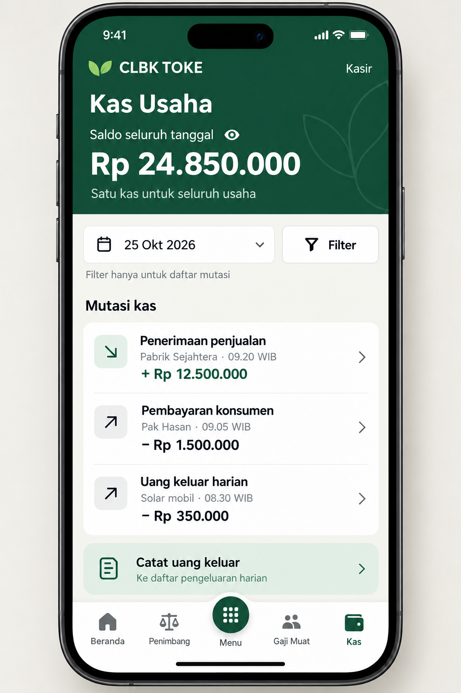
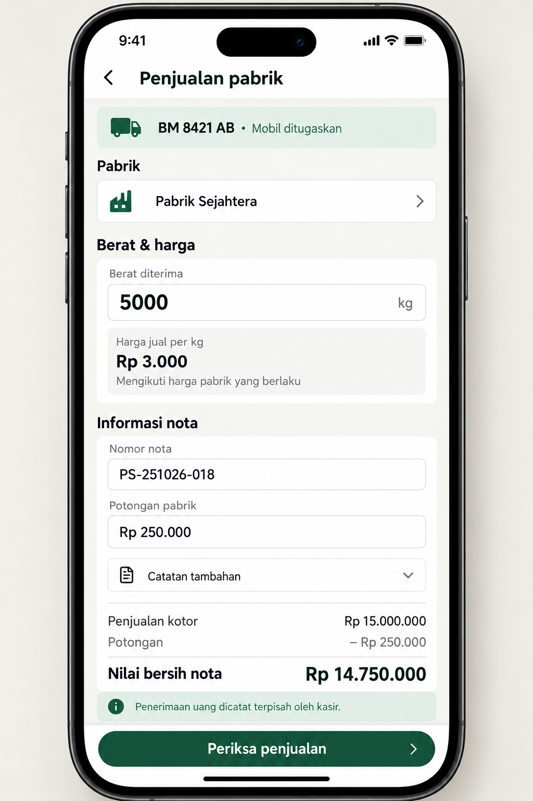

# Prototipe mobile CLBK TOKE

**Versi:** 1 · **Tanggal:** 25 Oktober 2026 · **Status:** diterapkan pada UI mobile manajer, kasir, dan supir; verifikasi visual perangkat masih diperlukan.

CLBK TOKE dirancang terasa seperti aplikasi mobile sehari-hari: ringkasan langsung terbaca, pekerjaan utama mudah dijangkau ibu jari, dan transaksi memiliki langkah pemeriksaan yang jelas. Inspirasi DANA diterjemahkan menjadi header berwarna, akses cepat, daftar transaksi, dan navigasi bawah, dengan identitas hijau serta alur usaha sawit CLBK.

Dokumen ini berisi **8 mockup layar terpisah**, alur interaksi, variasi berdasarkan role, dan spesifikasi responsif. Gambar tetap merupakan referensi statis dengan data demonstrasi. Desain telah diterapkan ke aplikasi menggunakan data sebenarnya, tanpa migrasi atau perubahan perhitungan transaksi. Lihat [catatan implementasi](docs/implementasi-mobile.md).

## 1. Daftar layar

| ID | Layar | Pengguna utama | Buka gambar |
| --- | --- | --- | --- |
| 01 | Beranda kasir | Kasir; pola dasar beranda manajer | [Beranda](docs/prototypes/mobile-v1/01-beranda-kasir.png) |
| 02 | Menu kasir | Kasir; pola menu sesuai role | [Menu](docs/prototypes/mobile-v1/02-menu-kasir.png) |
| 03 | Uang Penimbang | Kasir dan manajer | [Daftar konsumen](docs/prototypes/mobile-v1/03-uang-penimbang.png) |
| 04 | Pelunasan konsumen | Kasir dan manajer | [Pelunasan](docs/prototypes/mobile-v1/04-pelunasan-konsumen.png) |
| 05 | Catat timbangan | Supir dan manajer | [Timbangan](docs/prototypes/mobile-v1/05-catat-timbangan.png) |
| 06 | Gaji Karyawan Muat | Kasir dan manajer | [Gaji muat](docs/prototypes/mobile-v1/06-gaji-muat.png) |
| 07 | Kas Usaha | Kasir dan manajer | [Kas](docs/prototypes/mobile-v1/07-kas-usaha.png) |
| 08 | Penjualan pabrik | Supir dan manajer | [Penjualan](docs/prototypes/mobile-v1/08-penjualan-pabrik.png) |

**Cara melihat:** buka Markdown Preview untuk dokumen ini, kemudian gunakan tautan gambar jika ingin memeriksa layar dalam ukuran penuh. Aset tersimpan di [docs/prototypes/mobile-v1](docs/prototypes/mobile-v1/). [Prompt pembuatan visual](docs/prototypes/mobile-v1/prompts.md) disertakan untuk revisi berikutnya.

## 2. Arah desain

### Yang diadaptasi dari DANA

- Header berwarna kuat sebagai tempat identitas dan angka utama.
- Empat akses cepat yang langsung berkaitan dengan pekerjaan.
- Menu berbasis ikon dengan label pendek.
- Navigasi bawah lima posisi dengan tombol tengah yang mudah ditemukan.
- Daftar transaksi dengan nominal, konteks, dan status yang jelas.
- Form transaksi yang dilanjutkan dengan pemeriksaan sebelum pencatatan.

Referensi produk: [halaman resmi DANA](https://www.dana.id/product). Penggunaan pola tersebut merupakan interpretasi desain untuk CLBK, bukan salinan persis antarmuka DANA terbaru.

### Identitas CLBK

Warna hijau, motif tunas, istilah konsumen, TBS, sortir, anggota muat, pabrik, serta satu Kas Usaha mengikuti proyek yang ada. Tombol tengah tetap **Menu**, sesuai navigasi CLBK. Akses cepat di beranda membawa pengguna ke pekerjaan sawit dan kas.

Mockup memakai bingkai ponsel agar mudah dibayangkan. Bingkai, jam sistem, kamera, dan indikator baterai merupakan presentasi gambar; tampilan web nantinya tidak perlu menggandakan elemen sistem ponsel.

### Dasar peninjauan proyek

Peninjauan dilakukan pada struktur halaman, komponen, navigasi, dan warna dalam source proyek. CLBK sudah memiliki navigasi bawah, menu berdasarkan role, kartu pada sebagian daftar mobile, dan input sentuh. Usulan ini menyatukan semuanya menjadi pengalaman aplikasi yang lebih konsisten.

| Bagian | Arah perbaikan |
| --- | --- |
| Beranda | Ringkas area pembuka menjadi satu header dengan angka utama dan akses cepat. |
| Informasi usaha | Bedakan angka periode dan saldo seluruh tanggal secara terlihat. |
| Daftar pembayaran | Dahulukan nama penerima, sisa kewajiban, dan aksi pemeriksaan. |
| Form transaksi | Gunakan satu kolom, kelompok isian pendek, dan tombol utama dekat ibu jari. |
| Menu lengkap | Gunakan panel dari bawah dengan judul tetap dan isi yang dapat digulir. |
| Header | Tampilkan identitas pada beranda; halaman transaksi cukup judul dan tombol kembali. |

Ini merupakan audit source dan konsep visual, bukan hasil pengujian antarmuka berjalan pada perangkat.

## 3. Sistem visual bersama

| Elemen | Spesifikasi desain |
| --- | --- |
| Platform | Mobile lintas platform, cocok untuk browser ponsel dan mode PWA yang sudah ada. |
| Hijau utama | **#164B37**, untuk header, tombol utama, dan navigasi aktif. |
| Hijau pendukung | **#267955**, untuk penekanan terbatas. |
| Latar | **#F5F6F0**, mengikuti identitas proyek. |
| Permukaan | **#FFFFFF**, untuk form dan kelompok daftar. |
| Teks utama | **#1C3027**. |
| Teks sekunder | **#65716A** pada latar terang. |
| Status | Hijau untuk selesai; amber untuk belum lunas; merah untuk kesalahan. Status selalu disertai teks. |
| Tipografi | Sans yang konsisten dengan proyek; isi/input 16 px, informasi sekunder 14 px, label navigasi 12 px, judul 20–24 px, angka utama 28–32 px. |
| Jarak | Pola 4/8/12/16/24/32 px; margin layar 16 px, 12 px pada ponsel sangat kecil. |
| Area sentuh | Target 48 × 48 px; minimum 44 × 44 px. Tombol utama tinggi 52 px. |
| Sudut | Kelompok konten 16–20 px, input/tombol 12–16 px. |
| Ikon | Simbol jelas dan konsisten: timbangan, anggota muat, truk, pabrik, nota, kas. Label tetap terlihat. |
| Permukaan | Kelompok daftar datar, pembatas tipis, bayangan ringan pada navigasi atau panel yang menumpuk. |

Motif daun hanya menjadi aksen samar pada header. Hierarki mengutamakan angka dan pekerjaan. Pada layar ringkasan cukup satu angka utama dan sedikit informasi pendukung; rincian lebih lengkap berada di laporan atau halaman terkait.

## 4. Navigasi dan akses per role

### Navigasi bawah

| Role | Posisi 1 | Posisi 2 | Posisi tengah | Posisi 4 | Posisi 5 |
| --- | --- | --- | --- | --- | --- |
| Manajer | Beranda | Penimbang | **Menu** | Gaji Muat | Kas |
| Kasir | Beranda | Penimbang | **Menu** | Gaji Muat | Kas |
| Supir | Beranda | Timbang | **Menu** | Pabrik | Sortir |

Label **Beranda** mengarah ke Dashboard yang sudah ada. Susunan tujuan mengikuti navigasi proyek saat ini. Tombol Menu berbentuk lingkaran hijau sedikit terangkat, berikon grid, dan tetap memiliki label.

Navigasi bawah tampil pada halaman utama serta daftar. Pada form dan pemeriksaan transaksi, tempatnya digunakan untuk tombol tindakan utama; tombol kembali tetap jelas di atas.

Ketika pengguna membuka halaman sekunder seperti Laporan atau Profil, Menu menjadi penanda bagian aktif. Halaman utama yang ditinggalkan tetap dipertahankan konteks pencarian dan filternya ketika pengguna kembali.

### Isi Menu

| Role | Kelompok dan tujuan |
| --- | --- |
| Kasir | **Ringkasan usaha:** Beranda, Harga & Upah Muat, Laporan. **Keuangan:** Uang Penimbang, Gaji Karyawan Muat, Riwayat Penggajian, Penerimaan Penjualan, Uang Keluar Harian, Kas Usaha. **Akun:** Notifikasi WhatsApp, Profil Saya. |
| Supir | **Operasional:** Beranda, Timbang Sawit, Tambah Konsumen, Penjualan Pabrik, Penjualan Sortir. **Akun:** Profil Saya. |
| Manajer | **Ringkasan usaha:** Beranda, Harga & Upah Muat, Laporan. **Operasional:** Timbang Sawit, Penjualan Pabrik, Penjualan Sortir. **Keuangan:** seluruh enam tujuan keuangan. **Data master:** Konsumen, Anggota Muat, Mobil, Pabrik, Kategori Pengeluaran. **Administrasi/pengaturan:** Akun Pengguna, Pengaturan Usaha, Notifikasi WhatsApp. **Akun:** Profil Saya. |

Daftar mengikuti [navigasi source saat ini](resources/js/lib/navigation.ts), termasuk Notifikasi WhatsApp untuk kasir. WhatsApp merujuk pada fitur notifikasi transaksi CLBK. Pengaturan dan tindakan tetap mengikuti izin role yang sudah berlaku.

Keluar akun diletakkan sebagai aksi terpisah di bagian bawah panel Menu. Profil tersedia melalui Menu; header beranda tetap ringkas tanpa avatar akun tambahan.

## 5. Prototipe visual dan interaksi

### 01 — Beranda kasir

**Tujuan:** kasir mengetahui posisi kas dan segera masuk ke pekerjaan utama.

Urutan tampilan: identitas dan sapaan → saldo kas → empat akses cepat → ringkasan periode → kewajiban → harga dan upah → navigasi bawah.

- Angka **Rp 24.850.000** diberi label **Saldo seluruh tanggal**.
- Ikon mata menyembunyikan atau menampilkan nominal pada perangkat.
- Akses cepat: **Penimbang**, **Gaji Muat**, **Penerimaan**, **Uang Keluar**.
- Ringkasan pembelian dan penjualan mengikuti periode serta mobil yang dipilih.
- Utang konsumen dan upah ditampilkan terpisah dari ringkasan hari ini; keterangan tanggal saldo tetap terlihat.
- Ketuk kewajiban untuk membuka halaman terkait. Bila akses langsung ke rincian tidak diizinkan, tampilkan ringkasan tanpa tautan.
- Harga & Upah Muat membuka informasi harga yang berlaku.

**Pembedaan penting:** penjualan merupakan nilai nota; penerimaan merupakan uang yang sudah diterima. Nilai penjualan tidak diberi label uang masuk.

### 02 — Menu kasir

**Tujuan:** seluruh fitur yang diizinkan dapat ditemukan dari satu tempat.

Panel muncul dari bawah di atas halaman yang diredupkan. Isi memakai dua kolom; label boleh dua baris. Menu panjang dapat digulir, sementara judul, tombol tutup, dan bagian akun tetap dapat dijangkau. Bagian Akun pada gambar sengaja tampak sebagian untuk menunjukkan isi yang berlanjut.

- Ketuk tujuan untuk menutup panel dan membuka halaman.
- Tutup melalui X, tombol kembali, atau ketukan pada area luar panel.
- Fokus keyboard tetap di dalam panel selama terbuka dan kembali ke pemicu Menu ketika ditutup.
- Nama pengguna, role, dan Keluar akun ditempatkan di footer.
- Posisi halaman di belakang panel tidak berubah ketika panel dibuka atau ditutup.

### 03 — Uang Penimbang

**Tujuan:** menemukan konsumen yang harus dibayar dan memeriksa kewajibannya.

Setiap baris menampilkan nama, jumlah tiket belum lunas, nominal, status, dan panah ke rincian. Seluruh baris dapat diketuk. Pada lebar kecil, nominal dipindahkan ke bawah nama agar tidak terpotong.

Contoh: Pak Budi **Rp 2.600.000**, Ibu Sari **Rp 2.300.000**, Pak Hasan **Rp 1.500.000**; total **Rp 6.400.000**.

Pencarian dan Filter membantu menemukan konsumen atau pekerjaan. Label lingkup ringkasan harus mengikuti data yang benar-benar diringkas. Jika daftar difilter, tampilkan konteks filter secara jelas.

**Aturan pelunasan:** setelah masuk ke rincian konsumen, pelunasan penuh mencakup seluruh tiket belum lunas milik konsumen tersebut. Filter dan pagination daftar tidak membatasi tiket yang dilunasi.

### 04 — Pelunasan konsumen

**Tujuan:** kasir memeriksa penerima, cakupan tiket, dan dampak kas sebelum mencatat pelunasan.

Nominal **Rp 2.600.000** bersifat tetap sesuai sisa seluruh tiket. Pilihan metode Tunai atau Transfer bank ditampilkan jelas. Transfer bank memunculkan referensi transfer wajib. Tanggal menggunakan WIB; ketika tanggal diubah ke sebelumnya, alasan wajib terbuka langsung.

Rincian tiket dapat dibuka tanpa meninggalkan pemeriksaan. Informasi saldo sebelum dan sisa kas ditempatkan dekat tombol utama:

| Pemeriksaan | Contoh |
| --- | ---: |
| Saldo kas sebelum | Rp 24.850.000 |
| Pelunasan | Rp 2.600.000 |
| Perkiraan kas sesudah | Rp 22.250.000 |

**Alur:** Periksa pelunasan → ringkasan konfirmasi → **Ya, catat pelunasan** → hasil pencatatan dan voucher.

Konfirmasi terakhir menyebut nama, jumlah tiket, nominal, metode, dan bahwa uang sudah diserahkan atau transfer sudah berhasil. Antarmuka ini mencatat pembayaran yang dilakukan di luar aplikasi.

Setelah berhasil, tampilkan **Pelunasan tercatat**, penerima, nominal, nomor voucher, serta **Lihat bukti** dan **Kembali ke Penimbang**. Saldo dan kewajiban diperbarui dari hasil server. Jika saldo atau sisa tagihan berubah, pengguna memeriksa angka terbaru sebelum melanjutkan.

### 05 — Catat timbangan

**Tujuan:** supir mencatat buah dengan sedikit perpindahan fokus.

Urutan isian mengikuti alur langsung proyek: Konsumen → Mobil ditugaskan → Berat TBS → Berat sortir → Anggota muat → Harga dan upah → Pemeriksaan.

- Mobil supir tampil terkunci sesuai penugasan. Manajer mendapat pemilih mobil sesuai kewenangannya.
- Pemilih konsumen memakai panel pencarian. Tambah Konsumen tetap dapat diakses supir.
- Berat memakai satuan kg yang selalu terlihat; sortir dapat diisi 0.
- Anggota muat dipilih dari anggota aktif; pembagian upah dapat diperiksa.
- Harga dan upah ditampilkan dari jadwal yang berlaku, dengan status saat ringkasan diperbarui.
- Waktu dan petugas mengikuti pencatatan otomatis pada alur yang sudah ada.

Contoh: TBS 1.000 kg × Rp 2.500 + sortir 50 kg × Rp 2.000 = **Rp 2.600.000**. Total berat 1.050 kg. Dengan upah Rp 100/kg, total upah **Rp 105.000**, dibagi tiga anggota menjadi **Rp 35.000 per orang**.

**Alur:** Periksa timbangan → periksa konsumen, mobil, berat, harga, dan anggota → **Simpan timbangan** → detail tiket.

Harga dan upah dikunci saat penyimpanan berhasil. Halaman tidak menampilkan status draft tersimpan sebelum server mengonfirmasi penyimpanan. Jika penugasan atau harga bermasalah, tampilkan penyebab dan tindakan yang sesuai role.

### 06 — Gaji Karyawan Muat

**Tujuan:** kasir mengetahui sisa upah berdasarkan periode dan membayar per karyawan.

Periode ditempatkan sebelum ringkasan agar lingkup angka jelas. Contoh 19–25 Oktober: Andi **Rp 450.000**, Dedi **Rp 425.000**, Ujang **Rp 375.000**; total **Rp 1.250.000**.

**Periksa & bayar** membuka rincian seorang karyawan: pekerjaan dalam periode, hak upah, pembayaran sebelumnya, dan sisa. Nominal pembayaran dapat diisi sebagian atau seluruh sisa sesuai aturan gaji yang ada. Batas nominal mengikuti sisa upah periode tersebut.

Pemilihan mobil atau pencarian pada daftar membantu penelusuran pekerjaan. Pada pemeriksaan pembayaran, tampilkan kembali cakupan sebenarnya: seluruh sisa upah karyawan dalam periode yang dipilih, bukan hanya baris yang sedang terlihat.

**Alur:** Gaji Muat → pilih karyawan → periksa periode dan sisa → masukkan pembayaran → konfirmasi → voucher.

Riwayat Penggajian tetap terpisah dan dapat dibuka melalui Riwayat. Karyawan nonaktif dengan sisa hak tetap dapat ditampilkan dan dibayar mengikuti aturan yang sudah ada.

### 07 — Kas Usaha

**Tujuan:** memahami saldo usaha serta menelusuri sumber mutasinya.

Header menampilkan **Rp 24.850.000** dengan keterangan **Saldo seluruh tanggal**. Filter tanggal hanya membatasi mutasi; keterangan ini tetap terlihat setelah filter diterapkan.

Setiap mutasi berisi arah uang, jenis transaksi, pihak atau keterangan, waktu WIB, nominal bertanda plus/minus, dan tautan rincian. Warna hanya membantu; teks serta tanda nominal menjelaskan arah uang.

Contoh mutasi: penerimaan pabrik **+Rp 12.500.000**, pembayaran konsumen **−Rp 1.500.000**, solar **−Rp 350.000**. Daftar gambar merupakan cuplikan mutasi, bukan seluruh buku kas.

Ketuk mutasi untuk membuka dokumen sumber atau rinciannya. Catat uang keluar mengarah ke pengeluaran harian yang sudah ada. Penambahan modal, penarikan, dan pembalikan hanya tersedia sesuai izin yang berlaku.

Layar ini menunjukkan posisi sebelum contoh pelunasan Pak Budi pada layar 04. Riwayat pembayaran seseorang dapat berasal dari tiket sebelumnya; tiket baru tetap dapat menimbulkan kewajiban baru.

### 08 — Penjualan pabrik

**Tujuan:** supir mencatat nota pabrik dengan harga dan perhitungan yang jelas.

Mobil ditampilkan sesuai penugasan. Pilih pabrik, isi berat diterima, lalu periksa harga otomatis, nomor nota, potongan, dan nilai bersih. Data koreksi atau catatan tambahan dibuka saat diperlukan.

Contoh: 5.000 kg × Rp 3.000 = Rp 15.000.000; potongan Rp 250.000; nilai bersih **Rp 14.750.000**.

**Alur:** Periksa penjualan → ringkasan nota → **Simpan penjualan** → detail nota.

Penerimaan uang dicatat terpisah melalui Penerimaan Penjualan oleh kasir/manajer. Menyimpan nota belum menambah kas. Setelah nota tersimpan, supir melihat status nota dan piutang sesuai aksesnya.

Layar 05 dan 08 menggambarkan form transaksi baru pada skenario terpisah. Keduanya belum disimpan dan belum mengubah saldo atau daftar kewajiban pada contoh layar lain.

## 6. Variasi layar dan halaman lain

Delapan gambar di atas menjadi acuan komponen utama. Bagian berikut merupakan spesifikasi lanjutan; belum dibuat gambar tersendiri.

| Halaman/role | Susunan mobile yang diusulkan |
| --- | --- |
| Beranda manajer | Header identitas dan hasil periode; filter periode/mobil; angka pembelian, penjualan, dan upah; posisi kas, piutang, dan kewajiban; akses ke laporan. Hasil periode tetap dibedakan dari saldo kas. |
| Beranda supir | Sapaan, mobil ditugaskan, total berat/jumlah transaksi yang boleh diakses, lalu akses Catat Timbangan, Pabrik, Sortir, Tambah Konsumen. Ringkasan mengikuti cakupan akses supir. |
| Daftar timbang dan penjualan | Judul, pencarian, Filter, daftar ringkas nama/nomor/berat/status, lalu tombol tambah. Rincian dibuka sebagai halaman dengan tombol kembali. |
| Penjualan sortir | Pola form penjualan dengan isian yang sesuai alur sortir saat ini, harga/berat/pembeli yang relevan, dan pemeriksaan nilai. Penerimaan tetap melalui kasir/manajer. |
| Penerimaan Penjualan | Pilihan nota pabrik/sortir, nilai nota, sudah diterima, sisa piutang, nominal penerimaan, metode dan referensi. Bisa sebagian atau lunas sesuai aturan yang ada. |
| Uang Keluar Harian | Kategori, nominal, waktu, metode/referensi bila relevan, catatan, dan pemeriksaan pengurangan kas. |
| Laporan | Judul ringkas, filter melalui panel, kategori laporan yang bisa digeser mendatar, angka utama, lalu rincian vertikal. Filter yang berlaku terlihat; CSV dan Cetak masuk menu aksi. |
| Harga & Upah Muat | Harga berlaku dan waktu efektif di atas; histori di bawah. Tindakan perubahan mengikuti izin pengguna. |
| Profil dan pengaturan | Kelompok isian satu kolom dengan label permanen. Konfirmasi sensitif yang sudah ada tetap dipertahankan. |
| Data master dan pengguna | Pencarian dan baris identitas/status; detail serta perubahan berada di halaman terpisah. Akses mengikuti role. |
| Bukti transaksi | Nomor, tanggal, status, pihak, dan nominal di atas; rincian serta lampiran di bawah; tindakan cetak/unduh mudah ditemukan. |

Tindakan pembatalan atau pembalikan tetap menunjukkan alasan, akibat transaksi, dan riwayat dokumen. Status transaksi sah dan status pembayaran ditampilkan terpisah.

## 7. Perilaku responsif

Ukuran acuan desain adalah **390 × 844 px**. Spesifikasi berlaku pada area konten aplikasi; bingkai ponsel pada gambar tidak ikut dihitung.

| Lebar area tampilan | Perilaku |
| --- | --- |
| 320–359 px | Margin 12 px, satu kolom, angka utama dapat turun menjadi 28 px. Nominal pada daftar pindah ke bawah identitas. Label menu maksimal dua baris. |
| 360–430 px | Margin 16 px, akses cepat empat kolom, Menu dua kolom, daftar dan form satu kolom. |
| 431–599 px | Pola ponsel dipertahankan dengan ruang lebih lega; panjang baris dibatasi agar nyaman dibaca. |
| 600–1023 px | Navigasi bawah tetap tersedia. Ringkasan dapat dua kolom, form tetap memiliki urutan baca jelas, panel Menu lebih terpusat. |
| Mulai 1024 px | Sidebar desktop yang ada tetap menjadi navigasi utama; navigasi bawah disembunyikan. |

Aturan untuk semua ukuran:

- Konten utama tidak bergulir mendatar. Nama panjang membungkus; nominal tidak dihilangkan dengan elipsis.
- Angka dan satuan tetap bersama. Label/input tidak mengecil untuk memaksa konten masuk.
- Area atas dan bawah mengikuti ruang aman perangkat serta perubahan tinggi browser.
- Navigasi bawah sekitar 72 px ditambah ruang aman. Konten terakhir diberi ruang agar dapat digulir sepenuhnya di atasnya.
- Form memakai satu tombol utama pada dock bawah. Saat keyboard terbuka, isian aktif dan pesan kesalahannya tetap terlihat; dock tidak menutupi isian atau memakan sebagian besar layar.
- Pada layar pendek, isi bergulir vertikal. Header ringkas dan tindakan tetap dapat dijangkau tanpa memaksa semua bagian masuk ke satu viewport.
- Filter memakai panel dari bawah dengan **Terapkan** dan **Atur ulang**. Label periode/mobil terpilih terlihat setelah panel ditutup.
- Panel pemilih memiliki pencarian, keadaan kosong, pilihan aktif, dan tombol tutup.
- Perpindahan panel singkat dan tenang, sekitar 180–240 ms. Preferensi pengurangan gerak dihormati.

## 8. Kondisi interaksi penting

| Kondisi | Tampilan/perilaku yang direncanakan |
| --- | --- |
| Memuat | Placeholder mengikuti bentuk informasi; nominal belum tersedia tidak ditampilkan sebagai saldo nol. |
| Belum ada transaksi | Pesan singkat dan aksi yang sesuai role, misalnya Catat timbangan untuk supir. |
| Hasil pencarian kosong | Tampilkan kata pencarian dan aksi Hapus pencarian/Atur ulang filter. |
| Saldo tidak cukup | Tampilkan kebutuhan dan saldo tersedia; pencatatan pelunasan tidak dapat diteruskan. |
| Kas belum tersedia/nonaktif | Jelaskan status kas dan batasi tindakan yang membutuhkan kas aktif. |
| Referensi transfer kosong | Pesan pada isian referensi; fokus diarahkan ke isian tersebut. |
| Isian tidak valid | Pesan spesifik dekat isian; data lain tetap ada. |
| Mengirim transaksi | Tombol menunjukkan proses dan mencegah ketukan berulang. Keberhasilan mengikuti konfirmasi server. |
| Data berubah saat diperiksa | Tampilkan angka terbaru dan minta pemeriksaan ulang sebelum pencatatan. |
| Koneksi terputus | Banner koneksi terlihat. Tampilkan bahwa transaksi belum terkonfirmasi; isian yang masih terbuka dipertahankan. Prototipe tidak menjanjikan penyimpanan offline. |
| Gagal menyimpan | Jelaskan penyimpanan belum berhasil; pengguna dapat memeriksa data dan mencoba lagi tanpa memasukkan ulang seluruh form. |
| Berhasil | Ringkasan transaksi, nomor dokumen, dan akses bukti; hanya tampil setelah server menyatakan berhasil. |
| Meninggalkan form berubah | Peringatan sebelum keluar atau memuat ulang, mengikuti perlindungan form yang ada. |
| Tanggal sebelumnya | Alasan muncul dan wajib diisi; waktu selalu diberi konteks WIB. |

Aksesibilitas menjadi syarat desain: kontras teks normal ditargetkan minimal 4,5:1, fokus terlihat, tombol ikon memiliki nama, status tidak hanya dibedakan warna, dan urutan baca sesuai urutan visual. Pembesaran teks tidak boleh menutup nominal atau tindakan utama.

## 9. Alur peninjauan prototipe

| Skenario | Urutan layar/tindakan | Hasil yang harus jelas |
| --- | --- | --- |
| Kasir membayar konsumen | 01 → Penimbang → 03 → Pak Budi → 04 → pemeriksaan → konfirmasi → voucher | Seluruh tiket belum lunas dilunasi; kas contoh menjadi Rp 22.250.000. |
| Kasir membayar upah | 01 → Gaji Muat → 06 → Andi → rincian periode → nominal → konfirmasi | Pembayaran seorang karyawan mencakup periode yang diperiksa; nominal bisa sebagian sesuai aturan gaji. |
| Supir mencatat timbang | Beranda supir/Timbang → 05 → pilih konsumen dan anggota → periksa → simpan | Mobil sesuai penugasan; berat, harga, dan hak upah jelas sebelum disimpan. |
| Supir mencatat nota | Pabrik → tambah penjualan → 08 → periksa → simpan | Nota dan piutang tercatat; penerimaan uang menjadi pekerjaan kasir/manajer. |
| Kasir menelusuri uang | 01 → Kas → 07 → pilih mutasi | Dokumen sumber, arah uang, dan nominal dapat dipahami. |
| Pengguna mencari fitur | Halaman utama → Menu → 02/varian role → pilih tujuan | Tujuan sesuai izin dan panel menutup setelah navigasi. |

## 10. Cakupan hasil dan acuan

**Sudah dibuat:** delapan gambar layar yang konsisten, spesifikasi navigasi tiga role, alur transaksi, aturan ukuran kecil, dan keadaan interaksi. Gambar menggunakan built-in ImageGen; prompt final disimpan bersama aset.

**Implementasi:** layout bersama, beranda per role, navigasi bawah, Menu, pencarian dan filter, daftar penerima/gaji/kas, pemeriksaan timbang dan penjualan, serta dock tindakan form sudah diterapkan. Daftar data master dan transaksi memakai kartu mobile untuk semua role. Ringkasan daftar penerima/gaji diberi lingkup halaman agar angka pagination tidak disalahartikan sebagai total seluruh usaha.

**Verifikasi:** build produksi, pemeriksaan tipe, format, dan 36 pemeriksaan render/akses per role berhasil. Browser otomatis tidak tersedia pada sesi ini. Pengujian integrasi MySQL tertahan prasyarat server untuk trigger; akses HTTP lokal juga tertahan kredensial database. Ukuran sentuh, reflow, keyboard, fokus, dan kontras aktual tetap perlu diperiksa pada browser/perangkat. Rincian terdapat di [catatan implementasi](docs/implementasi-mobile.md).

Acuan proyek:

- [README dan alur usaha](README.md).
- [Navigasi per role](resources/js/lib/navigation.ts) dan [layout bersama](resources/js/layouts/StaffLayout.tsx).
- [Warna dan tipografi proyek](resources/css/foundation.css).
- [Ringkasan dashboard](resources/js/features/dashboard/components/DashboardOverview.tsx).
- [Pelunasan konsumen](resources/js/features/finance/components/CustomerSettlementForm.tsx).
- [Pembayaran upah](resources/js/features/finance/components/PayrollPaymentForm.tsx).
- [Form timbang langsung](resources/js/features/weighings/components/WeighingForm.tsx).
- [Form penjualan pabrik](resources/js/features/sales/components/FactorySaleEntryForm.tsx).
- [Alur penerimaan pabrik dan sortir](docs/penerimaan-semua-penjualan.md).
- [Penjelasan satu kas usaha](docs/kas-tunggal-dan-konsumen-supir.md).

Jika detail kecil gambar berbeda dari spesifikasi tertulis, gunakan spesifikasi tertulis sebagai acuan. Aplikasi memakai data sebenarnya dan izin role yang sudah ada; angka pada gambar tidak dimasukkan ke aplikasi.
